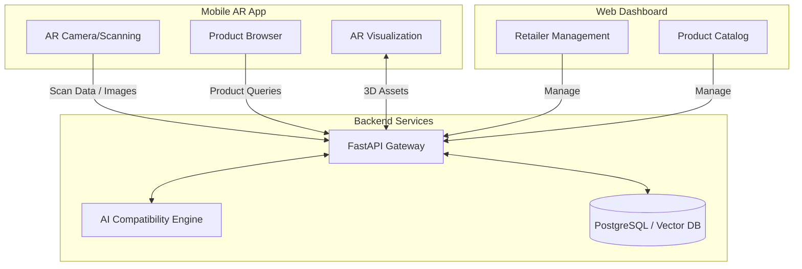

# Aayam 🚪✨

> **AI-Powered AR Platform for Physical-Space Commerce**  
> *Scan. Visualize. Decide.*

---

## 🛑 The Problem

- **Visualization Gap:** Customers struggle to visualize how hardware products (like handles or locks) will look on their actual doors or spaces.
- **High Return Rates:** Incompatible products lead to frustration and costly returns.
- **Measurement Challenges:** Customers lack the right tools to take precise measurements on their own.
- **Sales Limitations:** Sales professionals lack the technical tools needed to confidently recommend compatible, space-specific products.

## 💡 The Solution

Aayam is a cutting-edge mobile AR application that empowers customers to:

1. **Scan** their door with their smartphone camera.
2. **See** AI-detected measurements and door characteristics instantly.
3. **Browse** a curated catalog of compatible products from local retailers.
4. **Visualize** products applied to their actual door in immersive AR.
5. **Verify** with AI-powered compatibility checks.
6. **Purchase** with complete confidence or request a quote effortlessly.

## 🎯 MVP Focus

Our initial go-to-market strategy zeroes in on **door hardware visualization**:

- **Products:** Handles, locks, hinges, and accessories.
- **Catalog Size:** 20-50 initial high-quality 3D products.
- **Partnerships:** 3-5 pilot retailers.
- **Geography:** Launching in a single pilot city.

## 🛠️ Tech Stack

| Domain | Technologies |
| :--- | :--- |
| **AR & Mobile App** | Unity, AR Foundation (ARKit/ARCore), C# |
| **Backend API** | FastAPI, Python, PostgreSQL, Redis |
| **Machine Learning** | PyTorch, OpenCV, YOLO/Mask R-CNN, MediaPipe |
| **Web Dashboard** | Next.js, React, TypeScript, Tailwind CSS |
| **Cloud & DevOps** | AWS / GCP, Docker, GitHub Actions |

## 📐 Architecture



## 📁 Project Structure

```text
Aayam/
├── docs/
│   ├── PROJECT_CONTEXT.md
│   ├── phases/
│   │   ├── phase-0-validation.md
│   │   ├── phase-1-ar-foundation.md
│   │   ├── phase-2-product-pipeline.md
│   │   ├── phase-3-door-detection.md
│   │   ├── phase-4-door-coordinate-system.md
│   │   ├── phase-5-measurement.md
│   │   ├── phase-6-visualization.md
│   │   ├── phase-7-compatibility-engine.md
│   │   └── phase-8-retailer-dashboard.md
│   └── references/
├── unity/         # Unity AR project (future)
├── backend/       # FastAPI backend (future)
├── dashboard/     # Next.js dashboard (future)
├── ml/            # ML models and training (future)
└── assets/        # 3D models and textures (future)
```

## 📚 Documentation

Dive into our comprehensive documentation:

- [Project Context](./docs/PROJECT_CONTEXT.md)
- [Phase 0: Technical Validation](./docs/phases/phase-0-validation.md)
- [Phase 1: AR Foundation](./docs/phases/phase-1-ar-foundation.md)
- [Phase 2: Product Pipeline](./docs/phases/phase-2-product-pipeline.md)
- [Phase 3: Door Detection](./docs/phases/phase-3-door-detection.md)
- [Phase 4: Door Coordinate System](./docs/phases/phase-4-door-coordinate-system.md)
- [Phase 5: Measurement Extraction](./docs/phases/phase-5-measurement.md)
- [Phase 6: Visualization Engine](./docs/phases/phase-6-visualization.md)
- [Phase 7: Compatibility Engine](./docs/phases/phase-7-compatibility-engine.md)
- [Phase 8: Retailer Dashboard](./docs/phases/phase-8-retailer-dashboard.md)

## ⏱️ Timeline & Progress
 
| Month / Phase | Phase Focus | Key Deliverables | Status |
| :--- | :--- | :--- | :---: |
| **Month 1 (Phase 0)** | Technical Validation | Feasibility checks, AR prototyping, ML baseline | 📋 Planned |
| **Month 2 (Phase 1)** | **AR Foundation** | Core AR tracking, plane detection, object placement, interaction, UI, depth/occlusion, tests | ✅ **Completed** |
| **Month 3 (Phase 2)** | Product Pipeline | 3D asset processing, catalog API, database schema | 🚀 Next |
| **Month 4 (Phase 3)** | Door Detection | Semantic segmentation for doors, YOLO detection | 📋 Upcoming |
| **Month 5 (Phase 4)** | Coordinate System | Door tracking, anchor persistence, space mapping | 📋 Upcoming |
| **Month 6 (Phase 5)** | Measurement | Auto-measurement, depth mapping precision | 📋 Upcoming |
| **Month 7 (Phase 6)** | Visualization | Realistic occlusion, PBR materials, lighting estimation | 📋 Upcoming |
| **Month 8 (Phase 7 & 8)**| Dashboard & Launch | Compatibility rules, retailer portal, MVP release | 📋 Upcoming |

## 👥 Team

Current required roles for the MVP:

- **Founder / Product Lead:** Vision, partnerships, product management.
- **Unity / AR Developer:** Core AR interactions, visualization.
- **Machine Learning Engineer:** Computer vision, spatial analysis, compatibility algorithms.
- **Full-Stack / Backend Engineer:** FastAPI backend, scalable infrastructure.

## 🤝 Contributing

We are currently a closed-source startup. If you're a team member, please refer to our internal [CONTRIBUTING.md](./CONTRIBUTING.md) (coming soon) for coding standards, pull request processes, and branch naming conventions.

## 📄 License

**Proprietary** – All rights reserved. Do not distribute or copy without explicit permission.

## 📬 Contact

For inquiries, partnerships, or investment opportunities, please contact:
**Email:** [founder@aayam.com](mailto:founder@aayam.com) (Placeholder)
