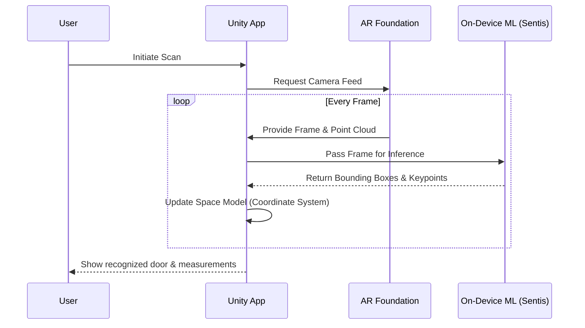
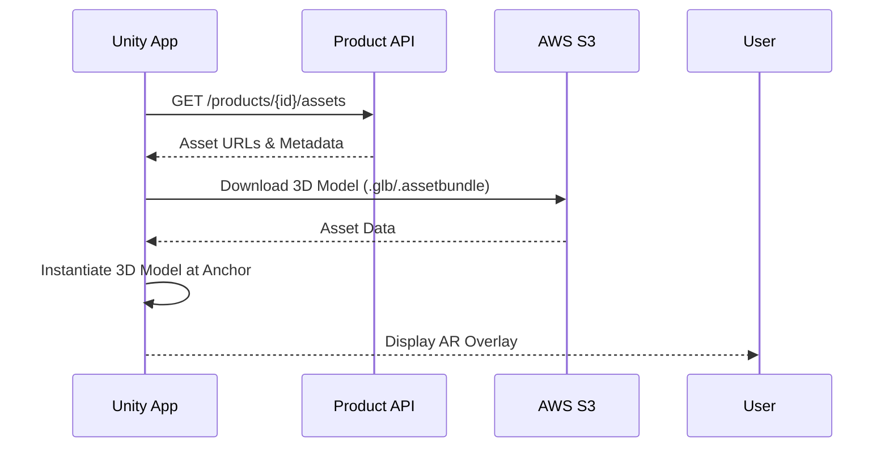
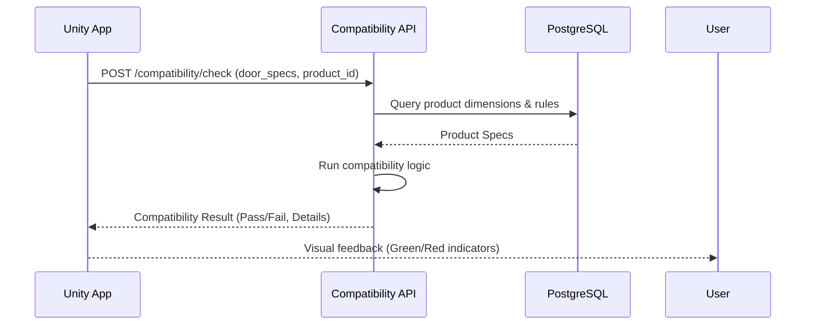
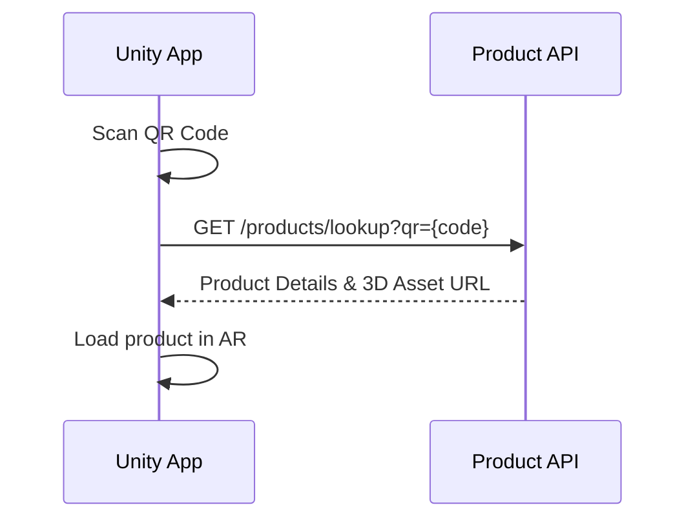
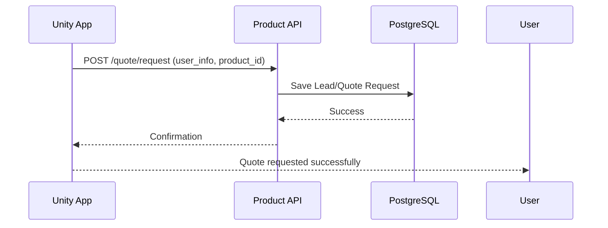
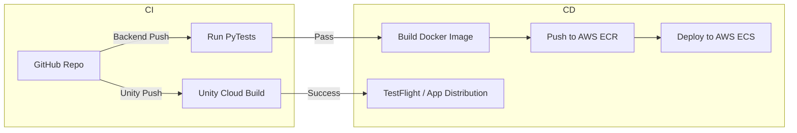

# Aayam - Architecture & Technology Decisions

This document outlines the core architecture and technology decisions for Aayam, an AI-powered AR platform for physical-space commerce.

## System Architecture Overview

The system follows a client-server architecture, with a mobile app (Unity) for the frontend and a Python-based backend.

```mermaid
flowchart TD
    subgraph Mobile App (Unity + C#)
        UI[UI Layer <br> Unity UI Toolkit / UGUI]
        AR[AR Layer <br> ARKit/ARCore via AR Foundation]
        ML[ML Layer <br> CV models via Sentis/CoreML/TFLite]
        Space[Space Model <br> Door coordinate system]
        
        UI --> Space
        Space --> AR
        Space --> ML
    end
    
    subgraph Backend (FastAPI + Python)
        API_Comp[Compatibility API]
        API_Prod[Product API]
        API_Auth[User/Auth API]
        API_Anal[Analytics API]
    end
    
    subgraph Data Layer
        DB[(PostgreSQL <br> Product data, users, sessions)]
        S3[(AWS S3 <br> 3D assets, images, textures)]
        Cache[(Redis <br> Caching, sessions)]
    end

    UI --> |REST API calls over HTTPS| API_Auth
    UI --> |REST API calls over HTTPS| API_Prod
    UI --> |REST API calls over HTTPS| API_Comp
    
    API_Comp --> DB
    API_Prod --> DB
    API_Auth --> DB
    API_Auth --> Cache
    API_Prod --> Cache
    
    API_Prod --> S3
```

## Why Unity (and Not React Native/Flutter/Native)

For a platform where AR and 3D visualization are core features, Unity was selected over alternative mobile frameworks.

| Feature | Unity | React Native / Flutter | Native (Swift/Kotlin) |
| :--- | :--- | :--- | :--- |
| **AR Ecosystem** | Highly mature (AR Foundation) | Requires third-party bridging | Platform-specific (ARKit/ARCore) |
| **3D Rendering** | Industry standard, robust | Weak, requires WebGL/plugins | Good, but platform-specific |
| **Cross-Platform** | Yes (Write once, deploy iOS/Android) | Yes | No (requires two codebases) |
| **Learning Curve** | High (C#, 3D math, game engine) | Medium (React/Dart) | Medium/High |
| **App Size** | Large (engine overhead) | Medium | Small |

**Detailed Rationale:**
- **Unity pros:** Provides a unified AR abstraction (AR Foundation) over ARKit and ARCore. It has excellent support for 3D physics, custom shaders, and complex spatial math.
- **Unity cons:** The resulting app size is larger than native apps. C# and game engine paradigms are less typical for standard UI-heavy mobile apps.
- **Why not React Native/Flutter:** While great for UI, they lack native, performant support for complex AR and 3D rendering. Bridging to native AR libraries is brittle and hard to maintain.
- **Why not native:** Building natively would require two separate teams and codebases (Swift for iOS, Kotlin for Android), drastically increasing development time and cost for an MVP.
- **Future consideration:** Exploring WebAR (WebXR) for instant access without app installation, or native ports if app size becomes a critical blocker.

## Why FastAPI (Backend)

FastAPI was chosen for the backend API layer.

- **Python ecosystem for ML:** Seamlessly integrates with AI/ML tools and libraries (PyTorch, OpenCV, scikit-learn), which is critical for Aayam's computer vision features.
- **Fast development:** Highly productive, minimal boilerplate.
- **Auto-generated OpenAPI docs:** Out-of-the-box Swagger UI is invaluable for cross-team collaboration (Unity client <-> Backend).
- **Async support:** Excellent performance for I/O bound operations (database queries, network requests).
- **Type hints:** Python type hints paired with Pydantic ensure data validation and reduce runtime errors.

## Why PostgreSQL

- **Relational data:** Perfect for structured product catalogs, dimensions, and compatibility rules.
- **JSON support:** Allows for flexible attributes (e.g., specific hardware properties that vary widely between product types) without schema changes.
- **PostGIS:** Ready for future location-based features (e.g., nearest distributor, geographic availability).
- **Mature & Reliable:** Battle-tested, excellent performance, and vast ecosystem.

## Why YOLO for Object Detection

For door and hardware recognition, YOLO (You Only Look Once) is the primary architecture.

- **Real-time inference:** Essential for AR overlays where lag breaks the illusion.
- **Mobile-optimized variants:** Models like YOLOv8 Nano or Edge-optimized variants can run efficiently on-device.
- **Single-shot detection:** Fast pipeline compared to two-stage detectors (like Faster R-CNN).
- **Excellent accuracy/speed tradeoff:** Balances the need to be highly precise (for measurements) with the need to be fast.
- **Large community:** Easy fine-tuning, extensive documentation, and robust tooling.

## Separation of Concerns

Aayam enforces a strict boundary between spatial interaction and business logic:

- **Unity handles:** AR tracking, 3D rendering, spatial UI, real-time visualization, and user interaction.
- **Python/Backend handles:** AI inference (cloud-side if applicable), product catalog intelligence, compatibility verification, and analytics.

**Why:**
- Skill sets differ wildly (3D technical artists vs. backend/ML engineers).
- Deployment cycles are decoupled (backend updates can fix business logic without requiring App Store review).
- Scaling needs differ (rendering is client-heavy, compatibility checks are server-heavy).

## Data Flow Diagrams

### 1. Door Scanning Workflow



### 2. Product Visualization Workflow



### 3. Compatibility Check Workflow



### 4. QR Code Workflow



### 5. Purchase/Quote Workflow



## API Design

- **Architecture:** REST for MVP (simpler, faster to build than GraphQL).
- **Versioning:** URL-based (e.g., `/api/v1/`).
- **Standard Error Responses:** Uniform JSON structure for errors (`{"error": "code", "message": "description"}`).
- **Rate Limiting:** IP and token-based rate limiting to prevent abuse.
- **Authentication:** JWT (JSON Web Tokens) for stateless authentication.

| Endpoint | Method | Description |
| :--- | :--- | :--- |
| `/api/v1/auth/login` | POST | Authenticate user/device |
| `/api/v1/products` | GET | List available products |
| `/api/v1/products/{id}` | GET | Get product details & asset links |
| `/api/v1/compatibility/check` | POST | Validate hardware fit for a door |
| `/api/v1/scan/upload` | POST | Optional: upload scan analytics/data |
| `/api/v1/quote/request` | POST | Submit interest/quote request |

## Security Architecture

- **HTTPS Everywhere:** All API traffic is encrypted in transit using TLS 1.2+.
- **JWT Authentication:** Secure token-based auth for API access.
- **API Key:** Device-level authentication for anonymous users.
- **Data Encryption at Rest:** Database volumes (PostgreSQL) are encrypted.
- **GDPR/Privacy:** Strict policies around camera data.
- **No PII from Camera:** Camera feeds are processed on-device. If frames are sent to the cloud for heavy processing, they are anonymized and immediately discarded unless user consent is explicitly given for training.

## Scalability Considerations

- **Stateless API Servers:** FastAPI servers hold no state, allowing easy horizontal scaling via auto-scaling groups or Kubernetes.
- **CDN for 3D Assets:** AWS CloudFront (or similar) fronting S3 to deliver heavy 3D assets globally with low latency.
- **Database Connection Pooling:** Using PgBouncer or similar to manage database connections under load.
- **Caching:** Redis caches frequent product catalog queries and session data.
- **Model Serving (Future):** If heavy ML shifts to the cloud, use dedicated serving infrastructure (e.g., Triton Inference Server, AWS SageMaker).

## DevOps & CI/CD

- **Pipeline:** GitHub Actions for automated testing and deployment.
- **Frontend (App):** Unity Cloud Build for continuous integration of iOS and Android binaries.
- **Backend:** Dockerized FastAPI deployed to AWS ECS (Fargate) for serverless container management.
- **Dashboard:** Vercel (if a web admin panel is built).
- **Environments:** Dev, Staging, and Production isolation.



## ML Model Architecture

- **Serving Strategy:** Hybrid. Critical real-time models run on-device; complex offline analysis models run in the cloud.
- **On-Device vs Cloud Inference:** 
  - *On-Device:* Fast, private, no network latency (crucial for AR tracking). Uses Unity Sentis, CoreML, or TFLite.
  - *Cloud:* More accurate, handles larger models, easier to update.
- **Model Versioning:** Models are versioned alongside the API to ensure backward compatibility with older app versions.
- **A/B Testing:** App can fetch different model weights dynamically based on user segment.
- **Update Pipeline:** New models are trained offline, evaluated, quantized, and pushed to S3/CDN for the app to download dynamically.

## Future Architecture Evolution

- **Microservices:** Extracting ML serving, catalog management, and analytics into separate services if the monolith becomes a bottleneck.
- **WebAR Support:** Reaching users via mobile browsers without requiring an app download (using 8th Wall or WebXR).
- **Real-Time Multiplayer:** Using WebRTC or Photon to allow a salesperson and customer to view and interact with the same AR scene remotely.
- **Offline Mode:** Caching catalog and models locally for use in areas with poor connectivity (e.g., construction sites).
- **Edge Computing:** Pushing inference to edge nodes (like AWS Wavelength) to achieve cloud-level accuracy with near on-device latency.
