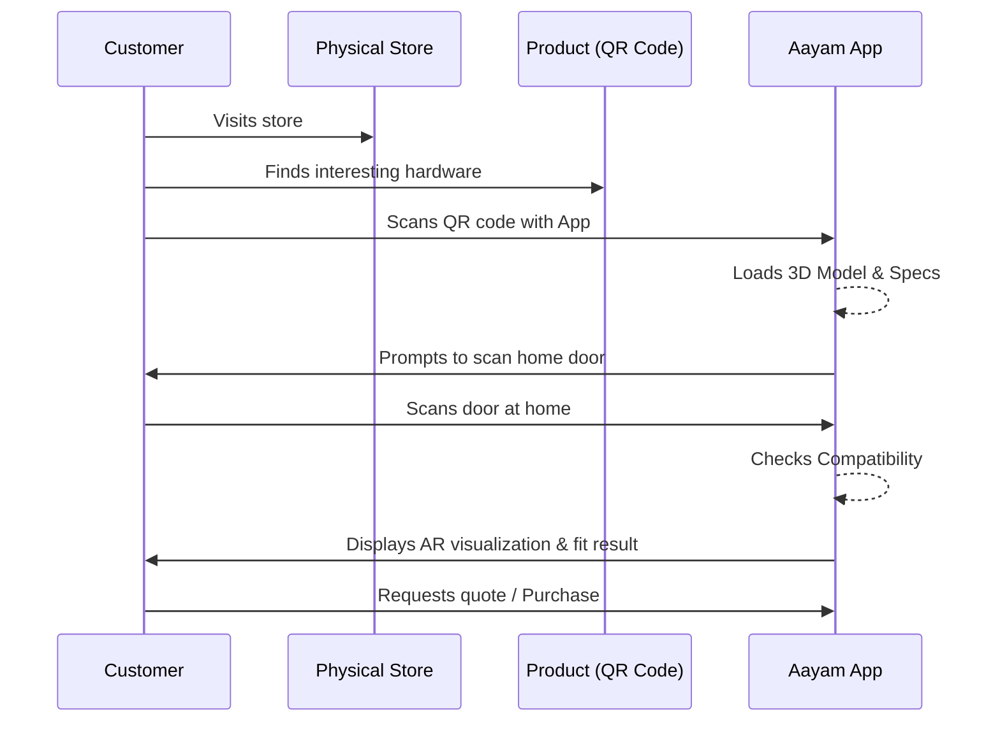

# Aayam: Project Context

## 1. Project Overview
**Aayam** is an AI-powered Augmented Reality (AR) platform for physical-space commerce. 
The MVP focuses specifically on **door hardware visualization and compatibility**.

**Core Workflow:**
1. **Scan door** → 2. **Understand door** → 3. **Select product** → 4. **Place accurately** → 5. **Visualize realistically** → 6. **Compatibility check**

## 2. Problem Statement
- **Lack of Visualization:** Customers cannot visualize how hardware products will look on their actual doors before purchasing.
- **High Return Rates:** A significant number of returns occur due to incompatible hardware.
- **Sales Inefficiency:** Salespeople struggle to recommend compatible products without physically seeing the door.
- **No Measurement Tools:** Customers lack the tools and knowledge to take accurate measurements required for hardware compatibility.

## 3. Solution
- **Mobile AR App:** An application that scans doors, detects measurements, and displays compatible products in AR.
- **Deterministic Compatibility Engine:** Core compatibility logic uses deterministic rules, NOT LLM-based guessing, to ensure accuracy.
- **QR Code Workflow:** Seamless integration for retail stores where customers scan physical QR codes to visualize products at home.
- **Retailer Dashboard:** A comprehensive dashboard for product management, analytics, and quote generation.

## 4. MVP Architecture

```mermaid
flowchart TD
    subgraph Mobile App "Mobile App (Unity + C#)"
        AR[AR Engine\nAR Foundation / ARKit / ARCore]
        Viz[AR Visualization]
        Flow[Purchase Flow]
    end

    subgraph AI/CV Engine "CV/ML Engine (Python / On-device)"
        CV[OpenCV + YOLO]
        Space[Space Model]
    end

    subgraph Backend "Backend Services (Python/FastAPI)"
        Comp[Compatibility Engine\nDeterministic Rules]
        API[REST API]
    end

    subgraph Data "Data Storage"
        DB[(PostgreSQL)]
        S3[(AWS S3\n3D Models)]
    end

    Mobile App <--> AI/CV Engine
    Mobile App <--> Backend
    Backend <--> Data
    AR --> Viz
```

## 5. Tech Stack Table

| Layer | Technology |
|---|---|
| **Mobile** | Unity + C# |
| **AR** | AR Foundation + ARKit / ARCore |
| **3D** | Blender + glTF/GLB |
| **Rendering** | Unity URP (Universal Render Pipeline) |
| **CV** | Python + OpenCV |
| **Object Detection** | YOLO-family |
| **Segmentation** | Lightweight model |
| **On-device ML** | Core ML / TFLite / Unity Sentis |
| **Backend** | FastAPI + Python |
| **Database** | PostgreSQL |
| **Storage** | AWS S3 |
| **API** | REST |
| **Auth** | Firebase Auth / Auth0 |
| **Analytics** | PostHog / Firebase Analytics |
| **Dashboard** | Next.js / React |
| **Cloud** | AWS |
| **CI/CD** | GitHub Actions |

## 6. Why Unity?
Unity is chosen over a standard mobile app framework (like React Native or Flutter) because Aayam is not a normal mobile app. It requires:
- Robust AR capabilities
- Real-time 3D rendering
- Spatial tracking
- Environmental occlusion
- Spatial anchors
- Realistic lighting estimation
- Complex physical interaction

## 7. Architecture Principles
- **Unity for Front-end AR:** Use Unity strictly for AR, 3D handling, and visual representation.
- **Python/Backend for Intelligence:** Keep AI, product intelligence, and compatibility rules in the backend (or distinct modules) for easy updating and scaling.
- **Separation of Concerns:** Ensure the AR presentation layer is decoupled from business logic.
- **Framework Agnostic:** Build backend services so they don't lock the platform into Unity permanently (future web-AR or native integrations).

## 8. MVP Screens
1. **Scan:** Guide the user to scan their door.
2. **Detection:** Show the detected door along with estimated measurements.
3. **Product:** Display a product card detailing hardware compatibility.
4. **AR:** Show the product overlaid on the door with options to compare, change, and view details.
5. **Purchase:** Provide a quote and initiate the purchase flow.

## 9. Target Users
- **Hardware Retailers (B2B):** Stores looking to enhance customer experience, reduce returns, and drive sales.
- **End Customers (B2C):** Homeowners and contractors (reached through retailers) needing to visualize and confirm hardware fit.

## 10. Success Metrics
- **Primary Goal:** Transition the customer from *"I don't know which one"* to *"I know exactly which one I want."*
- **Measurable KPIs:**
  - Number of scans
  - Number of AR visualizations
  - Number of comparisons made
  - Number of quotes generated
  - Conversion rate (purchases)
  - Reduction in compatibility errors/returns
  - User feedback scores

## 11. What NOT to Do
- **Don't build a custom AR engine.** Use established tools (AR Foundation/ARKit/ARCore).
- **Don't train a giant monolithic AI model.** Use modular, specialized models.
- **Don't start with all interior products.** Focus strictly on door hardware first.
- **Don't create 10,000 3D models initially.** Start with a representative subset.
- **Don't build a full marketplace.** Focus on retailer enablement.
- **Don't promise perfect fit.** Always use language like "AI-estimated compatibility".

## 12. AI Strategy
1. **AI #1: What am I looking at?** (Door detection - YOLO)
2. **AI #2: Where is it?** (Segmentation / Geometry)
3. **AI #3: What are its characteristics?** (Measurement / Classification of locks, hinges)
4. **AI #4: Which products fit?** (Deterministic Compatibility Engine - Rule-based)
5. **AI #5: Which product looks best?** *(Future Phase)* (Generative AI / Aesthetic Recommendation)

## 13. Team Plan

| Role | Core Skills |
|---|---|
| **Project Lead / Product Manager** | Vision, roadmap, user experience, vendor relations. |
| **Unity/AR Developer** | Unity, C#, AR Foundation, 3D math, shaders. |
| **Computer Vision / AI Engineer** | Python, OpenCV, YOLO, Segmentation, ML deployment. |
| **Backend Engineer** | Python, FastAPI, PostgreSQL, API design, AWS. |
| **3D Technical Artist** | Blender, optimization, texturing, glTF/GLB pipelines. |
| **UI/UX Designer** | Mobile UI, AR UX patterns, Figma, user research. |

## 14. Timeline Overview (8 Months)
- **Month 1:** Discovery, Prototyping, and Tech Stack Validation.
- **Month 2:** Core AR Tracking & Basic Door Detection.
- **Month 3:** Measurement CV pipeline & Spatial mapping.
- **Month 4:** 3D Model integration & Unity rendering setup.
- **Month 5:** Backend setup & Deterministic Compatibility Engine.
- **Month 6:** Retailer Dashboard & Auth integration.
- **Month 7:** E2E Integration, UI Polish, and QA testing.
- **Month 8:** Closed Beta with initial retailers, bug fixing, and MVP launch.

## 15. QR Code Workflow


