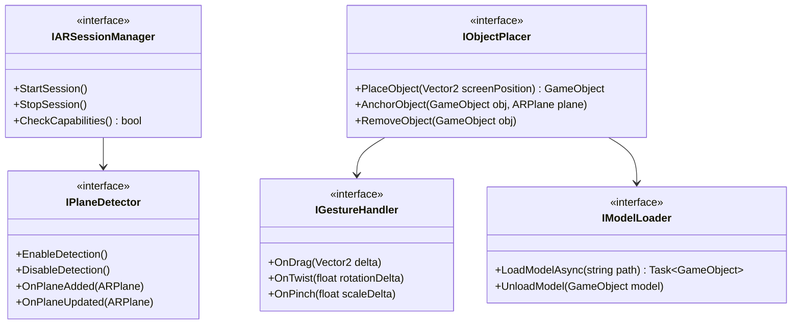

# Phase 1: Build the AR Foundation

**Duration**: 3-5 weeks (Month 1, second half + Month 2)

This phase builds the core AR experience WITHOUT AI. 

## Overview
- **Goal**: Point the camera at a door → place a 3D handle on it.
- **Milestone**: First technical milestone.
- **Approach**: No AI/CV yet - pure AR.

---

## 📋 Detailed Step-by-Step Implementation Guides

Each step has a dedicated, comprehensive implementation document with full code, architecture diagrams, and deliverables.

| Step | Topic | Duration | Guide |
|------|-------|----------|-------|
| **Step 1** | Project Setup | Week 1 | [step-1-project-setup.md](phase-1-steps/step-1-project-setup.md) |
| **Step 2** | AR Session Configuration | Week 1 | [step-2-ar-session-config.md](phase-1-steps/step-2-ar-session-config.md) |
| **Step 3** | Plane Detection | Week 2 | [step-3-plane-detection.md](phase-1-steps/step-3-plane-detection.md) |
| **Step 4** | Object Placement | Week 2-3 | [step-4-object-placement.md](phase-1-steps/step-4-object-placement.md) |
| **Step 5** | Object Interaction | Week 3-4 | [step-5-object-interaction.md](phase-1-steps/step-5-object-interaction.md) |
| **Step 6** | 3D Model Loading | Week 3 | [step-6-3d-model-loading.md](phase-1-steps/step-6-3d-model-loading.md) |
| **Step 7** | Basic UI | Week 4 | [step-7-basic-ui.md](phase-1-steps/step-7-basic-ui.md) |
| **Step 8** | Depth & Occlusion | Week 4-5 | [step-8-depth-occlusion.md](phase-1-steps/step-8-depth-occlusion.md) |
| **Step 9** | Testing & QA | Ongoing + Week 5 | [step-9-testing.md](phase-1-steps/step-9-testing.md) |

---

## 🗓️ Timeline

```
Week 1   │ Step 1: Project Setup  ████████████████░░░░░░░░░░░░░░░░░░░░
         │ Step 2: AR Session     ████████████████░░░░░░░░░░░░░░░░░░░░
─────────┼──────────────────────────────────────────────────────────────
Week 2   │ Step 3: Plane Detection░░░░░░░░████████████████░░░░░░░░░░░░
         │ Step 4: Object Placement░░░░░░░████████████████████████░░░░░
─────────┼──────────────────────────────────────────────────────────────
Week 3   │ Step 4: Object Placement░░░░░░░░░░░░░░░░░████████████░░░░░░
         │ Step 5: Object Interaction░░░░░░░░░░░░░░░░████████████████░░
         │ Step 6: 3D Model Loading░░░░░░░░░░░░░░░░░████████████████░░
─────────┼──────────────────────────────────────────────────────────────
Week 4   │ Step 5: Object Interaction░░░░░░░░░░░░░░░░░░░░████████████░
         │ Step 7: Basic UI        ░░░░░░░░░░░░░░░░░░░░░░████████████░
         │ Step 8: Depth & Occlusion░░░░░░░░░░░░░░░░░░░░░████████████░
─────────┼──────────────────────────────────────────────────────────────
Week 5   │ Step 8: Depth & Occlusion░░░░░░░░░░░░░░░░░░░░░░░░░████████
         │ Step 9: Testing & QA    ████████████████████████████████████
```

---

## Architecture



---

## Technical Requirements
- **Target**: 60 FPS on mid-range devices.
- **Tracking**: Drift < 2cm over 30 seconds.
- **Placement**: Accuracy within 1cm.

---

## Deliverables
- [ ] Unity project with AR Foundation
- [ ] Plane detection working (horizontal + vertical)
- [ ] 3D object placement on vertical surfaces
- [ ] Object manipulation (move/rotate/scale)
- [ ] Object locking
- [ ] Basic UI overlay
- [ ] Depth/occlusion (on supported devices)
- [ ] Test on iOS + Android
- [ ] 20+ unit tests passing
- [ ] Performance benchmarks met
- [ ] Demo video

---

## Risks
- **Vertical plane detection reliability**: Vertical planes (doors) can sometimes be featureless or highly reflective, making them hard to track.
- **Device fragmentation**: Varied AR capabilities across different Android devices.
- **Performance on lower-end devices**: Thermal throttling and battery drain on devices lacking dedicated AR hardware.

---

## What Each Step Doc Contains
Every step implementation guide includes:
- ✅ Detailed explanation of concepts and architecture
- ✅ Complete, compilable C# code (production-ready)
- ✅ Mermaid architecture/flow diagrams
- ✅ Unity setup instructions (component configuration)
- ✅ Deliverables checklist
- ✅ Testing scenarios
- ✅ Common issues and troubleshooting
