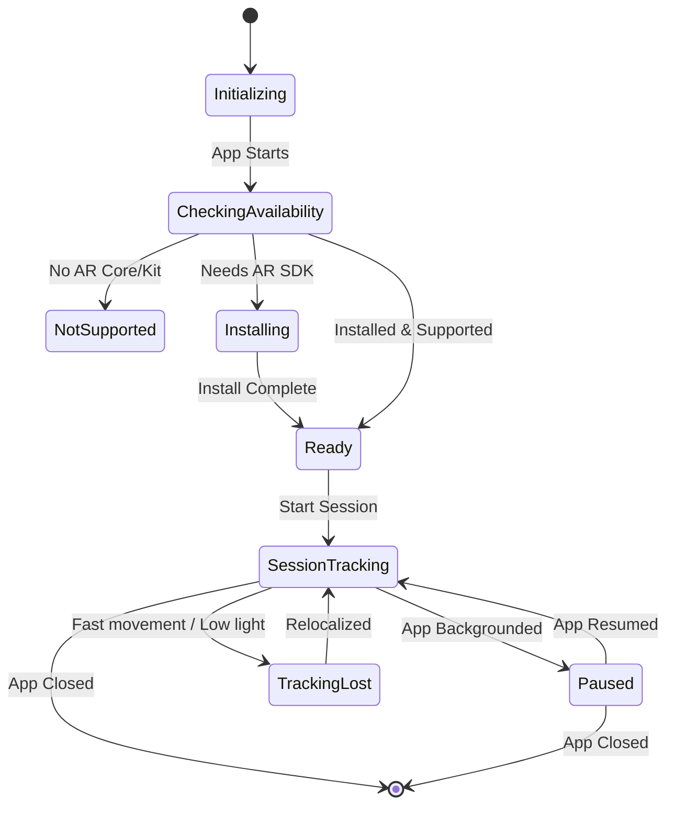

# Step 2: AR Session Configuration — Detailed Implementation Guide

**Phase:** 1
**Duration:** Week 1 (parallel with Step 1)

## 2.1 Understanding the AR Architecture

The AR Foundation architecture relies on a hierarchy of components that manage the translation between physical and virtual spaces.

```
AR Session
├── AR Session Origin (XR Origin in newer versions)
│   ├── AR Camera (Main Camera)
│   │   ├── AR Camera Manager
│   │   ├── AR Camera Background
│   │   └── Tracked Pose Driver
│   ├── AR Plane Manager
│   ├── AR Raycast Manager
│   ├── AR Anchor Manager
│   └── AR Occlusion Manager
```

### Key Components

*   **AR Session:** Controls the lifecycle of the AR experience (enable/disable, check support, install AR services). It manages the state of the overall system.
*   **XR Origin (formerly AR Session Origin):** Transforms trackable features (like planes and anchors) from AR space (which is arbitrary based on device boot/initialization) into Unity's world space.
*   **AR Camera:** The Unity Camera representing the device. It has:
    *   **AR Camera Manager:** Supplies camera images and metadata (like light estimation).
    *   **AR Camera Background:** Renders the camera feed to the screen.
    *   **Tracked Pose Driver:** Drives the camera's position and rotation based on device movement.
*   **Managers (Plane, Raycast, Anchor, Occlusion):** Individual subsystems that handle specific AR features.

### AR Pipeline

```mermaid
flowchart TD
    A[Hardware Sensors (Camera, Gyro, LiDAR)] --> B[Native AR SDK (ARKit/ARCore)]
    B --> C[Unity AR Subsystems]
    C --> D[AR Foundation Managers]
    D --> E[AR Session (Lifecycle)]
    D --> F[Tracked Data (Planes, Poses)]
    F --> G[XR Origin (Space Transformation)]
    G --> H[Unity Scene Rendering]
```

## 2.2 Create the AR Scene

Follow these steps to set up the base AR scene `ARScene.unity`:

1.  **Create New Scene:** Create a basic empty 3D scene named `ARScene.unity`.
2.  **Clean Up:** Delete the default `Main Camera` and `Directional Light`.
3.  **Add AR Session:**
    *   Right-click in Hierarchy -> **XR** -> **AR Session**.
    *   Ensure the GameObject has both the `AR Session` and `AR Input Manager` components.
4.  **Add XR Origin:**
    *   Right-click in Hierarchy -> **XR** -> **XR Origin (Mobile AR)** (or similar, depending on Unity version).
    *   This creates an `XR Origin` GameObject with a child `Camera Offset` and a grandchild `Main Camera`.
    *   On the `XR Origin` component, set **Tracking Origin Mode** to `Not Specified` or `Device` (depending on needs, usually default is fine for basic AR).
5.  **Configure AR Camera (Main Camera):**
    *   Select the `Main Camera` under the `XR Origin`.
    *   Ensure it is tagged as `MainCamera`.
    *   Verify it has an `AR Camera Manager` and `AR Camera Background`.
    *   Verify it has a `Tracked Pose Driver (Input System)`.
    *   **Camera Settings:**
        *   Clear Flags: `Solid Color`
        *   Background: Black `(0,0,0,0)` (AR Camera Background overrides this, but good practice).
        *   Clipping Planes: Near `0.1`, Far `100` (or greater, but limit to optimize rendering).
    *   Add an `AR Occlusion Manager` if depth-based occlusion is desired (enable environment depth if supported).

## 2.3 AR Session Manager Script

This script manages the lifecycle and state of the AR session, ensuring AR services are installed and ready before tracking begins.

```csharp
using UnityEngine;
using UnityEngine.XR.ARFoundation;
using System;
using System.Collections;

namespace Aayam.AR.Core
{
    public enum SessionState
    {
        None,
        CheckingAvailability,
        NotSupported,
        NeedsInstall,
        Installing,
        Ready,
        SessionInitializing,
        SessionTracking,
        Paused,
        Error
    }

    [RequireComponent(typeof(ARSession))]
    public class ARSessionController : MonoBehaviour
    {
        public static event Action<SessionState> OnSessionStateChanged;
        
        private ARSession _arSession;
        private SessionState _currentState = SessionState.None;

        public SessionState CurrentState
        {
            get => _currentState;
            private set
            {
                if (_currentState != value)
                {
                    _currentState = value;
                    OnSessionStateChanged?.Invoke(_currentState);
                    Debug.Log($"[ARSessionController] State changed to: {_currentState}");
                }
            }
        }

        private void Awake()
        {
            _arSession = GetComponent<ARSession>();
            ARSession.stateChanged += HandleARSessionStateChanged;
        }

        private void OnDestroy()
        {
            ARSession.stateChanged -= HandleARSessionStateChanged;
        }

        private IEnumerator Start()
        {
            yield return StartARSession();
        }

        public IEnumerator StartARSession()
        {
            CurrentState = SessionState.CheckingAvailability;
            
            if (ARSession.state == ARSessionState.None ||
                ARSession.state == ARSessionState.CheckingAvailability)
            {
                yield return ARSession.CheckAvailability();
            }
            
            if (ARSession.state == ARSessionState.Unsupported)
            {
                CurrentState = SessionState.NotSupported;
                HandleError("AR is not supported on this device.");
                yield break;
            }
            
            if (ARSession.state == ARSessionState.NeedsInstall)
            {
                CurrentState = SessionState.Installing;
                yield return ARSession.Install();
            }
            
            if (ARSession.state == ARSessionState.Ready)
            {
                CurrentState = SessionState.Ready;
                _arSession.enabled = true;
            }
        }

        private void HandleARSessionStateChanged(ARSessionStateChangedEventArgs args)
        {
            switch (args.state)
            {
                case ARSessionState.SessionInitializing:
                    CurrentState = SessionState.SessionInitializing;
                    break;
                case ARSessionState.SessionTracking:
                    CurrentState = SessionState.SessionTracking;
                    break;
                case ARSessionState.Unsupported:
                    CurrentState = SessionState.NotSupported;
                    break;
            }
        }

        public void PauseSession()
        {
            if (_arSession != null && _arSession.enabled)
            {
                _arSession.enabled = false;
                CurrentState = SessionState.Paused;
            }
        }

        public void ResumeSession()
        {
            if (_arSession != null && !_arSession.enabled)
            {
                _arSession.enabled = true;
            }
        }

        public void ResetSession()
        {
            if (_arSession != null)
            {
                _arSession.Reset();
            }
        }

        private void OnApplicationPause(bool isPaused)
        {
            if (isPaused)
            {
                PauseSession();
            }
            else
            {
                ResumeSession();
            }
        }

        private void HandleError(string message)
        {
            CurrentState = SessionState.Error;
            Debug.LogError($"[ARSessionController] Error: {message}");
            // Integration with UI to show error message goes here
        }
    }
}
```

## 2.4 Camera Configuration

To use AR, camera permissions must be requested at runtime on both Android and iOS. 

**iOS Configuration:**
*   In `Project Settings` > `Player` > `iOS` > `Other Settings`, set the **Camera Usage Description** (e.g., "Aayam requires camera access to visualize door hardware in your physical space.").

**Android Configuration:**
*   The AR Foundation package usually injects the `<uses-permission android:name="android.permission.CAMERA" />` into the Manifest automatically, but it is good to verify.

### Runtime Permission Script

```csharp
using UnityEngine;
#if UNITY_ANDROID
using UnityEngine.Android;
#endif
using System;
using System.Collections;

namespace Aayam.AR.Core
{
    public class CameraPermissionHandler : MonoBehaviour
    {
        public static event Action OnPermissionGranted;
        public static event Action OnPermissionDenied;

        public void RequestCameraPermission()
        {
#if UNITY_ANDROID
            if (!Permission.HasUserAuthorizedPermission(Permission.Camera))
            {
                PermissionCallbacks callbacks = new PermissionCallbacks();
                callbacks.PermissionGranted += PermissionGrantedCallback;
                callbacks.PermissionDenied += PermissionDeniedCallback;
                callbacks.PermissionDeniedAndDontAskAgain += PermissionDeniedAndDontAskAgainCallback;
                
                Permission.RequestUserPermission(Permission.Camera, callbacks);
            }
            else
            {
                OnPermissionGranted?.Invoke();
            }
#elif UNITY_IOS
            if (Application.HasUserAuthorization(UserAuthorization.WebCam))
            {
                OnPermissionGranted?.Invoke();
            }
            else
            {
                StartCoroutine(RequestIOSCameraCoroutine());
            }
#else
            // Editor or other platforms
            OnPermissionGranted?.Invoke();
#endif
        }

        private void PermissionGrantedCallback(string permissionName)
        {
            OnPermissionGranted?.Invoke();
        }

        private void PermissionDeniedCallback(string permissionName)
        {
            Debug.LogWarning("Camera permission denied.");
            OnPermissionDenied?.Invoke();
        }

        private void PermissionDeniedAndDontAskAgainCallback(string permissionName)
        {
            Debug.LogWarning("Camera permission denied completely. Prompting settings.");
            OnPermissionDenied?.Invoke();
            // Implement UI to tell user to go to settings and use OpenAppSettings()
        }

        private IEnumerator RequestIOSCameraCoroutine()
        {
            yield return Application.RequestUserAuthorization(UserAuthorization.WebCam);
            if (Application.HasUserAuthorization(UserAuthorization.WebCam))
            {
                OnPermissionGranted?.Invoke();
            }
            else
            {
                OnPermissionDenied?.Invoke();
            }
        }

        public void OpenAppSettings()
        {
#if UNITY_IOS
            Application.OpenURL("app-settings:");
#elif UNITY_ANDROID
            using (var unityClass = new AndroidJavaClass("com.unity3d.player.UnityPlayer"))
            using (var currentActivityObject = unityClass.GetStatic<AndroidJavaObject>("currentActivity"))
            {
                string packageName = currentActivityObject.Call<string>("getPackageName");
                using (var uriClass = new AndroidJavaClass("android.net.Uri"))
                using (var uriObject = uriClass.CallStatic<AndroidJavaObject>("fromParts", "package", packageName, null))
                using (var intentObject = new AndroidJavaObject("android.content.Intent", "android.settings.APPLICATION_DETAILS_SETTINGS", uriObject))
                {
                    intentObject.Call<AndroidJavaObject>("addCategory", "android.intent.category.DEFAULT");
                    intentObject.Call<AndroidJavaObject>("setFlags", 268435456); // FLAG_ACTIVITY_NEW_TASK
                    currentActivityObject.Call("startActivity", intentObject);
                }
            }
#endif
        }
    }
}
```

## 2.5 Device Capability Detection

This module checks exactly what AR features the current device supports to enable/disable UI features accordingly (e.g., LiDAR-specific occlusion).

```csharp
using UnityEngine;
using UnityEngine.XR.ARFoundation;
using UnityEngine.XR.ARSubsystems;
using System.Collections.Generic;

namespace Aayam.AR.Core
{
    [System.Serializable]
    public class DeviceCapabilities
    {
        public bool SupportsAR;
        public bool SupportsWorldTracking;
        public bool SupportsPlaneDetection;
        public bool SupportsVerticalPlanes;
        public bool SupportsDepth;
        public bool SupportsLiDAR;
        public bool SupportsOcclusion;
        public bool SupportsHumanOcclusion;
        public bool SupportsFaceTracking;
        public bool SupportsImageTracking;
        public bool SupportsLightEstimation;
        public bool SupportsMeshing;
        public string DeviceModel;
        public string OSVersion;
        public string ARSDKVersion;
    }
    
    public class DeviceCapabilityChecker : MonoBehaviour
    {
        public DeviceCapabilities Capabilities { get; private set; } = new DeviceCapabilities();

        private void Start()
        {
            CheckCapabilities();
        }

        public void CheckCapabilities()
        {
            Capabilities.DeviceModel = SystemInfo.deviceModel;
            Capabilities.OSVersion = SystemInfo.operatingSystem;
            Capabilities.ARSDKVersion = "ARFoundation/Native";

            // Check if AR is generally supported
            Capabilities.SupportsAR = ARSession.state >= ARSessionState.Ready;
            Capabilities.SupportsWorldTracking = Capabilities.SupportsAR; // Usually true if AR is supported

            // Check specific subsystem descriptors
            List<XRPlaneSubsystemDescriptor> planeDescriptors = new List<XRPlaneSubsystemDescriptor>();
            SubsystemManager.GetSubsystemDescriptors(planeDescriptors);
            Capabilities.SupportsPlaneDetection = planeDescriptors.Count > 0;
            Capabilities.SupportsVerticalPlanes = planeDescriptors.Count > 0; // Modern ARKit/Core support this implicitly

            List<XROcclusionSubsystemDescriptor> occlusionDescriptors = new List<XROcclusionSubsystemDescriptor>();
            SubsystemManager.GetSubsystemDescriptors(occlusionDescriptors);
            if (occlusionDescriptors.Count > 0)
            {
                Capabilities.SupportsOcclusion = true;
                Capabilities.SupportsHumanOcclusion = true;
                // Basic heuristic: iOS devices with advanced environment depth usually indicate LiDAR
                Capabilities.SupportsDepth = true;
                
                #if UNITY_IOS
                if (SystemInfo.deviceModel.Contains("iPad") && SystemInfo.deviceModel.CompareTo("iPad8") > 0 || 
                    SystemInfo.deviceModel.Contains("iPhone") && (SystemInfo.deviceModel.Contains("Pro") && SystemInfo.deviceModel.CompareTo("iPhone13") >= 0))
                {
                    Capabilities.SupportsLiDAR = true; 
                }
                #endif
            }

            List<XRFaceSubsystemDescriptor> faceDescriptors = new List<XRFaceSubsystemDescriptor>();
            SubsystemManager.GetSubsystemDescriptors(faceDescriptors);
            Capabilities.SupportsFaceTracking = faceDescriptors.Count > 0;

            List<XRImageTrackingSubsystemDescriptor> imageDescriptors = new List<XRImageTrackingSubsystemDescriptor>();
            SubsystemManager.GetSubsystemDescriptors(imageDescriptors);
            Capabilities.SupportsImageTracking = imageDescriptors.Count > 0;

            List<XRCameraSubsystemDescriptor> cameraDescriptors = new List<XRCameraSubsystemDescriptor>();
            SubsystemManager.GetSubsystemDescriptors(cameraDescriptors);
            Capabilities.SupportsLightEstimation = cameraDescriptors.Count > 0;

            List<XRMeshSubsystemDescriptor> meshDescriptors = new List<XRMeshSubsystemDescriptor>();
            SubsystemManager.GetSubsystemDescriptors(meshDescriptors);
            Capabilities.SupportsMeshing = meshDescriptors.Count > 0;

            LogCapabilities();
        }

        private void LogCapabilities()
        {
            Debug.Log($"[DeviceCapabilityChecker] Device: {Capabilities.DeviceModel} ({Capabilities.OSVersion})");
            Debug.Log($"[DeviceCapabilityChecker] AR Supported: {Capabilities.SupportsAR}");
            Debug.Log($"[DeviceCapabilityChecker] Planes: {Capabilities.SupportsPlaneDetection}");
            Debug.Log($"[DeviceCapabilityChecker] Occlusion/Depth: {Capabilities.SupportsOcclusion}");
            Debug.Log($"[DeviceCapabilityChecker] LiDAR (Estimated): {Capabilities.SupportsLiDAR}");
            Debug.Log($"[DeviceCapabilityChecker] Light Est: {Capabilities.SupportsLightEstimation}");
        }
    }
}
```

## 2.6 Supported Devices Matrix

Here is the matrix of supported devices, specifically tailored for the Indian market where Android is heavily fragmented.

### iOS (Minimum: iPhone SE 2nd gen)
| Device | AR Tracking | Depth | LiDAR | Rating |
|--------|----|----|------|--------|
| iPhone 12/13/14/15 | ✅ | ✅ | ❌ | Good |
| iPhone 12/13/14/15 Pro | ✅ | ✅ | ✅ | Excellent |
| iPhone 16 Pro | ✅ | ✅ | ✅ | Excellent |
| iPad Pro (2020+) | ✅ | ✅ | ✅ | Excellent |
| iPhone SE (2nd/3rd gen) | ✅ | ❌ | ❌ | Acceptable |

### Android (Minimum: ARCore supported)
| Device | AR Tracking | Depth | ToF Sensor | Rating |
|--------|----|----|------|--------|
| Samsung Galaxy S21+/S22/S23 | ✅ | ✅ | Varies | Excellent |
| Samsung Galaxy M/A Series (Newer) | ✅ | Varies | ❌ | Good |
| Google Pixel 6+/7/8 | ✅ | ✅ | ❌ | Good |
| OnePlus 10+/11/12 | ✅ | ✅ | ❌ | Good |
| Xiaomi 13/14 Series | ✅ | ✅ | ❌ | Good |
| Realme GT Series | ✅ | Varies | ❌ | Acceptable |
| POCO X/F Series (Newer) | ✅ | Varies | ❌ | Acceptable |

*Note: ARCore support can vary by region and exact model number. It's crucial to check `ARSession.state` dynamically.*

## 2.7 AR Session Lifecycle

The AR Session Lifecycle must handle interruptions such as the user backgrounding the app or tracking loss due to fast movement/poor lighting.



*Implementation is covered in the `ARSessionController.cs` script (PauseSession/ResumeSession methods).* Unity's `OnApplicationPause(bool isPaused)` is hooked into the Controller to manage the lifecycle natively.

## 2.8 Light Estimation Setup

Light estimation makes virtual objects look like they belong in the real environment by adjusting their lighting to match the physical space.

1.  Select the `AR Camera`.
2.  On the `AR Camera Manager`, set **Light Estimation** to `Everything` (or specifically Ambient Intensity, Ambient Color, Main Light Direction, etc.).
3.  Create a directional light in the scene (or use existing) and assign it to the script below.

```csharp
using UnityEngine;
using UnityEngine.XR.ARFoundation;

namespace Aayam.AR.Core
{
    [RequireComponent(typeof(ARCameraManager))]
    public class LightEstimationController : MonoBehaviour
    {
        [SerializeField] private Light _directionalLight;
        private ARCameraManager _cameraManager;

        private void Awake()
        {
            _cameraManager = GetComponent<ARCameraManager>();
        }

        private void OnEnable()
        {
            if (_cameraManager != null)
                _cameraManager.frameReceived += FrameChanged;
        }

        private void OnDisable()
        {
            if (_cameraManager != null)
                _cameraManager.frameReceived -= FrameChanged;
        }

        private void FrameChanged(ARCameraFrameEventArgs args)
        {
            if (_directionalLight == null) return;

            if (args.lightEstimation.averageBrightness.HasValue)
            {
                _directionalLight.intensity = args.lightEstimation.averageBrightness.Value;
                AREventBus.RaiseLightEstimationUpdated(args.lightEstimation.averageBrightness.Value);
            }

            if (args.lightEstimation.averageColorTemperature.HasValue)
            {
                _directionalLight.colorTemperature = args.lightEstimation.averageColorTemperature.Value;
            }

            if (args.lightEstimation.mainLightDirection.HasValue)
            {
                _directionalLight.transform.rotation = Quaternion.LookRotation(args.lightEstimation.mainLightDirection.Value);
            }
            
            if (args.lightEstimation.mainLightColor.HasValue)
            {
                _directionalLight.color = args.lightEstimation.mainLightColor.Value;
            }
        }
    }
}
```

## 2.9 Session Events System

A central event bus decouples the AR subsystem from the UI and logic systems.

```csharp
using System;
using UnityEngine.XR.ARFoundation;

namespace Aayam.AR.Core
{
    public static class AREventBus
    {
        // Session States
        public static event Action<SessionState> OnSessionStateChanged;
        
        // Tracking
        public static event Action OnTrackingLost;
        public static event Action OnTrackingRecovered;
        
        // Planes
        public static event Action<ARPlane> OnPlaneAdded;
        public static event Action<ARPlane> OnPlaneUpdated;
        
        // Environment
        public static event Action<float> OnLightEstimationUpdated;

        // Invokers
        public static void RaiseSessionStateChanged(SessionState state) => OnSessionStateChanged?.Invoke(state);
        public static void RaiseTrackingLost() => OnTrackingLost?.Invoke();
        public static void RaiseTrackingRecovered() => OnTrackingRecovered?.Invoke();
        public static void RaisePlaneAdded(ARPlane plane) => OnPlaneAdded?.Invoke(plane);
        public static void RaisePlaneUpdated(ARPlane plane) => OnPlaneUpdated?.Invoke(plane);
        public static void RaiseLightEstimationUpdated(float intensity) => OnLightEstimationUpdated?.Invoke(intensity);
    }
}
```

## 2.10 Configuration Scriptable Objects

Using ScriptableObjects allows us to configure AR parameters without modifying code or searching through scenes.

```csharp
using UnityEngine;

namespace Aayam.AR.Core
{
    [CreateAssetMenu(fileName = "ARConfiguration", menuName = "Aayam/AR Configuration")]
    public class ARConfiguration : ScriptableObject
    {
        [Header("Timeouts & Limits")]
        [Tooltip("Time in seconds before prompting user to move device to find planes.")]
        public float PlaneDetectionTimeout = 10f;
        
        [Tooltip("Time in seconds before showing critical tracking lost error.")]
        public float TrackingLostTimeout = 5f;

        [Header("Feature Toggles")]
        public bool EnableLightEstimation = true;
        public bool EnableOcclusion = true;
        public bool EnablePointClouds = false; // Usually off in production for performance

        [Header("Debugging")]
        public bool DebugMode = false;
        public bool ShowPlanesInBuild = false;
        
        [Header("Layer Setup")]
        public LayerMask ARInteractableLayer;
    }
}
```

## Deliverables Checklist
- [x] AR Scene created with correct hierarchy (`XR Origin`, `AR Session`)
- [x] `ARSessionController` implemented with full lifecycle and state management
- [x] Camera permissions handled on both platforms (`CameraPermissionHandler.cs`)
- [x] Device capabilities detection working (`DeviceCapabilityChecker.cs`)
- [x] Supported devices documented with Indian market context
- [x] Light estimation configured and applied to directional light
- [x] Event system (`AREventBus`) created for decoupled communication
- [x] Configuration `ScriptableObjects` created for tuning
- [x] Session pause/resume lifecycle mapped and documented
- [x] Error handling integrated into state flow
- [ ] AR session starts successfully on test device *(Requires physical device testing)*
