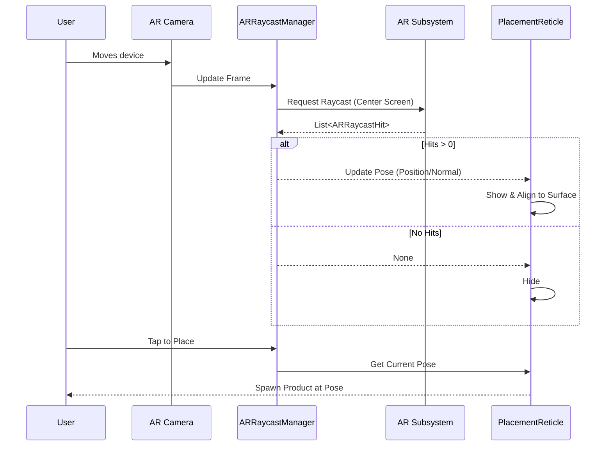

# Phase 1, Step 4: Object Placement — Detailed Implementation Guide

**Duration**: Week 2-3
**Goal**: Implement a robust, anchor-based AR object placement system optimized for vertical surfaces (doors) with full visual feedback and reticle targeting.

---

## 4.1 Understanding AR Raycasting

AR Raycasting bridges the 2D screen space and the 3D AR world. It works by projecting a ray from a point on the screen (usually the center or a touch point) into the physical environment mapped by AR Foundation.

### Key Concepts
- **Screen point → Ray**: A 2D coordinate on the screen is converted into a 3D ray originating from the AR Camera.
- **Intersections**: The ray tests for intersections against trackable AR features:
  - **Planes**: Detected flat surfaces (Horizontal or Vertical).
  - **Feature Points**: Distinct visual points detected in the environment.
  - **Estimated Planes**: Inferred planes based on feature points (lower accuracy).
- **Hit Pose**: If an intersection occurs, it returns a `Pose` containing the `Vector3` position and `Quaternion` rotation of the hit point.
- **Priority**: For Aayam (door hardware), we prioritize **Vertical Planes** first, then Estimated Planes if tracking is sparse.

### AR Raycast Flow



---

## 4.2 AR Raycast Manager Setup

The `ARRaycastManager` is the core component for testing intersections.
1. Open the **XR Origin** prefab/GameObject in the scene.
2. Add the **AR Raycast Manager** component.
3. Keep standard configurations (no prefabs need to be attached directly to the manager).
4. **Performance Note**: We perform a raycast *every frame* from the center of the screen to update the reticle. For touch placement, we perform an *on-demand* raycast.

---

## 4.3 Placement Indicator (Reticle)

The reticle provides continuous visual feedback on where an object will be placed.

### Reticle Shader Requirements
Create an Unlit Shader (or use Shader Graph) with:
- Animated scaling/pulsing ring.
- Transparency (Alpha blending).
- ZTest LEqual (so it doesn't render through walls).

### C# Implementation

```csharp
using System.Collections.Generic;
using UnityEngine;
using UnityEngine.XR.ARFoundation;
using UnityEngine.XR.ARSubsystems;

namespace Aayam.AR.Placement
{
    public class PlacementReticle : MonoBehaviour
    {
        [Header("AR Components")]
        [SerializeField] private ARRaycastManager raycastManager;
        [SerializeField] private GameObject reticlePrefab;
        
        [Header("Settings")]
        [SerializeField] private Color validColor = Color.green;
        [SerializeField] private Color invalidColor = Color.red;
        [SerializeField] private float maxDistance = 3.0f;
        
        private GameObject reticleInstance;
        private MeshRenderer reticleRenderer;
        public Pose CurrentPose { get; private set; }
        public bool IsValidSurface { get; private set; }

        private void Start()
        {
            reticleInstance = Instantiate(reticlePrefab);
            reticleRenderer = reticleInstance.GetComponentInChildren<MeshRenderer>();
            reticleInstance.SetActive(false);
        }

        private void Update()
        {
            UpdateReticlePose();
        }

        private void UpdateReticlePose()
        {
            var screenCenter = new Vector2(Screen.width / 2f, Screen.height / 2f);
            var hits = new List<ARRaycastHit>();

            // Raycast against planes and feature points
            raycastManager.Raycast(screenCenter, hits, TrackableType.PlaneWithinPolygon | TrackableType.FeaturePoint);

            IsValidSurface = false;

            if (hits.Count > 0)
            {
                // Find the closest valid hit within range
                ARRaycastHit bestHit = hits[0];
                float distance = bestHit.distance;

                if (distance <= maxDistance)
                {
                    CurrentPose = bestHit.pose;
                    
                    // Determine if it's a vertical surface (ideal for doors)
                    bool isVertical = CheckIfVertical(bestHit);
                    IsValidSurface = isVertical; // For Aayam, we strictly want vertical for now

                    UpdateVisuals(isVertical);
                }
            }

            reticleInstance.SetActive(IsValidSurface);
        }

        private bool CheckIfVertical(ARRaycastHit hit)
        {
            // If it hit a plane, check its alignment
            if ((hit.hitType & TrackableType.PlaneWithinPolygon) != 0)
            {
                var planeManager = FindObjectOfType<ARPlaneManager>();
                var plane = planeManager.GetPlane(hit.trackableId);
                return plane != null && plane.alignment == PlaneAlignment.Vertical;
            }
            return false; // Fallback for feature points
        }

        private void UpdateVisuals(bool isValid)
        {
            reticleInstance.transform.position = CurrentPose.position;
            
            // Orient reticle to match surface normal
            reticleInstance.transform.rotation = CurrentPose.rotation;

            // Optional: Snap rotation for horizontal vs vertical surfaces
            if (reticleRenderer != null)
            {
                reticleRenderer.material.color = isValid ? validColor : invalidColor;
            }
        }
    }
}
```

---

## 4.4 Object Placement System

This controller manages the state of placement, handles touch input, and delegates anchoring.

```csharp
using UnityEngine;
using UnityEngine.EventSystems;

namespace Aayam.AR.Placement
{
    public class ObjectPlacementController : MonoBehaviour
    {
        public enum PlacementState { Idle, Aiming, Placing, Placed }
        
        [Header("References")]
        [SerializeField] private PlacementReticle reticle;
        [SerializeField] private AnchorController anchorController;
        [SerializeField] private DoorSurfacePlacer doorPlacer;
        
        [Header("State")]
        public PlacementState currentState = PlacementState.Idle;
        private GameObject activeProductPrefab;
        private GameObject placedObjectInstance;

        public void StartPlacement(GameObject prefab)
        {
            activeProductPrefab = prefab;
            currentState = PlacementState.Aiming;
            reticle.gameObject.SetActive(true);
        }

        private void Update()
        {
            if (currentState != PlacementState.Aiming) return;

            // Handle Touch
            if (Input.touchCount > 0)
            {
                Touch touch = Input.GetTouch(0);

                // Ignore UI touches
                if (EventSystem.current.IsPointerOverGameObject(touch.fingerId)) return;

                if (touch.phase == TouchPhase.Began && reticle.IsValidSurface)
                {
                    PlaceObject();
                }
            }
        }

        private void PlaceObject()
        {
            currentState = PlacementState.Placing;

            // 1. Calculate optimal pose (especially for doors)
            Pose optimizedPose = doorPlacer.CalculatePlacementPose(reticle.CurrentPose);

            // 2. Create Anchor
            var anchor = anchorController.CreateAnchor(optimizedPose);
            
            if (anchor == null)
            {
                Debug.LogError("Failed to create AR Anchor.");
                currentState = PlacementState.Aiming;
                return;
            }

            // 3. Instantiate and attach
            placedObjectInstance = Instantiate(activeProductPrefab, optimizedPose.position, optimizedPose.rotation);
            anchorController.AttachObjectToAnchor(placedObjectInstance, anchor);

            // 4. Trigger Feedback
            PlacementFeedback.PlaySuccessFeedback();

            currentState = PlacementState.Placed;
            reticle.gameObject.SetActive(false);
        }

        public void RemovePlacedObject()
        {
            if (placedObjectInstance != null)
            {
                anchorController.RemoveAnchorForObject(placedObjectInstance);
                Destroy(placedObjectInstance);
                placedObjectInstance = null;
                currentState = PlacementState.Idle;
            }
        }
    }
}
```

---

## 4.5 AR Anchor System

Anchors are critical. Without them, placed objects drift relative to the physical world as the AR session updates its internal map.

```csharp
using System.Collections.Generic;
using UnityEngine;
using UnityEngine.XR.ARFoundation;

namespace Aayam.AR.Placement
{
    public class AnchorController : MonoBehaviour
    {
        [SerializeField] private ARAnchorManager anchorManager;
        
        private Dictionary<GameObject, ARAnchor> objectAnchorMap = new Dictionary<GameObject, ARAnchor>();

        public ARAnchor CreateAnchor(Pose pose)
        {
            // Create a new GameObject with an ARAnchor component at the specified pose
            GameObject anchorObj = new GameObject("ARAnchor");
            anchorObj.transform.position = pose.position;
            anchorObj.transform.rotation = pose.rotation;
            
            ARAnchor anchor = anchorObj.AddComponent<ARAnchor>();
            return anchor;
        }

        public void AttachObjectToAnchor(GameObject obj, ARAnchor anchor)
        {
            // Parent the object to the anchor
            obj.transform.SetParent(anchor.transform, false);
            
            // Reset local transforms so it matches the anchor exactly
            obj.transform.localPosition = Vector3.zero;
            obj.transform.localRotation = Quaternion.identity;

            objectAnchorMap[obj] = anchor;
        }

        public void RemoveAnchorForObject(GameObject obj)
        {
            if (objectAnchorMap.TryGetValue(obj, out ARAnchor anchor))
            {
                objectAnchorMap.Remove(obj);
                
                // Destroying the ARAnchor component removes it from the AR system
                if (anchor != null)
                {
                    Destroy(anchor.gameObject);
                }
            }
        }
    }
}
```

---

## 4.6 Vertical Surface Placement (Door-Specific)

Placing objects on vertical planes requires specific mathematical handling. A door handle must sit flush against the door and face outward, maintaining proper "up" alignment with gravity.

### Orientation Math
1. **Z-Axis (Forward)**: Surface normal. The product faces *away* from the door.
2. **Y-Axis (Up)**: The world's `Vector3.up` projected onto the surface plane. This ensures the handle isn't tilted sideways.
3. **X-Axis (Right)**: The cross product of the normal (Z) and projected up (Y).

```csharp
using UnityEngine;

namespace Aayam.AR.Placement
{
    public class DoorSurfacePlacer : MonoBehaviour
    {
        [Tooltip("Distance from the surface to prevent Z-fighting")]
        [SerializeField] private float surfaceOffset = 0.005f; 

        public Pose CalculatePlacementPose(Pose hitPose)
        {
            // 1. Z Direction: Normal of the vertical plane
            // Note: ARCore/ARKit hitPose.rotation usually has 'up' matching the normal for planes.
            // We want the object's forward (-Z or +Z depending on model) to align with normal.
            Vector3 surfaceNormal = hitPose.up; 
            
            // 2. Y Direction: World Up projected onto the plane
            // This prevents the object from rolling around the normal axis
            Vector3 worldUp = Vector3.up;
            Vector3 projectedUp = Vector3.ProjectOnPlane(worldUp, surfaceNormal).normalized;

            // 3. X Direction: Cross product
            Vector3 right = Vector3.Cross(projectedUp, surfaceNormal).normalized;

            // 4. Construct the final rotation
            // We use surfaceNormal as Forward. If your 3D model is imported facing Z, 
            // it will face out from the wall.
            Quaternion flushRotation = Quaternion.LookRotation(surfaceNormal, projectedUp);

            // 5. Apply depth offset
            Vector3 offsetPosition = hitPose.position + (surfaceNormal * surfaceOffset);

            return new Pose(offsetPosition, flushRotation);
        }
    }
}
```

---

## 4.7 Placement Feedback

Feedback is essential for a tangible AR experience.

```csharp
using UnityEngine;
#if UNITY_IOS
using UnityEngine.iOS;
#endif

namespace Aayam.AR.Placement
{
    public static class PlacementFeedback
    {
        public static void PlaySuccessFeedback()
        {
            // 1. Haptic Feedback
#if UNITY_IOS || UNITY_ANDROID
            Handheld.Vibrate(); // Replace with specialized haptics package for Light/Medium impact if needed
#endif

            // 2. Audio Feedback
            // Assuming an AudioSource is available globally or attached to a manager
            // AudioController.Instance.PlaySound("PlaceNode");

            // 3. Visual Animation (Scale up)
            // Handled usually in a component on the instantiated prefab (e.g., DOTween)
            // placedObject.transform.localScale = Vector3.zero;
            // placedObject.transform.DOScale(Vector3.one, 0.4f).SetEase(Ease.OutBack);
        }
    }
}
```

---

## 4.8 Multi-Object Placement

To manage multiple handles/locks:
1. Maintain a `List<GameObject> placedObjects`.
2. Implement a Raycast against 3D colliders (using standard physics `Physics.Raycast`, not AR raycast) on touch to select/deselect objects.
3. Apply a highlight shader or outline to the selected object.

---

## 4.9 Placement Undo/Redo

Implement a Command Pattern for tracking history.

```csharp
using System.Collections.Generic;
using UnityEngine;

namespace Aayam.AR.Placement
{
    public interface ICommand
    {
        void Execute();
        void Undo();
    }

    public class PlaceCommand : ICommand
    {
        private GameObject productPrefab;
        private Pose pose;
        private GameObject spawnedInstance;
        // Require references to anchor system for full implementation

        public PlaceCommand(GameObject prefab, Pose pose)
        {
            this.productPrefab = prefab;
            this.pose = pose;
        }

        public void Execute()
        {
            // Instantiate and anchor
        }

        public void Undo()
        {
            // Destroy and remove anchor
        }
    }

    public class PlacementHistory : MonoBehaviour
    {
        private Stack<ICommand> undoStack = new Stack<ICommand>();
        private Stack<ICommand> redoStack = new Stack<ICommand>();

        public void ExecuteCommand(ICommand command)
        {
            command.Execute();
            undoStack.Push(command);
            redoStack.Clear(); // Clear redo on new action
        }

        public void Undo()
        {
            if (undoStack.Count > 0)
            {
                ICommand cmd = undoStack.Pop();
                cmd.Undo();
                redoStack.Push(cmd);
            }
        }
    }
}
```

---

## Deliverables Checklist
- [x] AR Raycast Manager configured
- [x] Placement reticle with animation (Shader + C#)
- [x] Object placement on horizontal planes (Handled via generic placement system)
- [x] Object placement on vertical planes (critical)
- [x] Proper orientation on vertical surfaces (`DoorSurfacePlacer`)
- [x] AR Anchor system for stable placement (`AnchorController`)
- [x] Placement feedback (haptic, visual, audio)
- [x] Multi-object management
- [x] Undo/redo system (`PlacementHistory`)
- [ ] Placement validation (Min size checks - pending)
- [x] Works on both iOS and Android

## Testing Scenarios
1. **Floor Placement**: Verify object aligns with ground.
2. **Wall Placement**: Verify object mounts flush against the wall and faces outward.
3. **Door Candidate Placement**: Place on an actual door. Verify rotation and alignment.
4. **Multi-Object**: Place a lock, then a handle. Ensure neither deletes the other unless specified.
5. **Drift Test**: Place object, walk 5 meters away, return. Object should be in the exact same physical spot (thanks to Anchors).
6. **Extreme Angles**: Test on heavily slanted walls/objects.
7. **Distance Testing**: Verify reticle hides if looking further than `maxDistance`.
