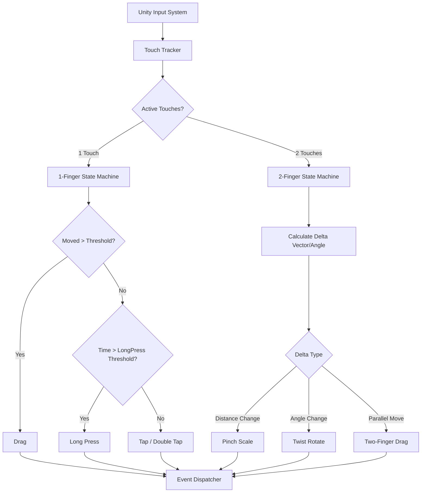
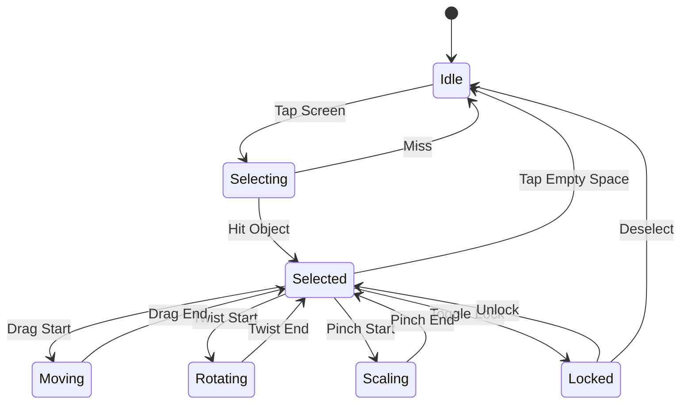

# Step 5: Object Interaction — Detailed Implementation Guide

**Phase:** 1  
**Duration:** Week 3-4  

This guide provides a comprehensive implementation strategy for AR object interaction in Aayam, covering robust gesture detection, surface-constrained manipulation, and intuitive feedback mechanisms tailored for architectural elements like door hardware.

---

## 5.1 Gesture Architecture

Aayam uses a custom gesture recognition layer built on top of the **Unity Input System (New)**. This ensures cross-platform consistency and accurate multi-touch handling.

### Key Concepts
- **Touch Phases:** We track `Began`, `Moved`, `Stationary`, `Ended`, and `Canceled`.
- **Multi-Touch Handling:** Gestures are categorized by touch count (1 finger vs 2 fingers).
- **Conflict Resolution:** We use priority checks. For example, a drag requires a movement threshold. If a second finger touches during a drag, it escalates to a pinch/twist.

### Gesture Pipeline



---

## 5.2 Gesture Detection System

This `GestureDetector` robustly processes touch data to emit clean interaction events.

```csharp
using System;
using System.Collections.Generic;
using UnityEngine;
using UnityEngine.InputSystem;
using UnityEngine.InputSystem.EnhancedTouch;
using Touch = UnityEngine.InputSystem.EnhancedTouch.Touch;
using TouchPhase = UnityEngine.InputSystem.TouchPhase;

namespace Aayam.AR.Interaction
{
    public enum GestureType
    {
        None, Tap, DoubleTap, LongPress, Drag, Pinch, Twist, TwoFingerDrag
    }

    public class GestureDetector : MonoBehaviour
    {
        public event Action<Vector2> OnTap;
        public event Action<Vector2> OnDoubleTap;
        public event Action<Vector2> OnLongPress;
        public event Action<Vector2, Vector2> OnDragStart;   
        public event Action<Vector2> OnDragUpdate;           
        public event Action OnDragEnd;
        public event Action<float> OnPinch;                  
        public event Action<float> OnTwist;                  

        [Header("Thresholds")]
        [SerializeField] private float tapThreshold = 0.2f;
        [SerializeField] private float doubleTapWindow = 0.3f;
        [SerializeField] private float longPressTime = 0.5f;
        [SerializeField] private float dragThreshold = 10f;
        [SerializeField] private float pinchThreshold = 0.01f;
        [SerializeField] private float twistThreshold = 1f;

        private float touchStartTime;
        private Vector2 touchStartPosition;
        private bool isDragging;
        private bool isLongPressTriggered;
        private float lastTapTime;

        // Two-finger state
        private float initialPinchDistance;
        private float initialTwistAngle;

        private void OnEnable()
        {
            EnhancedTouchSupport.Enable();
        }

        private void OnDisable()
        {
            EnhancedTouchSupport.Disable();
        }

        private void Update()
        {
            int touchCount = Touch.activeTouches.Count;

            if (touchCount == 1)
            {
                HandleSingleTouch(Touch.activeTouches[0]);
            }
            else if (touchCount == 2)
            {
                HandleDoubleTouch(Touch.activeTouches[0], Touch.activeTouches[1]);
            }
            else
            {
                ResetGestures();
            }
        }

        private void HandleSingleTouch(Touch touch)
        {
            switch (touch.phase)
            {
                case TouchPhase.Began:
                    touchStartTime = Time.time;
                    touchStartPosition = touch.screenPosition;
                    isDragging = false;
                    isLongPressTriggered = false;
                    break;

                case TouchPhase.Moved:
                case TouchPhase.Stationary:
                    float moveDistance = Vector2.Distance(touch.screenPosition, touchStartPosition);
                    
                    if (!isDragging && moveDistance > dragThreshold)
                    {
                        isDragging = true;
                        OnDragStart?.Invoke(touchStartPosition, touch.screenPosition);
                    }
                    else if (isDragging)
                    {
                        OnDragUpdate?.Invoke(touch.delta);
                    }
                    else if (!isDragging && !isLongPressTriggered && (Time.time - touchStartTime) > longPressTime)
                    {
                        isLongPressTriggered = true;
                        OnLongPress?.Invoke(touchStartPosition);
                    }
                    break;

                case TouchPhase.Ended:
                case TouchPhase.Canceled:
                    if (isDragging)
                    {
                        OnDragEnd?.Invoke();
                    }
                    else if (!isLongPressTriggered && (Time.time - touchStartTime) < tapThreshold)
                    {
                        if (Time.time - lastTapTime < doubleTapWindow)
                        {
                            OnDoubleTap?.Invoke(touch.screenPosition);
                            lastTapTime = 0; // Reset
                        }
                        else
                        {
                            OnTap?.Invoke(touch.screenPosition);
                            lastTapTime = Time.time;
                        }
                    }
                    ResetGestures();
                    break;
            }
        }

        private void HandleDoubleTouch(Touch touch1, Touch touch2)
        {
            if (isDragging) // Cancel single drag if second finger drops
            {
                OnDragEnd?.Invoke();
                isDragging = false;
            }

            if (touch1.phase == TouchPhase.Began || touch2.phase == TouchPhase.Began)
            {
                initialPinchDistance = Vector2.Distance(touch1.screenPosition, touch2.screenPosition);
                Vector2 diff = touch1.screenPosition - touch2.screenPosition;
                initialTwistAngle = Mathf.Atan2(diff.y, diff.x) * Mathf.Rad2Deg;
            }
            else if (touch1.phase == TouchPhase.Moved || touch2.phase == TouchPhase.Moved)
            {
                // Pinch
                float currentDistance = Vector2.Distance(touch1.screenPosition, touch2.screenPosition);
                float pinchDelta = currentDistance - initialPinchDistance;
                
                if (Mathf.Abs(pinchDelta) > pinchThreshold)
                {
                    float scaleFactor = currentDistance / initialPinchDistance;
                    OnPinch?.Invoke(scaleFactor);
                    initialPinchDistance = currentDistance; // Reset for continuous smooth scaling
                }

                // Twist
                Vector2 currentDiff = touch1.screenPosition - touch2.screenPosition;
                float currentAngle = Mathf.Atan2(currentDiff.y, currentDiff.x) * Mathf.Rad2Deg;
                float angleDelta = Mathf.DeltaAngle(initialTwistAngle, currentAngle);

                if (Mathf.Abs(angleDelta) > twistThreshold)
                {
                    OnTwist?.Invoke(angleDelta);
                    initialTwistAngle = currentAngle;
                }
            }
        }

        private void ResetGestures()
        {
            isDragging = false;
            isLongPressTriggered = false;
        }
    }
}
```

---

## 5.3 Object Selection

Handles 3D physics raycasting to select AR objects and triggers visual feedback.

```csharp
using System;
using UnityEngine;

namespace Aayam.AR.Interaction
{
    [RequireComponent(typeof(GestureDetector))]
    public class ObjectSelector : MonoBehaviour
    {
        public event Action<Transform> OnObjectSelected;
        public event Action OnObjectDeselected;

        [SerializeField] private Camera arCamera;
        [SerializeField] private LayerMask selectableLayer;
        
        private Transform currentSelection;
        private GestureDetector gestureDetector;

        private void Awake()
        {
            gestureDetector = GetComponent<GestureDetector>();
        }

        private void OnEnable() => gestureDetector.OnTap += HandleTap;
        private void OnDisable() => gestureDetector.OnTap -= HandleTap;

        private void HandleTap(Vector2 screenPosition)
        {
            Ray ray = arCamera.ScreenPointToRay(screenPosition);
            if (Physics.Raycast(ray, out RaycastHit hit, 10f, selectableLayer))
            {
                SelectObject(hit.transform);
            }
            else
            {
                DeselectCurrent();
            }
        }

        private void SelectObject(Transform obj)
        {
            if (currentSelection == obj) return;

            DeselectCurrent();
            currentSelection = obj;
            
            // Enable Outline
            var outline = currentSelection.GetComponent<Outline>();
            if (outline != null) outline.enabled = true;

            OnObjectSelected?.Invoke(currentSelection);
        }

        private void DeselectCurrent()
        {
            if (currentSelection != null)
            {
                var outline = currentSelection.GetComponent<Outline>();
                if (outline != null) outline.enabled = false;
                
                currentSelection = null;
                OnObjectDeselected?.Invoke();
            }
        }
    }
}
```

### Basic Outline Shader (HLSL Concept for URP)
Create a Shader Graph with:
1. Normal expansion (vertex position + normal * thickness).
2. Render Front Face = Off.
3. Unlit solid color.
Attach via multi-pass renderer feature or direct material assignment.

---

## 5.4 Move (Drag) Interaction

Moves objects perfectly flush along the detected AR planes (walls/doors).

```csharp
using System.Collections.Generic;
using UnityEngine;
using UnityEngine.XR.ARFoundation;
using UnityEngine.XR.ARSubsystems;

namespace Aayam.AR.Interaction
{
    [RequireComponent(typeof(GestureDetector), typeof(ObjectSelector))]
    public class DragHandler : MonoBehaviour
    {
        [SerializeField] private ARRaycastManager arRaycastManager;
        [SerializeField] private float smoothing = 15f;

        private GestureDetector gestureDetector;
        private ObjectSelector objectSelector;
        private Transform activeObject;
        private Vector3 targetPosition;
        private bool isDragging;

        private static List<ARRaycastHit> hits = new List<ARRaycastHit>();

        private void Awake()
        {
            gestureDetector = GetComponent<GestureDetector>();
            objectSelector = GetComponent<ObjectSelector>();
        }

        private void OnEnable()
        {
            objectSelector.OnObjectSelected += (obj) => activeObject = obj;
            objectSelector.OnObjectDeselected += () => activeObject = null;
            
            gestureDetector.OnDragStart += HandleDragStart;
            gestureDetector.OnDragUpdate += HandleDragUpdate;
            gestureDetector.OnDragEnd += HandleDragEnd;
        }

        private void HandleDragStart(Vector2 startPos, Vector2 currentPos)
        {
            if (activeObject == null) return;
            isDragging = true;
            targetPosition = activeObject.position;
        }

        private void HandleDragUpdate(Vector2 delta)
        {
            if (!isDragging || activeObject == null) return;

            // Continually raycast center of screen or touch pos against planes
            // Note: ARRaycastManager requires screen coordinates.
            Vector2 currentTouch = UnityEngine.InputSystem.EnhancedTouch.Touch.activeTouches[0].screenPosition;
            
            if (arRaycastManager.Raycast(currentTouch, hits, TrackableType.PlaneWithinPolygon))
            {
                var hit = hits[0];
                targetPosition = hit.pose.position;
                
                // Align to normal
                activeObject.rotation = Quaternion.LookRotation(hit.pose.up, Vector3.up);
            }
        }

        private void HandleDragEnd()
        {
            isDragging = false;
        }

        private void Update()
        {
            if (activeObject != null && isDragging)
            {
                activeObject.position = Vector3.Lerp(activeObject.position, targetPosition, Time.deltaTime * smoothing);
            }
        }
    }
}
```

---

## 5.5 Rotate (Twist) Interaction

Allows rotation around the surface normal (useful for aligning locks/handles).

```csharp
using UnityEngine;

namespace Aayam.AR.Interaction
{
    [RequireComponent(typeof(GestureDetector), typeof(ObjectSelector))]
    public class RotationHandler : MonoBehaviour
    {
        [SerializeField] private float rotationSensitivity = 1.5f;
        [SerializeField] private bool snapRotation = true;
        [SerializeField] private float snapAngle = 90f;

        private GestureDetector gestureDetector;
        private ObjectSelector objectSelector;
        private Transform activeObject;
        
        private float currentYaw;

        private void Awake()
        {
            gestureDetector = GetComponent<GestureDetector>();
            objectSelector = GetComponent<ObjectSelector>();
        }

        private void OnEnable()
        {
            objectSelector.OnObjectSelected += (obj) => { activeObject = obj; currentYaw = 0; };
            objectSelector.OnObjectDeselected += () => activeObject = null;
            gestureDetector.OnTwist += HandleTwist;
            // Snapping on gesture end could be bound here if twisting ended
        }

        private void HandleTwist(float angleDelta)
        {
            if (activeObject == null) return;

            // We rotate around the object's local up axis (assuming Z is forward, Y is up)
            float step = -angleDelta * rotationSensitivity; 
            activeObject.Rotate(Vector3.up, step, Space.Self);

            if (snapRotation)
            {
                // Optional: Implementation of snap logic after twist ends
            }
        }
    }
}
```

---

## 5.6 Scale (Pinch) Interaction

Aayam explicitly restricts scaling to ensure 1:1 real-world size accuracy.

```csharp
using UnityEngine;

namespace Aayam.AR.Interaction
{
    [RequireComponent(typeof(GestureDetector), typeof(ObjectSelector))]
    public class ScaleHandler : MonoBehaviour
    {
        [Header("Scale Constraints (1:1 Real Scale enforced)")]
        [SerializeField] private bool allowPreviewScaling = false;
        [SerializeField] private float minScale = 0.8f;
        [SerializeField] private float maxScale = 1.2f;

        private GestureDetector gestureDetector;
        private ObjectSelector objectSelector;
        private Transform activeObject;
        private Vector3 originalScale;

        private void Awake()
        {
            gestureDetector = GetComponent<GestureDetector>();
            objectSelector = GetComponent<ObjectSelector>();
        }

        private void OnEnable()
        {
            objectSelector.OnObjectSelected += (obj) => { 
                activeObject = obj; 
                originalScale = obj.localScale; 
            };
            objectSelector.OnObjectDeselected += () => activeObject = null;
            gestureDetector.OnPinch += HandlePinch;
        }

        private void HandlePinch(float scaleFactor)
        {
            if (activeObject == null || !allowPreviewScaling) return;

            Vector3 newScale = activeObject.localScale * scaleFactor;
            
            // Clamp
            float currentMagnitude = newScale.x / originalScale.x;
            if (currentMagnitude > minScale && currentMagnitude < maxScale)
            {
                activeObject.localScale = newScale;
            }
        }

        public void ResetToRealScale()
        {
            if (activeObject != null) activeObject.localScale = originalScale;
        }
    }
}
```

---

## 5.7 Lock/Unlock System

Prevents accidental interaction after placement is finalized.

```csharp
using UnityEngine;

namespace Aayam.AR.Interaction
{
    public class ObjectLockController : MonoBehaviour
    {
        public bool IsLocked { get; private set; }
        
        [SerializeField] private GameObject lockVisualIndicator;
        [SerializeField] private Collider objectCollider;

        public void ToggleLock()
        {
            IsLocked = !IsLocked;
            
            if (objectCollider != null)
                objectCollider.enabled = !IsLocked; // Disables raycast selection

            if (lockVisualIndicator != null)
                lockVisualIndicator.SetActive(IsLocked);
                
            if (IsLocked)
            {
                HapticFeedback.PlaySuccess();
            }
        }
    }
}
```

---

## 5.8 Snap System

Ensures door hardware aligns to standardized ergonomic heights.

```csharp
using UnityEngine;

namespace Aayam.AR.Interaction
{
    public class SnapController : MonoBehaviour
    {
        [Header("Standard Heights (Meters)")]
        [SerializeField] private float handleHeight = 1.0f;
        [SerializeField] private float peepholeHeight = 1.5f;
        [SerializeField] private float snapThreshold = 0.1f;

        public Vector3 ApplyHeightSnap(Vector3 currentPosition, string objectType)
        {
            float targetHeight = objectType.ToLower() == "peephole" ? peepholeHeight : handleHeight;
            
            if (Mathf.Abs(currentPosition.y - targetHeight) < snapThreshold)
            {
                HapticFeedback.PlaySnap();
                return new Vector3(currentPosition.x, targetHeight, currentPosition.z);
            }
            
            return currentPosition;
        }
    }
}
```

---

## 5.9 Interaction State Machine

Prevents conflicts (e.g., trying to scale and drag simultaneously).



```csharp
namespace Aayam.AR.Interaction
{
    public enum InteractionState
    {
        Idle, Selecting, Selected, Moving, Rotating, Scaling, Locked
    }

    public class InteractionStateMachine : MonoBehaviour
    {
        public InteractionState CurrentState { get; private set; } = InteractionState.Idle;

        public void ChangeState(InteractionState newState)
        {
            if (CurrentState == newState) return;
            
            // Exit logic
            if (CurrentState == InteractionState.Moving) 
                Debug.Log("Exiting Move State");

            CurrentState = newState;

            // Entry logic
            if (CurrentState == InteractionState.Locked)
                Debug.Log("Entering Locked State");
        }
    }
}
```

---

## 5.10 Transform Gizmo

When an object is `Selected`, visual gizmos help orient the user:
- **Move Plane:** A semitransparent circle at the base indicating planar movement.
- **Rotation Ring:** A curved arrow around the normal axis indicating twist support.
- **Scale Handles:** (Disabled by default to enforce 1:1 scale).
*Setup:* Build a prefab consisting of SpriteRenderers/LineRenderers attached to the selection logic. Show/hide elements based on the `InteractionStateMachine`'s current state.

---

## 5.11 Interaction Feedback

- **Haptics:** iOS `UIImpactFeedbackGenerator` / Android `Vibrator`.
  - Tap: Light tick.
  - Snap: Medium tick.
  - Error (Invalid placement): Heavy bump.
- **Audio:** UI clicks for select/deselect. Satisfying "click" sound when an object snaps to 1000mm height.
- **Visuals:** Drop shadows beneath objects, outline shaders on selection.

---

## Deliverables Checklist
- [ ] Gesture detection system (tap, drag, pinch, twist)
- [ ] Object selection with visual highlighting
- [ ] Move interaction (surface-constrained drag)
- [ ] Rotate interaction (twist gesture)
- [ ] Scale interaction (pinch with limits)
- [ ] Lock/unlock system
- [ ] Snap system (surface, height, grid)
- [ ] Interaction state machine
- [ ] Transform gizmo visuals
- [ ] Haptic/audio/visual feedback
- [ ] Works on both iOS and Android
- [ ] No conflicts between gesture types

## Testing Scenarios
1. **Tap:** Verify objects select (outline appears) and deselect.
2. **Drag (Wall):** Drag object. Ensure it does not float off the wall.
3. **Pinch:** Attempt to scale. Verify limits block extreme scaling.
4. **Twist:** Rotate lock. Verify axis of rotation aligns with surface normal.
5. **Lock:** Lock object, try to drag (should fail), unlock, try to drag (should succeed).
6. **Snap:** Move handle slowly towards 1m height. Verify haptic snap and position lock within threshold.
7. **Conflicts:** Try dragging with one finger, then pinching with a second. Ensure smooth state transition.
