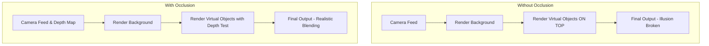

# Phase 1, Step 8: Depth & Occlusion — Detailed Implementation Guide

**Duration:** Week 4-5

## 8.1 Why Occlusion Matters

In augmented reality, a common visual problem is that virtual objects always render on top of the physical world by default. 
- **Without occlusion**, a virtual door handle floats in front of your hand when you reach out to grab it, breaking the illusion of presence.
- **Occlusion** solves this by ensuring that real-world objects (like hands, people, or furniture) correctly hide virtual objects when they are positioned in front of them from the camera's perspective. 
- **Before/After**: Before occlusion, virtual assets look like stickers overlaid on the camera feed. After occlusion, assets integrate spatially into the scene, respecting the physical depth of the real world.

### Rendering Pipeline Comparison



## 8.2 Types of Occlusion

### Environment Occlusion
- **Concept:** Real-world geometry occludes virtual objects based on a depth map.
- **Hardware:** Requires depth-sensing hardware like LiDAR (iPhone 12 Pro+, iPad Pro) or ToF sensors on modern Android devices.
- **API:** Managed via `AREnvironmentDepthManager` in ARFoundation (wrapping ARKit/ARCore).

### Human Occlusion (People Occlusion)
- **Concept:** People in the scene correctly occlude virtual objects.
- **Hardware/API:** Primarily an ARKit feature utilizing a machine learning segmentation model to separate humans from the background.
- **Modes:** 
  - **Stencil:** A binary mask (person vs. not person).
  - **Depth:** Per-pixel depth estimation for the segmented person.

### Plane-Based Occlusion (Fallback)
- **Concept:** For devices without dedicated depth sensors.
- **Implementation:** Create invisible meshes on detected AR planes. These meshes write to the depth buffer (Z-buffer) but not the color buffer.
- **Result:** Virtual objects positioned behind these planes get occluded. While less granular than dense depth mapping, it works reliably across all AR-capable devices.

## 8.3 AR Occlusion Manager Setup

This script sets up ARFoundation's `AROcclusionManager` while checking device capabilities to provide the best possible occlusion method.

```csharp
using UnityEngine;
using UnityEngine.XR.ARFoundation;
using UnityEngine.XR.ARSubsystems;

namespace Aayam.AR.Core
{
    [RequireComponent(typeof(AROcclusionManager))]
    [RequireComponent(typeof(ARCameraManager))]
    public class OcclusionController : MonoBehaviour
    {
        [SerializeField] private AROcclusionManager occlusionManager;
        [SerializeField] private PlaneOcclusionController planeOcclusionFallback;
        
        [Header("Performance Settings")]
        [SerializeField] private int minFpsThreshold = 45;
        
        private DeviceCapabilityChecker deviceCapabilities;
        private bool isOcclusionEnabled = true;

        void Awake()
        {
            if (occlusionManager == null) occlusionManager = GetComponent<AROcclusionManager>();
            deviceCapabilities = GetComponent<DeviceCapabilityChecker>() ?? gameObject.AddComponent<DeviceCapabilityChecker>();
        }

        void Start()
        {
            ConfigureOcclusion();
        }

        private void Update()
        {
            MonitorPerformance();
        }

        public void ConfigureOcclusion()
        {
            if (!isOcclusionEnabled)
            {
                DisableAllOcclusion();
                return;
            }

            if (deviceCapabilities.SupportsLiDAR)
            {
                // Best quality environment and human occlusion
                occlusionManager.requestedEnvironmentDepthMode = EnvironmentDepthMode.Best;
                occlusionManager.requestedHumanDepthMode = HumanSegmentationDepthMode.Best;
                occlusionManager.requestedHumanStencilMode = HumanSegmentationStencilMode.Best;
                occlusionManager.requestedOcclusionPreferenceMode = OcclusionPreferenceMode.PreferEnvironmentOcclusion;
                if (planeOcclusionFallback) planeOcclusionFallback.enabled = false;
            }
            else if (deviceCapabilities.SupportsDepth)
            {
                // Medium quality for standard ToF
                occlusionManager.requestedEnvironmentDepthMode = EnvironmentDepthMode.Medium;
                occlusionManager.requestedHumanDepthMode = HumanSegmentationDepthMode.Medium;
                occlusionManager.requestedHumanStencilMode = HumanSegmentationStencilMode.Medium;
                occlusionManager.requestedOcclusionPreferenceMode = OcclusionPreferenceMode.PreferEnvironmentOcclusion;
                if (planeOcclusionFallback) planeOcclusionFallback.enabled = false;
            }
            else
            {
                // Fallback to plane-based occlusion
                occlusionManager.requestedEnvironmentDepthMode = EnvironmentDepthMode.None;
                occlusionManager.requestedHumanDepthMode = HumanSegmentationDepthMode.None;
                EnablePlaneBasedOcclusion();
            }
        }

        private void DisableAllOcclusion()
        {
            occlusionManager.requestedEnvironmentDepthMode = EnvironmentDepthMode.None;
            occlusionManager.requestedHumanDepthMode = HumanSegmentationDepthMode.None;
            occlusionManager.requestedHumanStencilMode = HumanSegmentationStencilMode.None;
            if (planeOcclusionFallback) planeOcclusionFallback.enabled = false;
        }

        private void EnablePlaneBasedOcclusion()
        {
            if (planeOcclusionFallback != null)
            {
                planeOcclusionFallback.enabled = true;
                planeOcclusionFallback.Initialize();
            }
        }

        public void ToggleOcclusion(bool enable)
        {
            isOcclusionEnabled = enable;
            ConfigureOcclusion();
        }

        private void MonitorPerformance()
        {
            // Simple FPS monitor to downgrade occlusion if performance suffers
            float fps = 1.0f / Time.deltaTime;
            if (fps < minFpsThreshold && isOcclusionEnabled && occlusionManager.requestedEnvironmentDepthMode != EnvironmentDepthMode.None)
            {
                Debug.LogWarning("FPS dropped below threshold. Downgrading occlusion quality.");
                // Downgrade logic
                if (occlusionManager.requestedEnvironmentDepthMode == EnvironmentDepthMode.Best)
                {
                    occlusionManager.requestedEnvironmentDepthMode = EnvironmentDepthMode.Fastest;
                }
                else
                {
                    ConfigureOcclusion(); // Re-evaluates based on capabilities, might need a force-fallback flag
                }
            }
        }
    }

    // Dummy class for capabilities check
    public class DeviceCapabilityChecker : MonoBehaviour 
    {
        public bool SupportsLiDAR { get { return SystemInfo.supportsComputeShaders && Application.platform == RuntimePlatform.IPhonePlayer; } }
        public bool SupportsDepth { get { return true; } } // Abstracted check
        public bool SupportsHumanOcclusion { get { return Application.platform == RuntimePlatform.IPhonePlayer; } }
    }
}
```

## 8.4 Environment Depth Texture

Accessing the raw depth texture from the `AROcclusionManager` for advanced use cases, like depth-based placement and visualization.

```csharp
using System;
using Unity.Collections;
using UnityEngine;
using UnityEngine.XR.ARFoundation;
using UnityEngine.XR.ARSubsystems;

namespace Aayam.AR.Core
{
    [RequireComponent(typeof(AROcclusionManager))]
    public class DepthTextureHandler : MonoBehaviour
    {
        private AROcclusionManager occlusionManager;
        private Texture2D depthTexture;

        void Awake()
        {
            occlusionManager = GetComponent<AROcclusionManager>();
        }

        void OnEnable()
        {
            occlusionManager.frameReceived += OnOcclusionFrameReceived;
        }

        void OnDisable()
        {
            occlusionManager.frameReceived -= OnOcclusionFrameReceived;
        }

        private void OnOcclusionFrameReceived(AROcclusionFrameEventArgs args)
        {
            if (occlusionManager.TryAcquireEnvironmentDepthCpuImage(out XRCpuImage image))
            {
                using (image)
                {
                    UpdateDepthTexture(image);
                }
            }
        }

        private void UpdateDepthTexture(XRCpuImage cpuImage)
        {
            if (depthTexture == null || depthTexture.width != cpuImage.width || depthTexture.height != cpuImage.height)
            {
                depthTexture = new Texture2D(cpuImage.width, cpuImage.height, TextureFormat.RFloat, false);
            }

            var conversionParams = new XRCpuImage.ConversionParams
            {
                inputRect = new RectInt(0, 0, cpuImage.width, cpuImage.height),
                outputDimensions = new Vector2Int(cpuImage.width, cpuImage.height),
                outputFormat = TextureFormat.RFloat,
                transformation = XRCpuImage.Transformation.None
            };

            var rawTextureData = depthTexture.GetRawTextureData<float>();
            
            // Note: In a production app, use async conversion to prevent main thread blocking
            cpuImage.Convert(conversionParams, new IntPtr(rawTextureData.GetUnsafePtr()), rawTextureData.Length * sizeof(float));
            depthTexture.Apply();
        }

        // Returns depth in meters at a specific UV coordinate
        public float GetDepthAtScreenPoint(Vector2 screenPosition)
        {
            if (depthTexture == null) return 0f;

            float u = screenPosition.x / Screen.width;
            float v = screenPosition.y / Screen.height;

            // Handle device rotation/texture mapping differences here
            int x = Mathf.Clamp(Mathf.RoundToInt(u * depthTexture.width), 0, depthTexture.width - 1);
            int y = Mathf.Clamp(Mathf.RoundToInt(v * depthTexture.height), 0, depthTexture.height - 1);

            Color pixel = depthTexture.GetPixel(x, y);
            return pixel.r; // RFloat format
        }
        
        public Texture2D GetCurrentDepthTexture()
        {
            return depthTexture;
        }
    }
}
```

## 8.5 Occlusion Shader

A custom URP shader that writes only to the depth buffer. This creates "invisible" geometry that still occludes virtual objects behind it.

```hlsl
Shader "Aayam/AR/OcclusionPlane"
{
    Properties
    {
        // No properties needed for basic depth-only occlusion
    }
    
    SubShader
    {
        // Queue geometry-1 ensures this renders before standard opaque objects
        Tags { "RenderType"="Opaque" "RenderPipeline"="UniversalPipeline" "Queue"="Geometry-1" }
        
        Pass
        {
            Name "DepthOnly"
            Tags { "LightMode"="DepthOnly" }
            
            ZWrite On
            ZTest LEqual
            ColorMask 0 // Do not write to color buffer, making the object invisible
            Cull Back
            
            HLSLPROGRAM
            #pragma vertex vert
            #pragma fragment frag
            
            #include "Packages/com.unity.render-pipelines.universal/ShaderLibrary/Core.hlsl"
            
            struct Attributes
            {
                float4 positionOS : POSITION;
            };
            
            struct Varyings
            {
                float4 positionCS : SV_POSITION;
            };
            
            Varyings vert(Attributes input)
            {
                Varyings output;
                // Transform object space position to clip space
                output.positionCS = TransformObjectToHClip(input.positionOS.xyz);
                return output;
            }
            
            half4 frag(Varyings input) : SV_Target
            {
                // Output doesn't matter since ColorMask is 0, but we return 0
                return half4(0, 0, 0, 0);
            }
            ENDHLSL
        }
    }
}
```

## 8.6 Plane-Based Occlusion (Fallback System)

For devices without depth sensors, this system applies the occlusion shader to detected AR planes.

```csharp
using UnityEngine;
using UnityEngine.XR.ARFoundation;
using System.Collections.Generic;

namespace Aayam.AR.Core
{
    [RequireComponent(typeof(ARPlaneManager))]
    public class PlaneOcclusionController : MonoBehaviour
    {
        [SerializeField] private Material occlusionMaterial;
        private ARPlaneManager planeManager;
        private Dictionary<TrackableId, GameObject> occlusionPlanes = new Dictionary<TrackableId, GameObject>();

        public void Initialize()
        {
            planeManager = GetComponent<ARPlaneManager>();
            planeManager.planesChanged += OnPlanesChanged;
            
            // Apply to already detected planes
            foreach (var plane in planeManager.trackables)
            {
                ApplyOcclusionMaterial(plane);
            }
        }

        private void OnDisable()
        {
            if (planeManager != null)
            {
                planeManager.planesChanged -= OnPlanesChanged;
            }
        }

        private void OnPlanesChanged(ARPlanesChangedEventArgs args)
        {
            foreach (var plane in args.added)
            {
                ApplyOcclusionMaterial(plane);
            }

            foreach (var plane in args.updated)
            {
                // Geometry updates are handled automatically by ARPlaneMeshVisualizer if attached
                // We just need to ensure the material is correct
                ApplyOcclusionMaterial(plane);
            }

            foreach (var plane in args.removed)
            {
                if (occlusionPlanes.ContainsKey(plane.trackableId))
                {
                    occlusionPlanes.Remove(plane.trackableId);
                }
            }
        }

        private void ApplyOcclusionMaterial(ARPlane plane)
        {
            if (!occlusionPlanes.ContainsKey(plane.trackableId))
            {
                MeshRenderer renderer = plane.GetComponent<MeshRenderer>();
                if (renderer != null)
                {
                    renderer.material = occlusionMaterial;
                    renderer.enabled = true; // Ensure it's rendered to write to depth
                    occlusionPlanes.Add(plane.trackableId, plane.gameObject);
                }
            }
        }
        
        // Special logic for doors
        public void ConfigureDoorOcclusion(ARPlane doorPlane, GameObject doorHardware)
        {
            // Door hardware placed ON the door shouldn't be occluded by the door itself.
            // This is usually handled by placing the hardware slightly offset from the plane,
            // or by manipulating render queues.
            
            // Example: Move hardware slightly forward along normal
            doorHardware.transform.position += doorPlane.normal * 0.01f;
        }
    }
}
```

## 8.7 Depth-Based Object Placement

Using depth data to place objects on uneven surfaces where AR planes might fail to generate accurately.

```csharp
using UnityEngine;
using UnityEngine.XR.ARFoundation;

namespace Aayam.AR.Core
{
    [RequireComponent(typeof(DepthTextureHandler))]
    [RequireComponent(typeof(Camera))]
    public class DepthPlacement : MonoBehaviour
    {
        private DepthTextureHandler depthHandler;
        private Camera arCamera;

        void Awake()
        {
            depthHandler = GetComponent<DepthTextureHandler>();
            arCamera = GetComponent<Camera>();
        }

        public bool TryGetPlacementPose(Vector2 screenPosition, out Pose hitPose)
        {
            hitPose = Pose.identity;
            
            float depthInMeters = depthHandler.GetDepthAtScreenPoint(screenPosition);
            
            if (depthInMeters <= 0.1f || depthInMeters > 5.0f) 
            {
                // Invalid or too far depth
                return false;
            }

            // Convert screen point to world ray
            Ray ray = arCamera.ScreenPointToRay(screenPosition);
            
            // Calculate world position based on depth
            Vector3 worldPosition = ray.origin + ray.direction * depthInMeters;
            
            // Calculate an approximate normal (looking back at camera)
            // For better normals, we would need to sample neighboring depth pixels and calculate the cross product
            Vector3 normal = (arCamera.transform.position - worldPosition).normalized;
            
            hitPose = new Pose(worldPosition, Quaternion.LookRotation(normal));
            return true;
        }
    }
}
```

## 8.8 AR Meshing (Advanced)

For LiDAR-equipped devices, generating a full environmental mesh provides the highest fidelity occlusion and physics interactions.

```csharp
using UnityEngine;
using UnityEngine.XR.ARFoundation;

namespace Aayam.AR.Core
{
    [RequireComponent(typeof(ARMeshManager))]
    public class MeshingController : MonoBehaviour
    {
        private ARMeshManager meshManager;
        [SerializeField] private Material occlusionMaterial;

        void Awake()
        {
            meshManager = GetComponent<ARMeshManager>();
        }

        public void EnableMeshing(bool enable)
        {
            meshManager.enabled = enable;
            
            if (enable)
            {
                // Assign the invisible occlusion material to the mesh prefab
                if (meshManager.meshPrefab != null)
                {
                    var renderer = meshManager.meshPrefab.GetComponent<MeshRenderer>();
                    if (renderer != null)
                    {
                        renderer.material = occlusionMaterial;
                    }
                }
            }
            else
            {
                meshManager.DestroyAllMeshes();
            }
        }
    }
}
```

## 8.9 Occlusion Quality Tiers

| Tier | Devices | Occlusion Method | Quality |
|------|---------|------------------|---------|
| Ultra | iPhone Pro (LiDAR), iPad Pro | Environment depth + Human + Meshing | Excellent |
| High | iPhone 12+, Galaxy S23+ | Environment depth + Human | Good |
| Medium | Mid-range ARCore | Plane-based + Human stencil | Acceptable |
| Low | Older ARCore / ARKit | Plane-based only | Basic |

```csharp
using UnityEngine;

namespace Aayam.AR.Core
{
    public enum OcclusionQualityTier
    {
        Low,
        Medium,
        High,
        Ultra
    }

    public class OcclusionQualityManager : MonoBehaviour
    {
        public OcclusionQualityTier CurrentTier { get; private set; }
        
        [SerializeField] private OcclusionController occlusionController;
        [SerializeField] private MeshingController meshingController;
        private DeviceCapabilityChecker caps;

        void Start()
        {
            caps = GetComponent<DeviceCapabilityChecker>() ?? gameObject.AddComponent<DeviceCapabilityChecker>();
            DetermineAutoTier();
            ApplyTierSettings(CurrentTier);
        }

        private void DetermineAutoTier()
        {
            if (caps.SupportsLiDAR) CurrentTier = OcclusionQualityTier.Ultra;
            else if (caps.SupportsDepth && caps.SupportsHumanOcclusion) CurrentTier = OcclusionQualityTier.High;
            else if (caps.SupportsHumanOcclusion) CurrentTier = OcclusionQualityTier.Medium;
            else CurrentTier = OcclusionQualityTier.Low;
        }

        public void ApplyTierSettings(OcclusionQualityTier tier)
        {
            CurrentTier = tier;
            
            switch (tier)
            {
                case OcclusionQualityTier.Ultra:
                    occlusionController.ToggleOcclusion(true);
                    if (meshingController) meshingController.EnableMeshing(true);
                    break;
                case OcclusionQualityTier.High:
                    occlusionController.ToggleOcclusion(true);
                    if (meshingController) meshingController.EnableMeshing(false);
                    break;
                case OcclusionQualityTier.Medium:
                case OcclusionQualityTier.Low:
                    // Relies on OcclusionController's internal fallback logic based on capabilities
                    occlusionController.ToggleOcclusion(true); 
                    if (meshingController) meshingController.EnableMeshing(false);
                    break;
            }
        }
    }
}
```

## 8.10 Depth Visualization (Debug)

A tool to visualize what the depth sensor sees.

```csharp
using UnityEngine;
using UnityEngine.UI;

namespace Aayam.AR.Debug
{
    [RequireComponent(typeof(Aayam.AR.Core.DepthTextureHandler))]
    public class DepthVisualizer : MonoBehaviour
    {
        [SerializeField] private RawImage debugOverlay;
        [SerializeField] private Material depthVisualizationMaterial;
        
        private Aayam.AR.Core.DepthTextureHandler depthHandler;
        private bool isVisualizing = false;

        void Awake()
        {
            depthHandler = GetComponent<Aayam.AR.Core.DepthTextureHandler>();
            if (debugOverlay != null) debugOverlay.gameObject.SetActive(false);
        }

        void Update()
        {
            if (isVisualizing && debugOverlay != null)
            {
                Texture2D currentDepth = depthHandler.GetCurrentDepthTexture();
                if (currentDepth != null)
                {
                    debugOverlay.texture = currentDepth;
                    debugOverlay.material = depthVisualizationMaterial;
                }
            }
        }

        public void ToggleVisualization()
        {
            isVisualizing = !isVisualizing;
            if (debugOverlay != null) debugOverlay.gameObject.SetActive(isVisualizing);
        }
    }
}
```

**Depth Visualization Shader (URP):**
```hlsl
Shader "Aayam/AR/Debug/DepthVisualizer"
{
    Properties
    {
        _MainTex ("Depth Texture", 2D) = "white" {}
        _MinDepth ("Min Depth", Float) = 0.1
        _MaxDepth ("Max Depth", Float) = 5.0
    }
    
    SubShader
    {
        Tags { "RenderType"="Opaque" "RenderPipeline"="UniversalPipeline" }
        
        Pass
        {
            HLSLPROGRAM
            #pragma vertex vert
            #pragma fragment frag
            
            #include "Packages/com.unity.render-pipelines.universal/ShaderLibrary/Core.hlsl"
            
            struct Attributes
            {
                float4 positionOS : POSITION;
                float2 uv : TEXCOORD0;
            };
            
            struct Varyings
            {
                float4 positionCS : SV_POSITION;
                float2 uv : TEXCOORD0;
            };
            
            TEXTURE2D(_MainTex);
            SAMPLER(sampler_MainTex);
            float _MinDepth;
            float _MaxDepth;
            
            Varyings vert(Attributes input)
            {
                Varyings output;
                output.positionCS = TransformObjectToHClip(input.positionOS.xyz);
                output.uv = input.uv;
                return output;
            }
            
            half4 frag(Varyings input) : SV_Target
            {
                float depth = SAMPLE_TEXTURE2D(_MainTex, sampler_MainTex, input.uv).r;
                
                // Normalize depth between Min and Max
                float normalizedDepth = saturate((depth - _MinDepth) / (_MaxDepth - _MinDepth));
                
                // Color mapping: Near = Red, Mid = Green, Far = Blue
                half3 color;
                if (normalizedDepth < 0.5)
                {
                    color = lerp(half3(1, 0, 0), half3(0, 1, 0), normalizedDepth * 2.0);
                }
                else
                {
                    color = lerp(half3(0, 1, 0), half3(0, 0, 1), (normalizedDepth - 0.5) * 2.0);
                }
                
                // Black for invalid/zero depth
                if (depth < 0.01) color = half3(0, 0, 0);
                
                return half4(color, 1.0);
            }
            ENDHLSL
        }
    }
}
```

## 8.11 Performance Considerations

- **Depth Processing GPU Cost:** Calculating per-pixel depth and updating occlusion buffers is computationally expensive.
- **Human Segmentation Cost:** Uses neural network models; high CPU/GPU impact and battery drain.
- **Meshing Memory Usage:** Real-time mesh generation consumes significant RAM. Limit concurrent mesh bounds if possible.
- **Frame Rate Targets:**
  - LiDAR occlusion (Ultra): aim for 55+ FPS.
  - Plane-based occlusion: aim for 58+ FPS.
  - No occlusion: aim for 60 FPS (strict).
- **Optimization:** Heavily profile on target mid-range devices. Implement thermal throttling checks to step down occlusion quality if the device overheats.

## Deliverables Checklist

- [x] AR Occlusion Manager configured
- [x] Environment depth occlusion working (on supported devices)
- [x] Human occlusion working (iOS)
- [x] Plane-based occlusion fallback working
- [x] Occlusion shader created
- [x] Depth-based placement enhancement
- [x] Quality tier system implemented
- [x] Depth visualization debug tool
- [x] Performance within targets per tier
- [x] Graceful degradation on unsupported devices
- [x] User toggle for occlusion quality
- [x] Tested on LiDAR, non-LiDAR iOS, and Android

## Testing Scenarios

1. **Product on door test:** Place a product on a door, walk around, and put your hand in front of the camera. Does the hand occlude the product correctly?
2. **People passing:** Have multiple people walk in front of a placed product to test human segmentation limits.
3. **LiDAR precision:** On a Pro device, verify precise occlusion boundaries against complex shapes like chair legs.
4. **Fallback test:** On a non-LiDAR device, verify plane-based occlusion successfully hides assets behind walls/floors.
5. **Performance benchmarking:** Measure and record FPS with each occlusion mode active on minimum spec devices.
6. **Edge cases:** Test near glass surfaces, highly reflective objects, thin structures, and fast-moving objects.
