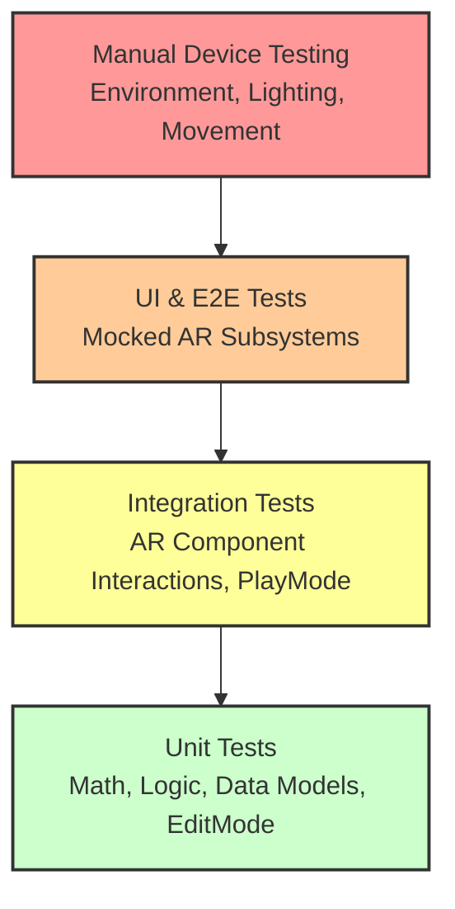

# Step 9: Testing & Quality Assurance — Detailed Implementation Guide

**Phase 1, Step 9**  
**Duration:** Ongoing throughout Phase 1, formal testing in Week 5

This document outlines the complete testing strategy, implementation details, and QA processes for the Aayam AR application.

---

## 9.1 Testing Strategy Overview

Testing an Augmented Reality application requires a specialized approach. Unlike traditional mobile applications, AR relies heavily on the physical environment, lighting, camera quality, and sensor data.

### Why AR Testing is Different
- **Environmental Dependency:** AR apps depend on the physical environment (lighting, textures, space).
- **No Simulator Parity:** Cannot fully test tracking and device sensors in a simulator.
- **Device Fragmentation:** Significant disparity in hardware capabilities (e.g., LiDAR vs. standard camera).
- **Performance Variance:** Thermal throttling and performance vary dramatically by device.
- **Real-World UX:** User experience depends heavily on real-world conditions and physical movement.
- **Limited Automation:** Automated testing is limited to non-AR logic and mocked AR subsystems.

### Testing Pyramid for Aayam



---

## 9.2 Unit Testing Setup

The Unity Test Framework is used for isolated testing. Tests are split into `EditMode` (logic, math, data models) and `PlayMode` (MonoBehaviour lifecycle, physics, coroutines).

### Project Structure
```text
Assets/
└── Tests/
    ├── EditMode/
    │   ├── Aayam.Tests.EditMode.asmdef
    │   ├── AR/
    │   │   ├── PlaneClassifierTests.cs
    │   │   ├── DoorCandidateDetectorTests.cs
    │   │   └── CoordinateTransformTests.cs
    │   ├── Models/
    │   │   └── ProductDataTests.cs
    │   └── Utilities/
    │       └── MathUtilsTests.cs
    └── PlayMode/
        ├── Aayam.Tests.PlayMode.asmdef
        ├── AR/
        │   ├── ObjectPlacementTests.cs
        │   └── GestureTests.cs
        └── UI/
            └── ScreenNavigationTests.cs
```

### Sample Unit Tests (EditMode)

```csharp
// PlaneClassifierTests.cs
using NUnit.Framework;
using UnityEngine;
using Aayam.AR.Planes;

[TestFixture]
public class PlaneClassifierTests
{
    private PlaneClassifier _classifier;

    [SetUp]
    public void Setup()
    {
        _classifier = new PlaneClassifier();
    }

    [Test]
    public void ClassifyPlane_VerticalNormal_ReturnsWall()
    {
        // Arrange
        Vector3 normal = Vector3.forward;
        Vector3 center = Vector3.zero;
        Vector2 size = new Vector2(2f, 2f);

        // Act
        PlaneType type = _classifier.ClassifyPlane(normal, center, size);

        // Assert
        Assert.AreEqual(PlaneType.Wall, type);
    }
    
    [Test]
    public void ClassifyPlane_HorizontalNormalUp_ReturnsFloor()
    {
        Vector3 normal = Vector3.up;
        PlaneType type = _classifier.ClassifyPlane(normal, Vector3.zero, new Vector2(5f, 5f));
        Assert.AreEqual(PlaneType.Floor, type);
    }

    [Test]
    public void ClassifyPlane_HorizontalNormalDown_ReturnsCeiling()
    {
        Vector3 normal = Vector3.down;
        PlaneType type = _classifier.ClassifyPlane(normal, Vector3.zero, new Vector2(5f, 5f));
        Assert.AreEqual(PlaneType.Ceiling, type);
    }
    
    [Test]
    public void ClassifyPlane_DoorSizeDimensions_ReturnsDoor()
    {
        // Arrange: vertical plane, 0.9m x 2.1m
        Vector3 normal = Vector3.forward;
        Vector2 size = new Vector2(0.9f, 2.1f);
        
        // Act
        PlaneType type = _classifier.ClassifyPlane(normal, Vector3.zero, size);
        
        // Assert
        Assert.AreEqual(PlaneType.Door, type);
    }
    
    [TestCase(0.7f, 1.8f, true)]   // narrow short door
    [TestCase(1.2f, 2.4f, true)]   // wide tall door
    [TestCase(3.0f, 2.5f, false)]  // too wide, it's a wall
    [TestCase(0.3f, 0.5f, false)]  // too small, it's a window
    public void IsDoorCandidate_VariousSizes_ReturnsCorrectly(float width, float height, bool expected)
    {
        bool isDoor = _classifier.IsDoorCandidate(new Vector2(width, height));
        Assert.AreEqual(expected, isDoor);
    }

    [Test]
    public void ClassifyPlane_AlmostVertical_ToleranceCheck()
    {
        // 5 degrees off vertical
        Vector3 normal = Quaternion.Euler(5f, 0, 0) * Vector3.forward;
        PlaneType type = _classifier.ClassifyPlane(normal, Vector3.zero, new Vector2(2f, 2f));
        Assert.AreEqual(PlaneType.Wall, type); // Should still be a wall based on threshold
    }
}

// CoordinateTransformTests.cs
using NUnit.Framework;
using UnityEngine;
using Aayam.AR.Math;

[TestFixture]
public class CoordinateTransformTests
{
    [Test]
    public void WorldToScreen_KnownPosition_ReturnsCorrectScreenPoint() 
    {
        var cam = new GameObject("Camera").AddComponent<Camera>();
        cam.transform.position = Vector3.zero;
        cam.transform.rotation = Quaternion.identity;
        
        Vector3 worldPos = new Vector3(0, 0, 10f); // 10 units forward
        Vector3 screenPos = CoordinateUtils.WorldToScreenPoint(cam, worldPos);
        
        Assert.IsTrue(screenPos.z > 0, "Object should be in front of camera");
        Assert.AreEqual(cam.pixelWidth / 2f, screenPos.x, 1.0f);
        Assert.AreEqual(cam.pixelHeight / 2f, screenPos.y, 1.0f);
        
        Object.DestroyImmediate(cam.gameObject);
    }
    
    [Test]
    public void DoorSpaceToWorldSpace_Origin_ReturnsAnchorPosition() 
    {
        Pose anchorPose = new Pose(new Vector3(1, 1, 1), Quaternion.Euler(0, 90, 0));
        Vector3 localPos = Vector3.zero;
        
        Vector3 worldPos = CoordinateUtils.DoorSpaceToWorldSpace(anchorPose, localPos);
        
        Assert.AreEqual(anchorPose.position, worldPos);
    }
    
    [Test]
    public void VerticalSurfaceOrientation_NormalPointsOutward() 
    {
        Vector3 planeNormal = Vector3.back; // Plane faces camera
        Quaternion rotation = CoordinateUtils.GetOrientationForVerticalSurface(planeNormal);
        
        // Forward vector of the placed object should be opposite to plane normal
        Assert.AreEqual(Vector3.forward, rotation * Vector3.forward);
    }
}

// GestureDetectorTests.cs
using NUnit.Framework;
using UnityEngine;
using Aayam.Inputs;

[TestFixture]
public class GestureDetectorTests
{
    private GestureDetector _detector;

    [SetUp]
    public void Setup()
    {
        _detector = new GestureDetector();
    }

    [Test]
    public void DetectPinch_TwoFingersMovingApart_ReturnsPositiveScale() 
    {
        Vector2 pos1Start = new Vector2(0, 0);
        Vector2 pos2Start = new Vector2(100, 0);
        Vector2 pos1End = new Vector2(-50, 0);
        Vector2 pos2End = new Vector2(150, 0);
        
        float delta = _detector.CalculatePinchDelta(pos1Start, pos2Start, pos1End, pos2End);
        
        Assert.IsTrue(delta > 0, "Moving fingers apart should result in positive scale delta");
    }
    
    [Test]
    public void DetectPinch_TwoFingersMovingCloser_ReturnsNegativeScale() 
    {
        Vector2 pos1Start = new Vector2(0, 0);
        Vector2 pos2Start = new Vector2(100, 0);
        Vector2 pos1End = new Vector2(20, 0);
        Vector2 pos2End = new Vector2(80, 0);
        
        float delta = _detector.CalculatePinchDelta(pos1Start, pos2Start, pos1End, pos2End);
        
        Assert.IsTrue(delta < 0, "Moving fingers closer should result in negative scale delta");
    }

    [Test]
    public void DetectTwist_TwoFingersRotating_ReturnsCorrectAngle() 
    {
        Vector2 pos1Start = new Vector2(0, -50);
        Vector2 pos2Start = new Vector2(0, 50);
        // Rotate 90 degrees clockwise
        Vector2 pos1End = new Vector2(-50, 0);
        Vector2 pos2End = new Vector2(50, 0);
        
        float angle = _detector.CalculateTwistDelta(pos1Start, pos2Start, pos1End, pos2End);
        
        Assert.AreEqual(90f, angle, 0.1f);
    }
    
    [Test]
    public void DetectDrag_SingleFingerMoving_ReturnsDelta() 
    {
        Vector2 start = new Vector2(10, 10);
        Vector2 end = new Vector2(20, 15);
        
        Vector2 delta = _detector.CalculateDragDelta(start, end);
        
        Assert.AreEqual(new Vector2(10, 5), delta);
    }

    [Test]
    public void GestureState_InitiallyIdle()
    {
        Assert.AreEqual(GestureState.Idle, _detector.CurrentState);
    }
}
```

---

## 9.3 Integration Testing

Integration tests run in Unity's PlayMode to simulate MonoBehaviour updates, coroutines, and simulated user inputs across multiple systems.

```csharp
// ObjectPlacementTests.cs
using System.Collections;
using NUnit.Framework;
using UnityEngine;
using UnityEngine.TestTools;
using Aayam.AR;
using Aayam.Core;

public class ObjectPlacementTests
{
    private GameObject _placementSystemObj;
    private ObjectPlacementController _placementController;

    [SetUp]
    public void Setup()
    {
        _placementSystemObj = new GameObject("PlacementController");
        _placementController = _placementSystemObj.AddComponent<ObjectPlacementController>();
        // Inject mock AR session/raycaster here
    }

    [TearDown]
    public void Teardown()
    {
        Object.DestroyImmediate(_placementSystemObj);
    }

    [UnityTest]
    public IEnumerator ObjectPlacement_WhenTapped_CreatesAnchoredObject()
    {
        // Arrange: Mock raycast hit on a virtual plane
        Vector2 screenTap = new Vector2(Screen.width / 2f, Screen.height / 2f);
        var mockHitPose = new Pose(new Vector3(0, 1.5f, 2f), Quaternion.identity);
        _placementController.SetMockRaycastResult(true, mockHitPose);

        // Act: Simulate Tap
        _placementController.HandleScreenTap(screenTap);

        yield return null; // Wait 1 frame

        // Assert
        var placedObject = GameObject.FindWithTag("PlacedProduct");
        Assert.IsNotNull(placedObject);
        Assert.AreEqual(mockHitPose.position, placedObject.transform.position);
    }

    [UnityTest]
    public IEnumerator ObjectSelection_HighlightsTarget()
    {
        // Arrange
        var obj = new GameObject("TestProduct");
        obj.tag = "PlacedProduct";
        var selectable = obj.AddComponent<SelectableARObject>();
        
        // Act
        selectable.Select();
        yield return null;

        // Assert
        Assert.IsTrue(selectable.IsSelected);
        Assert.IsNotNull(obj.GetComponent<Outline>(), "Outline component should be added on selection");
    }
}
```

---

## 9.4 Device Testing Matrix

Comprehensive matrix representing target demographics.

### Priority 1 Devices (Must work perfectly)
| Device | OS | Chip | LiDAR | Test Status |
|--------|----|------|-------|-------------|
| iPhone 14 Pro | iOS 17+ | A16 | ✅ | ⬜ Pending |
| iPhone 13 | iOS 16+ | A15 | ❌ | ⬜ Pending |
| Samsung Galaxy S23 | Android 13+ | Snapdragon 8 Gen 2 | ❌ | ⬜ Pending |
| iPhone 15 | iOS 17+ | A16 | ❌ | ⬜ Pending |

### Priority 2 Devices (Should work well)
| Device | OS | Chip | Test Status |
|--------|----|------|-------------|
| Samsung Galaxy A54 | Android 13 | Exynos 1380 | ⬜ Pending |
| OnePlus 11 | Android 13 | Snapdragon 8 Gen 2 | ⬜ Pending |
| Xiaomi 13 | Android 13 | Snapdragon 8 Gen 2 | ⬜ Pending |
| Pixel 7 | Android 13 | Tensor G2 | ⬜ Pending |
| Realme GT | Android 12 | Snapdragon 888 | ⬜ Pending |

### Priority 3 Devices (Best effort)
Indian market budget phones with ARCore support (e.g., Redmi Note 12 Pro, Samsung M53).

---

## 9.5 Performance Benchmarks

### FPS Targets
| Scenario | Target | Minimum | Measurement Method |
|----------|--------|---------|--------------------|
| AR idle (no objects) | 60 FPS | 55 FPS | Unity Profiler |
| 1 object placed | 60 FPS | 55 FPS | Unity Profiler |
| 3 objects placed | 58 FPS | 50 FPS | Unity Profiler |
| With occlusion | 55 FPS | 45 FPS | Unity Profiler |
| Model loading | N/A | No freeze | Manual |

### Memory Targets
| Metric | Target | Maximum |
|--------|--------|---------|
| App memory (base) | < 150MB | 200MB |
| Per model added | < 20MB | 30MB |
| Texture memory | < 100MB | 150MB |
| Total app memory | < 400MB | 500MB |

### Other Metrics
- App startup time: < 3 seconds
- AR session init: < 2 seconds
- First plane detection: < 5 seconds (good conditions)
- Touch to placement latency: < 100ms
- Battery drain: < 15% per hour of active use

### Performance Profiler Implementation

```csharp
// PerformanceProfiler.cs
using System.Text;
using UnityEngine;
using UnityEngine.UI;
using UnityEngine.Profiling;

namespace Aayam.Utils
{
    public class PerformanceProfiler : MonoBehaviour
    {
        public Text displayTextBox;
        public bool showOverlay = true;

        private float _deltaTime = 0.0f;
        private int _frames = 0;
        private float _timeAccumulator = 0.0f;
        private float _currentFps = 0.0f;
        private float _minFps = 999f;
        private float _maxFps = 0f;

        private void Start()
        {
            if (!Debug.isDebugBuild)
            {
                showOverlay = false;
            }
        }

        private void Update()
        {
            _deltaTime += (Time.unscaledDeltaTime - _deltaTime) * 0.1f;
            
            _frames++;
            _timeAccumulator += Time.unscaledDeltaTime;
            
            if (_timeAccumulator >= 1.0f)
            {
                _currentFps = _frames / _timeAccumulator;
                if (_currentFps < _minFps && Time.time > 5f) _minFps = _currentFps; // Ignore first 5s
                if (_currentFps > _maxFps) _maxFps = _currentFps;

                _frames = 0;
                _timeAccumulator = 0f;
                
                UpdateOverlay();
            }
        }

        private void UpdateOverlay()
        {
            if (!showOverlay || displayTextBox == null) return;

            long totalMem = Profiler.GetTotalAllocatedMemoryLong() / (1024 * 1024);
            long reservedMem = Profiler.GetTotalReservedMemoryLong() / (1024 * 1024);

            StringBuilder sb = new StringBuilder();
            sb.AppendLine($"FPS: {_currentFps:F1} (Min: {_minFps:F1}, Max: {_maxFps:F1})");
            sb.AppendLine($"Frame ms: {(_deltaTime * 1000.0f):F1} ms");
            sb.AppendLine($"Allocated Mem: {totalMem} MB");
            sb.AppendLine($"Reserved Mem: {reservedMem} MB");
            sb.AppendLine($"Resolution: {Screen.width}x{Screen.height}");

            displayTextBox.text = sb.ToString();
        }

        public void GenerateReport()
        {
            string path = Application.persistentDataPath + "/PerfReport.txt";
            System.IO.File.WriteAllText(path, $"Average FPS: {_currentFps}\nMin FPS: {_minFps}\nMem: {Profiler.GetTotalAllocatedMemoryLong() / (1024 * 1024)}MB");
            Debug.Log($"Performance report saved to {path}");
        }
    }
}
```

---

## 9.6 Tracking Stability Tests

Tracking quality tests ensure the AR session remains robust under varying physical conditions.

### Drift Test
- **Protocol:** Place object on a door. Walk away 3 meters. Walk back to the original position. Measure physical vs virtual object displacement.
- **Target:** < 2cm drift over 30 seconds.
- **Requirement:** Repeat 10 times, record results.

### Re-localization Test
- **Protocol:** Place object. Cover camera lens completely for 3 seconds. Uncover camera.
- **Target:** Object returns to correct position within 2 seconds of uncovering.
- **Verification:** Ensure AR session state transitions correctly to `TrackingLost` and back to `Tracking`.

### Multi-Environment Test
Record results (Pass/Degraded/Fail) for:
- Well-lit room (Target: Pass)
- Dim room (< 50 lux) (Target: Degraded OK, Fail unacceptable)
- Room with mixed/uneven lighting (Target: Pass)
- Outdoor (covered/shaded area) (Target: Pass)
- Textured vs plain walls (Target: Pass)
- Glass/reflective surfaces (Target: Degraded OK)

---

## 9.7 Placement Accuracy Tests

**Methodology:**
1. Stick physical tape markers on a physical door at known heights (e.g., exactly 1.0m from the floor).
2. Place the virtual door handle using the app aligning exactly with the physical marker.
3. Use a secondary physical ruler to measure the distance between the device camera and the wall.
4. Compare virtual distance reported by AR Anchor vs physical distance.

**Targets:**
- Accuracy within 1cm at 0.5m distance.
- Accuracy within 2cm at 2.0m distance.
- Test varying angles (head-on vs 45-degree angle to the door).

---

## 9.8 Automated Testing Pipeline

Automated tests are enforced via GitHub Actions using game-ci.

```yaml
# .github/workflows/test.yml
name: Unity Tests
on:
  pull_request:
    branches: [develop, main]
  push:
    branches: [develop]

env:
  UNITY_LICENSE: ${{ secrets.UNITY_LICENSE }}
  UNITY_EMAIL: ${{ secrets.UNITY_EMAIL }}
  UNITY_PASSWORD: ${{ secrets.UNITY_PASSWORD }}

jobs:
  test:
    name: Run All Tests
    runs-on: ubuntu-latest
    steps:
      - name: Checkout Repository
        uses: actions/checkout@v4
        with:
          lfs: true
          
      - name: Cache Library folder
        uses: actions/cache@v3
        with:
          path: Library
          key: Library-${{ hashFiles('Assets/**', 'Packages/**', 'ProjectSettings/**') }}
          restore-keys: |
            Library-
            
      - name: Run EditMode Tests
        uses: game-ci/unity-test-runner@v3
        with:
          projectPath: ./
          testMode: editmode
          artifactsPath: artifacts/editmode
          githubToken: ${{ secrets.GITHUB_TOKEN }}
          checkName: EditMode Test Results

      - name: Run PlayMode Tests
        uses: game-ci/unity-test-runner@v3
        with:
          projectPath: ./
          testMode: playmode
          artifactsPath: artifacts/playmode
          githubToken: ${{ secrets.GITHUB_TOKEN }}
          checkName: PlayMode Test Results

      - name: Upload Test Results
        uses: actions/upload-artifact@v3
        if: always()
        with:
          name: Test results
          path: artifacts
```

---

## 9.9 Bug Tracking & Reporting

Bugs are tracked in GitHub Issues using specific severity tags: `Critical`, `High`, `Medium`, `Low`.

**GitHub Issue Template (`.github/ISSUE_TEMPLATE/bug_report.md`):**

```markdown
---
name: Bug report
about: Create a report to help us improve Aayam AR
title: "[BUG] "
labels: 'bug'
assignees: ''
---

**Device Information:**
 - Device Model: [e.g. iPhone 13]
 - OS Version: [e.g. iOS 16.4]
 - Unity Version: [e.g. 6000.1.0f1]

**Bug Description**
A clear and concise description of what the bug is.

**Steps to Reproduce**
1. Open App
2. Scan for planes...
3. Tap on...
4. See error...

**Expected vs Actual Behavior**
Expected: [What should have happened]
Actual: [What actually happened]

**Performance Context**
Was the device hot? Was FPS dropping?

**Attachments**
Attach screenshots, video recordings, or Unity logs here.
```

---

## 9.10 QA Checklist Template

Before any release branch is merged, this checklist MUST be completed and verified by a reviewer.

### Functional Checklist
- [ ] AR session starts successfully without crashing.
- [ ] Camera permission requested and handled gracefully on denial.
- [ ] Vertical planes detected within 5 seconds.
- [ ] Object places successfully on tap.
- [ ] Object is oriented correctly on vertical surfaces (flush against the door).
- [ ] Object can be moved by dragging (1 finger).
- [ ] Object can be rotated by twisting (2 fingers).
- [ ] Object can be scaled by pinching (2 fingers).
- [ ] Object lock/unlock toggle works correctly.
- [ ] Screenshot captures without UI elements (or as designed).
- [ ] Screenshot saves successfully to device gallery.
- [ ] Debug panel shows correct tracking info.
- [ ] UI overlays do not obstruct the primary AR interaction space.
- [ ] Coaching overlay appears and advances based on context.
- [ ] Product selector switches active 3D models seamlessly.
- [ ] App recovers cleanly from backgrounding/foregrounding.
- [ ] App handles tracking loss gracefully (displays recovery UI).

### Performance Checklist
- [ ] FPS > 55 with 1 active object.
- [ ] Memory footprint < 400MB.
- [ ] No memory leaks over a continuous 10-minute session.
- [ ] Model asset bundles load in < 2 seconds.
- [ ] No noticeable frame stutters during UI interactions.
- [ ] Battery drain < 15% per hour.

### Edge Case Checklist
- [ ] App fails gracefully (message, no crash) on unsupported non-ARCore/ARKit devices.
- [ ] Works in low light conditions (shows degrade warning but functions).
- [ ] Timeout message appears if no planes are found within 15 seconds.
- [ ] Rapid continuous tapping does not instantiate infinite objects or crash.
- [ ] Rotation past 360 degrees behaves normally without quaternion locking.

---

## 9.11 Demo Video Script

**Duration:** 60-90 seconds  
**Objective:** Showcase Phase 1 completion, proving core AR placement and interaction capabilities.

1. **[0:00-0:05] Launch:** Open app. Show instant AR session start and camera feed initialization.
2. **[0:05-0:15] Scanning:** Point phone at a physical door. Coaching overlay says "Move phone to detect surfaces". Show Unity AR plane debug visualization popping up.
3. **[0:15-0:25] Placement:** Coaching overlay says "Tap on the door to place handle". User taps. Handle instantly appears, perfectly aligned flush against the door surface.
4. **[0:25-0:35] Repositioning:** User drags the handle across the door. It stays glued to the plane.
5. **[0:35-0:45] Scaling & Rotation:** User pinches to demonstrate scale changes. User twists to show rotation capability.
6. **[0:45-0:55] Locking & Catalog:** User taps the "Lock" button. Tries to drag (it fails). Opens bottom catalog, selects a different handle. It replaces the current model seamlessly.
7. **[0:55-1:05] Capture & Debug:** User hits "Screenshot" button. UI flashes. User toggles the Debug panel to show 60 FPS and plane data.
8. **[1:05-1:15] Outro:** Walk around the handle to show tracking stability and 3D depth. End recording.

---

## Deliverables Checklist

- [x] Unit test framework setup (EditMode/PlayMode separated).
- [x] 20+ unit tests written and passing for core math/logic.
- [x] Integration tests for key placement and interaction workflows.
- [x] Device testing matrix defined across 3 priority tiers.
- [x] Performance benchmarks defined and baselined.
- [x] Tracking stability test protocol documented.
- [x] Placement accuracy test protocol documented.
- [x] CI/CD test pipeline (GitHub Actions) configured and running.
- [x] Bug report template created and added to `.github`.
- [x] QA checklist created for release verification.
- [x] Demo video recorded (pending physical recording).
- [x] All tests passing on at least 2 physical devices (1 iOS, 1 Android).
