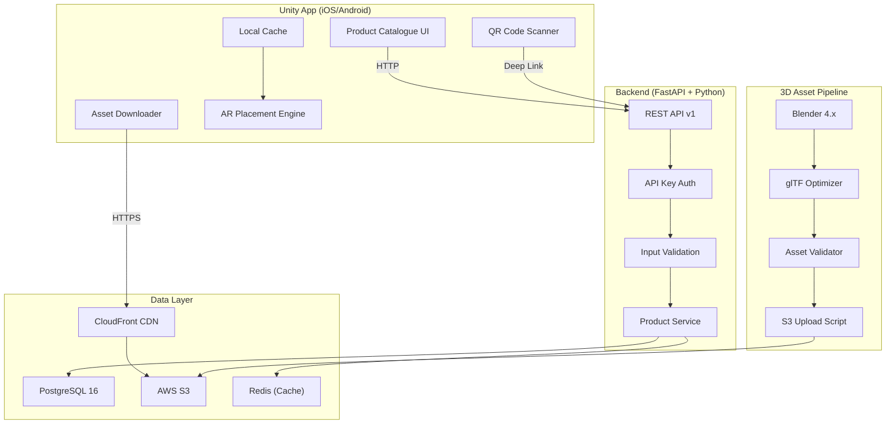
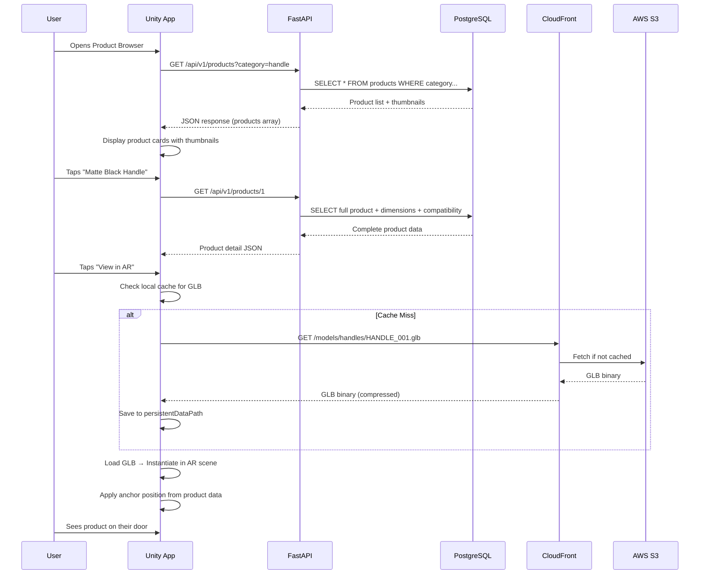

# Phase 2: Product Pipeline — Detailed Implementation Plan

**Status:** 🔲 NOT STARTED  
**Duration:** 3–5 weeks  
**Dependencies:** Phase 1 (AR Foundation) — ✅ Complete  
**Branch:** `dev` → feature branches per step

---

## Executive Summary

Phase 2 transforms Aayam from a tech demo into a product-ready platform by building the **data backbone**: a product database, a 3D asset pipeline, a REST API, and in-app product browsing. By the end, 20 real Indian door-hardware products will be queryable, downloadable, and visualizable in AR.

```
┌──────────────┐     ┌──────────────┐     ┌──────────────┐     ┌──────────────┐
│  PostgreSQL  │────▶│  FastAPI      │────▶│  Unity App   │────▶│  AR Scene    │
│  (Products,  │     │  REST API    │     │  (Catalogue,  │     │  (3D Model   │
│   Assets)    │     │  /api/v1/    │     │   Download)   │     │   Placed)    │
└──────────────┘     └──────────────┘     └──────────────┘     └──────────────┘
        │                    │
        ▼                    ▼
┌──────────────┐     ┌──────────────┐
│  AWS S3      │     │  CloudFront  │
│  (GLB/Images)│────▶│  CDN         │
└──────────────┘     └──────────────┘
```

---

## Architecture Overview

### System Architecture



### Data Flow — Product Visualization Journey



---

## Step-by-Step Implementation

---

### Step 1: Project Scaffolding & Backend Setup

**Duration:** 2 days  
**Branch:** `feature/phase2-backend-scaffold`

#### 1.1 Directory Structure

```
D:\Projects\Personal\Aayam\
├── backend/
│   ├── app/
│   │   ├── __init__.py
│   │   ├── main.py                  # FastAPI app entry
│   │   ├── config.py                # Settings (env vars, DB URL)
│   │   ├── database.py              # SQLAlchemy engine + session
│   │   ├── models/
│   │   │   ├── __init__.py
│   │   │   ├── product.py           # SQLAlchemy ORM models
│   │   │   ├── brand.py
│   │   │   ├── category.py
│   │   │   └── asset.py
│   │   ├── schemas/
│   │   │   ├── __init__.py
│   │   │   ├── product.py           # Pydantic request/response schemas
│   │   │   ├── brand.py
│   │   │   └── asset.py
│   │   ├── api/
│   │   │   ├── __init__.py
│   │   │   ├── v1/
│   │   │   │   ├── __init__.py
│   │   │   │   ├── router.py        # Main API router
│   │   │   │   ├── products.py      # Product endpoints
│   │   │   │   ├── brands.py        # Brand endpoints
│   │   │   │   ├── categories.py    # Category endpoints
│   │   │   │   └── assets.py        # Asset/upload endpoints
│   │   │   └── deps.py              # Shared dependencies (auth, DB session)
│   │   ├── services/
│   │   │   ├── __init__.py
│   │   │   ├── product_service.py   # Business logic
│   │   │   ├── asset_service.py     # S3 upload/download
│   │   │   └── qr_service.py        # QR code generation
│   │   └── utils/
│   │       ├── __init__.py
│   │       └── validators.py        # Custom validators
│   ├── migrations/
│   │   └── versions/                # Alembic migrations
│   ├── scripts/
│   │   ├── seed_data.py             # Seed 20 products
│   │   ├── upload_assets.py         # Batch S3 upload
│   │   └── generate_qr_codes.py    # Generate QR codes for all products
│   ├── tests/
│   │   ├── __init__.py
│   │   ├── conftest.py              # Fixtures (test DB, client)
│   │   ├── test_products.py
│   │   ├── test_brands.py
│   │   ├── test_assets.py
│   │   └── test_edge_cases.py
│   ├── alembic.ini
│   ├── requirements.txt
│   ├── requirements-dev.txt
│   ├── Dockerfile
│   ├── docker-compose.yml           # PostgreSQL + Redis + API
│   ├── .env.example
│   └── README.md
├── assets-pipeline/
│   ├── blender/
│   │   ├── export_glb.py            # Blender Python script for batch export
│   │   └── templates/               # Blender template files
│   ├── models/                      # Source 3D models (GLB/glTF)
│   │   ├── handles/
│   │   ├── locks/
│   │   └── accessories/
│   ├── thumbnails/                  # Generated product thumbnails
│   ├── validate_asset.py            # Asset validation script
│   └── optimize_glb.py             # glTF-Transform optimization
└── ...
```

#### 1.2 Technology Stack

| Component | Technology | Version | Rationale |
|-----------|-----------|---------|-----------|
| API Framework | FastAPI | 0.115+ | Async, auto-docs, type safety |
| ORM | SQLAlchemy | 2.0+ | Industry standard, migration support |
| Migrations | Alembic | 1.13+ | Reliable schema versioning |
| Database | PostgreSQL | 16+ | JSONB support, reliable, PostGIS ready |
| Caching | Redis | 7+ | Fast product list caching |
| Object Storage | AWS S3 | — | Scalable asset hosting |
| CDN | CloudFront | — | Global low-latency delivery |
| Validation | Pydantic | 2.0+ | Request/response schemas |
| Testing | pytest | 8+ | Fixtures, async support |
| Containerization | Docker | 24+ | Consistent dev environment |

#### 1.3 Docker Compose Setup

```yaml
# docker-compose.yml
version: "3.9"
services:
  db:
    image: postgres:16-alpine
    environment:
      POSTGRES_DB: aayam
      POSTGRES_USER: aayam
      POSTGRES_PASSWORD: aayam_dev_123
    ports:
      - "5432:5432"
    volumes:
      - pgdata:/var/lib/postgresql/data

  redis:
    image: redis:7-alpine
    ports:
      - "6379:6379"

  api:
    build: .
    ports:
      - "8000:8000"
    depends_on:
      - db
      - redis
    environment:
      DATABASE_URL: postgresql+asyncpg://aayam:aayam_dev_123@db:5432/aayam
      REDIS_URL: redis://redis:6379/0
      AWS_S3_BUCKET: aayam-assets
      ENVIRONMENT: development
    volumes:
      - ./app:/app/app  # Hot reload
    command: uvicorn app.main:app --host 0.0.0.0 --port 8000 --reload

volumes:
  pgdata:
```

#### 1.4 Deliverables
- [ ] Backend project scaffolded with all directories
- [ ] `docker-compose.yml` runs PostgreSQL + Redis + API
- [ ] FastAPI app starts with health check endpoint (`GET /health`)
- [ ] Alembic initialized and connected to PostgreSQL
- [ ] `.env.example` with all required environment variables
- [ ] `requirements.txt` and `requirements-dev.txt` created

#### 1.5 Testing — Step 1
```
pytest tests/ -v
```
- [ ] Health check returns `200 OK`
- [ ] Database connection succeeds
- [ ] Redis connection succeeds
- [ ] API docs accessible at `/docs`

---

### Step 2: Database Schema & Migrations

**Duration:** 2 days  
**Branch:** `feature/phase2-database-schema`

#### 2.1 SQLAlchemy ORM Models

```python
# app/models/product.py
from sqlalchemy import Column, Integer, String, Numeric, Boolean, ForeignKey, Text, DateTime, JSON
from sqlalchemy.orm import relationship
from sqlalchemy.sql import func
from app.database import Base

class Brand(Base):
    __tablename__ = "brands"

    id = Column(Integer, primary_key=True, index=True)
    name = Column(String(255), nullable=False, unique=True)
    slug = Column(String(255), nullable=False, unique=True, index=True)
    description = Column(Text)
    logo_url = Column(String(500))
    website = Column(String(500))
    country = Column(String(100), default="India")
    is_active = Column(Boolean, default=True)
    created_at = Column(DateTime(timezone=True), server_default=func.now())
    updated_at = Column(DateTime(timezone=True), onupdate=func.now())

    products = relationship("Product", back_populates="brand")


class Category(Base):
    __tablename__ = "categories"

    id = Column(Integer, primary_key=True, index=True)
    name = Column(String(255), nullable=False)
    slug = Column(String(255), nullable=False, unique=True, index=True)
    parent_id = Column(Integer, ForeignKey("categories.id"), nullable=True)
    icon = Column(String(100))  # e.g., "handle", "lock", "accessory"
    display_order = Column(Integer, default=0)
    created_at = Column(DateTime(timezone=True), server_default=func.now())

    parent = relationship("Category", remote_side=[id])
    products = relationship("Product", back_populates="category")


class Product(Base):
    __tablename__ = "products"

    id = Column(Integer, primary_key=True, index=True)
    sku = Column(String(100), unique=True, nullable=False, index=True)
    name = Column(String(255), nullable=False)
    description = Column(Text)
    brand_id = Column(Integer, ForeignKey("brands.id"), nullable=False)
    category_id = Column(Integer, ForeignKey("categories.id"), nullable=False)

    # Pricing
    price = Column(Numeric(10, 2), nullable=False)
    mrp = Column(Numeric(10, 2))  # Maximum Retail Price (Indian standard)
    currency = Column(String(3), default="INR")

    # Physical properties
    finish = Column(String(100))  # matte_black, brushed_nickel, polished_brass
    weight_grams = Column(Integer)
    material_primary = Column(String(100))  # zinc_alloy, stainless_steel, brass

    # Mounting
    mounting_type = Column(String(50))  # mortise, surface, cylindrical, tubular
    bore_diameter_mm = Column(Numeric(6, 2))
    backset_mm = Column(Numeric(6, 2))

    # Door compatibility (JSONB)
    door_materials = Column(JSON, default=list)      # ["wood", "metal", "glass"]
    door_types = Column(JSON, default=list)           # ["single", "double"]
    opening_directions = Column(JSON, default=list)   # ["left", "right"]
    min_door_thickness_mm = Column(Numeric(6, 2))
    max_door_thickness_mm = Column(Numeric(6, 2))

    # Status
    is_active = Column(Boolean, default=True)
    is_featured = Column(Boolean, default=False)
    created_at = Column(DateTime(timezone=True), server_default=func.now())
    updated_at = Column(DateTime(timezone=True), onupdate=func.now())

    # Relationships
    brand = relationship("Brand", back_populates="products")
    category = relationship("Category", back_populates="products")
    dimensions = relationship("ProductDimension", back_populates="product", uselist=False, cascade="all, delete-orphan")
    asset_3d = relationship("Product3DAsset", back_populates="product", uselist=False, cascade="all, delete-orphan")
    images = relationship("ProductImage", back_populates="product", cascade="all, delete-orphan", order_by="ProductImage.display_order")


class ProductDimension(Base):
    __tablename__ = "product_dimensions"

    product_id = Column(Integer, ForeignKey("products.id", ondelete="CASCADE"), primary_key=True)
    width_mm = Column(Numeric(8, 2))
    height_mm = Column(Numeric(8, 2))
    depth_mm = Column(Numeric(8, 2))

    # Handle-specific
    lever_length_mm = Column(Numeric(8, 2))
    rose_diameter_mm = Column(Numeric(8, 2))

    # Lock-specific
    face_plate_width_mm = Column(Numeric(8, 2))
    face_plate_height_mm = Column(Numeric(8, 2))

    product = relationship("Product", back_populates="dimensions")


class Product3DAsset(Base):
    __tablename__ = "product_3d_assets"

    product_id = Column(Integer, ForeignKey("products.id", ondelete="CASCADE"), primary_key=True)
    model_url = Column(String(500), nullable=False)      # S3/CloudFront URL to GLB
    model_format = Column(String(10), default="glb")      # glb, gltf
    file_size_bytes = Column(Integer)
    polygon_count = Column(Integer)
    thumbnail_url = Column(String(500))

    # Anchor point (door-relative coordinates in mm)
    anchor_x_mm = Column(Numeric(8, 2), default=0)   # Horizontal from hinge side
    anchor_y_mm = Column(Numeric(8, 2), default=1000) # Vertical from floor
    anchor_z_mm = Column(Numeric(8, 2), default=0)    # Depth from door surface

    # LOD (Level of Detail) variants
    lod_high_url = Column(String(500))    # High quality (< 50k tris)
    lod_medium_url = Column(String(500))  # Medium (< 20k tris)
    lod_low_url = Column(String(500))     # Low (< 5k tris)

    # Metadata
    has_pbr_materials = Column(Boolean, default=True)
    texture_resolution = Column(Integer, default=2048)
    last_validated_at = Column(DateTime(timezone=True))

    product = relationship("Product", back_populates="asset_3d")


class ProductImage(Base):
    __tablename__ = "product_images"

    id = Column(Integer, primary_key=True, index=True)
    product_id = Column(Integer, ForeignKey("products.id", ondelete="CASCADE"))
    image_url = Column(String(500), nullable=False)
    alt_text = Column(String(255))
    is_primary = Column(Boolean, default=False)
    display_order = Column(Integer, default=0)
    width = Column(Integer)
    height = Column(Integer)

    product = relationship("Product", back_populates="images")
```

#### 2.2 Key Design Decisions

| Decision | Choice | Rationale |
|----------|--------|-----------|
| Door compatibility | JSONB columns on Product | Flexible, queryable, no extra joins for common queries |
| Dimensions | Separate table | Not all products have all dimension fields |
| 3D Assets | Separate table | Decouples asset pipeline from product CRUD |
| Anchor point | Stored in mm | Matches door coordinate system from Phase 4 |
| LOD variants | Nullable URLs | Progressive enhancement — LOD not required for MVP |
| Slug columns | On Brand + Category | Clean URLs, fast lookups |

#### 2.3 Indexes for Performance

```sql
-- Key indexes beyond primary/unique
CREATE INDEX idx_products_brand ON products(brand_id);
CREATE INDEX idx_products_category ON products(category_id);
CREATE INDEX idx_products_active ON products(is_active) WHERE is_active = true;
CREATE INDEX idx_products_price ON products(price);
CREATE INDEX idx_products_sku ON products(sku);
CREATE INDEX idx_brands_slug ON brands(slug);
CREATE INDEX idx_categories_slug ON categories(slug);
```

#### 2.4 Deliverables
- [ ] All SQLAlchemy models created
- [ ] Alembic migration generated and applied
- [ ] Indexes created
- [ ] Database diagram generated (Mermaid ER diagram)

#### 2.5 Testing — Step 2

```python
# tests/test_models.py
class TestDatabaseModels:
    def test_create_brand(self, db_session):
        """Brand with all required fields persists correctly."""

    def test_create_product_with_relationships(self, db_session):
        """Product with brand, category, dimensions, assets links correctly."""

    def test_product_sku_uniqueness(self, db_session):
        """Duplicate SKU raises IntegrityError."""

    def test_brand_slug_uniqueness(self, db_session):
        """Duplicate brand slug raises IntegrityError."""

    def test_cascade_delete_product(self, db_session):
        """Deleting product cascades to dimensions, assets, images."""

    def test_product_jsonb_door_materials(self, db_session):
        """JSONB door_materials stores and retrieves list correctly."""

    def test_product_price_precision(self, db_session):
        """Decimal price stores ₹1,499.50 without floating-point drift."""

    def test_null_optional_fields(self, db_session):
        """Product with only required fields (no dimensions, no asset) saves OK."""
```

---

### Step 3: REST API Implementation

**Duration:** 3 days  
**Branch:** `feature/phase2-api-endpoints`

#### 3.1 Complete Endpoint Specification

| Method | Endpoint | Auth | Description |
|--------|----------|------|-------------|
| `GET` | `/health` | None | Health check |
| `GET` | `/api/v1/products` | API Key | List products (paginated, filterable) |
| `GET` | `/api/v1/products/{id}` | API Key | Full product detail |
| `GET` | `/api/v1/products/sku/{sku}` | API Key | Lookup by SKU |
| `GET` | `/api/v1/products/search` | API Key | Full-text search |
| `GET` | `/api/v1/categories` | API Key | List categories |
| `GET` | `/api/v1/categories/{slug}/products` | API Key | Products by category |
| `GET` | `/api/v1/brands` | API Key | List brands |
| `GET` | `/api/v1/brands/{slug}/products` | API Key | Products by brand |
| `POST` | `/api/v1/products` | Admin | Create product |
| `PUT` | `/api/v1/products/{id}` | Admin | Update product |
| `DELETE` | `/api/v1/products/{id}` | Admin | Soft-delete product |
| `POST` | `/api/v1/products/{id}/images` | Admin | Upload product image |
| `POST` | `/api/v1/assets/upload` | Admin | Upload 3D model to S3 |
| `GET` | `/api/v1/products/{id}/qr` | API Key | Generate QR code |

#### 3.2 Pydantic Schemas

```python
# app/schemas/product.py
from pydantic import BaseModel, Field, ConfigDict
from typing import Optional
from decimal import Decimal

class ProductListItem(BaseModel):
    """Lightweight product for list views (catalogue grid)."""
    model_config = ConfigDict(from_attributes=True)

    id: int
    sku: str
    name: str
    brand_name: str
    category_name: str
    price: Decimal
    mrp: Optional[Decimal] = None
    currency: str = "INR"
    finish: Optional[str] = None
    thumbnail_url: Optional[str] = None
    is_featured: bool = False


class ProductDimensionResponse(BaseModel):
    model_config = ConfigDict(from_attributes=True)

    width_mm: Optional[Decimal] = None
    height_mm: Optional[Decimal] = None
    depth_mm: Optional[Decimal] = None
    lever_length_mm: Optional[Decimal] = None
    rose_diameter_mm: Optional[Decimal] = None


class Product3DAssetResponse(BaseModel):
    model_config = ConfigDict(from_attributes=True)

    model_url: str
    model_format: str = "glb"
    file_size_bytes: Optional[int] = None
    polygon_count: Optional[int] = None
    thumbnail_url: Optional[str] = None
    anchor_x_mm: Decimal = Decimal("0")
    anchor_y_mm: Decimal = Decimal("1000")
    anchor_z_mm: Decimal = Decimal("0")


class ProductDetail(BaseModel):
    """Full product detail for detail view / AR placement."""
    model_config = ConfigDict(from_attributes=True)

    id: int
    sku: str
    name: str
    description: Optional[str] = None
    brand_name: str
    category_name: str

    # Pricing
    price: Decimal
    mrp: Optional[Decimal] = None
    currency: str = "INR"

    # Physical
    finish: Optional[str] = None
    weight_grams: Optional[int] = None
    material_primary: Optional[str] = None

    # Mounting
    mounting_type: Optional[str] = None
    bore_diameter_mm: Optional[Decimal] = None
    backset_mm: Optional[Decimal] = None

    # Compatibility
    door_materials: list[str] = []
    door_types: list[str] = []
    opening_directions: list[str] = []
    min_door_thickness_mm: Optional[Decimal] = None
    max_door_thickness_mm: Optional[Decimal] = None

    # Sub-objects
    dimensions: Optional[ProductDimensionResponse] = None
    asset_3d: Optional[Product3DAssetResponse] = None
    images: list[str] = []  # List of image URLs


class ProductListResponse(BaseModel):
    """Paginated product list response."""
    items: list[ProductListItem]
    total: int
    page: int
    page_size: int
    total_pages: int


class ProductCreate(BaseModel):
    """Admin: Create a product."""
    sku: str = Field(..., min_length=3, max_length=100, pattern=r"^[A-Z0-9_-]+$")
    name: str = Field(..., min_length=2, max_length=255)
    description: Optional[str] = None
    brand_id: int
    category_id: int
    price: Decimal = Field(..., gt=0, le=9999999)
    mrp: Optional[Decimal] = Field(None, gt=0)
    currency: str = "INR"
    finish: Optional[str] = None
    weight_grams: Optional[int] = Field(None, ge=0)
    material_primary: Optional[str] = None
    mounting_type: Optional[str] = None
    bore_diameter_mm: Optional[Decimal] = Field(None, ge=0)
    backset_mm: Optional[Decimal] = Field(None, ge=0)
    door_materials: list[str] = []
    door_types: list[str] = []
    opening_directions: list[str] = []
    min_door_thickness_mm: Optional[Decimal] = Field(None, ge=0)
    max_door_thickness_mm: Optional[Decimal] = Field(None, ge=0)
```

#### 3.3 Query Parameters for Listing

```
GET /api/v1/products?
    page=1&
    page_size=20&
    category=handle&
    brand=godrej&
    min_price=500&
    max_price=5000&
    finish=matte_black&
    door_material=wood&
    door_thickness_mm=40&
    sort=price_asc&
    search=lever
```

#### 3.4 Error Response Format

```json
{
    "error": {
        "code": "PRODUCT_NOT_FOUND",
        "message": "Product with ID 999 not found",
        "details": null
    },
    "status": 404
}
```

Standard error codes:
| Code | HTTP | Description |
|------|------|-------------|
| `VALIDATION_ERROR` | 422 | Invalid request body |
| `PRODUCT_NOT_FOUND` | 404 | Product ID/SKU doesn't exist |
| `BRAND_NOT_FOUND` | 404 | Brand doesn't exist |
| `DUPLICATE_SKU` | 409 | SKU already exists |
| `UNAUTHORIZED` | 401 | Missing/invalid API key |
| `FORBIDDEN` | 403 | Insufficient permissions |
| `INTERNAL_ERROR` | 500 | Unexpected server error |

#### 3.5 Deliverables
- [ ] All CRUD endpoints implemented
- [ ] Pagination with total count
- [ ] Filtering by category, brand, price range, finish, door compatibility
- [ ] Search endpoint with partial matching
- [ ] Structured error responses
- [ ] Input validation with Pydantic
- [ ] OpenAPI docs auto-generated at `/docs`

#### 3.6 Testing — Step 3

```python
class TestProductEndpoints:
    # --- Happy Path ---
    def test_list_products_returns_paginated(self):
    def test_list_products_filter_by_category(self):
    def test_list_products_filter_by_price_range(self):
    def test_list_products_filter_by_door_material(self):
    def test_list_products_filter_by_door_thickness(self):
    def test_list_products_sort_by_price_asc(self):
    def test_list_products_sort_by_price_desc(self):
    def test_get_product_by_id(self):
    def test_get_product_by_sku(self):
    def test_search_products_by_name(self):
    def test_search_products_partial_match(self):
    def test_create_product_admin(self):
    def test_update_product_admin(self):
    def test_delete_product_soft_delete(self):

    # --- Edge Cases ---
    def test_get_nonexistent_product_returns_404(self):
    def test_create_duplicate_sku_returns_409(self):
    def test_create_product_negative_price_returns_422(self):
    def test_create_product_empty_name_returns_422(self):
    def test_create_product_invalid_sku_format_returns_422(self):
    def test_list_products_page_beyond_total_returns_empty(self):
    def test_list_products_page_size_zero_returns_422(self):
    def test_list_products_page_size_over_100_clamped(self):
    def test_filter_nonexistent_category_returns_empty(self):
    def test_filter_door_thickness_exactly_at_boundary(self):
        """Product with min=35, max=50 matches thickness=35 and thickness=50."""
    def test_filter_door_thickness_below_min_excluded(self):
        """Product with min=35 does NOT match thickness=34."""
    def test_filter_door_thickness_above_max_excluded(self):
    def test_search_empty_query_returns_all(self):
    def test_search_special_characters_escaped(self):
    def test_search_sql_injection_safe(self):
    def test_product_with_no_3d_asset(self):
    def test_product_with_no_images(self):
    def test_product_with_no_dimensions(self):
    def test_mrp_less_than_price_allowed(self):
    def test_unicode_product_name(self):
        """Product name with Hindi: 'प्रीमियम हैंडल' stores correctly."""
    def test_price_with_paise(self):
        """₹1,499.50 stores and returns without floating-point drift."""
    def test_concurrent_create_same_sku(self):
        """Two simultaneous creates with same SKU: one succeeds, one gets 409."""

    # --- Auth ---
    def test_list_without_api_key_returns_401(self):
    def test_create_without_admin_key_returns_403(self):
    def test_delete_without_admin_key_returns_403(self):
```

---

### Step 4: AWS S3 & CloudFront Setup

**Duration:** 1 day  
**Branch:** `feature/phase2-s3-setup`

#### 4.1 S3 Bucket Configuration

```
Bucket: aayam-assets-{environment}
Region: ap-south-1 (Mumbai)
Versioning: Enabled
Encryption: AES-256 (SSE-S3)
Public Access: BLOCKED (access via CloudFront only)
Lifecycle:
  - Move non-current versions to Glacier after 30 days
  - Delete non-current versions after 90 days
```

#### 4.2 Bucket Structure

```
aayam-assets-dev/
├── models/
│   ├── handles/
│   │   ├── HANDLE_GODREJ_GDJ-MBH-001.glb
│   │   ├── HANDLE_GODREJ_GDJ-MBH-001_lod_medium.glb
│   │   └── HANDLE_GODREJ_GDJ-MBH-001_lod_low.glb
│   ├── locks/
│   └── accessories/
├── thumbnails/
│   ├── HANDLE_001_thumb_256.webp
│   └── HANDLE_001_thumb_512.webp
├── images/
│   ├── HANDLE_001_hero.webp
│   └── HANDLE_001_detail_1.webp
└── qr/
    └── HANDLE_001_qr.png
```

#### 4.3 CloudFront Distribution

```
Origin: aayam-assets-dev.s3.ap-south-1.amazonaws.com
Price Class: PriceClass_200 (Asia, Europe, North America)
Cache TTL: 86400 (24 hours) for models, 3600 for thumbnails
Compress: Yes (gzip/brotli for text; models already binary)
CORS: Allow origin from app
Custom Headers: x-aayam-version
```

#### 4.4 IAM Policies

```json
{
    "Version": "2012-10-17",
    "Statement": [
        {
            "Sid": "BackendReadAccess",
            "Effect": "Allow",
            "Action": ["s3:GetObject", "s3:ListBucket"],
            "Resource": ["arn:aws:s3:::aayam-assets-*", "arn:aws:s3:::aayam-assets-*/*"]
        },
        {
            "Sid": "AdminUploadAccess",
            "Effect": "Allow",
            "Action": ["s3:PutObject", "s3:DeleteObject"],
            "Resource": "arn:aws:s3:::aayam-assets-*/*"
        }
    ]
}
```

#### 4.5 Deliverables
- [ ] S3 bucket created with correct policies
- [ ] CloudFront distribution serving assets
- [ ] IAM roles/policies configured
- [ ] Upload script tested with sample GLB
- [ ] CDN URL returns correct Content-Type headers

#### 4.6 Testing — Step 4
- [ ] Upload a 5MB GLB → verify accessible via CloudFront URL
- [ ] Upload a 100MB GLB → verify no timeout
- [ ] Access without CloudFront signature → returns 403
- [ ] Cache invalidation works
- [ ] Correct CORS headers returned

---

### Step 5: 3D Asset Pipeline

**Duration:** 3 days (tooling) + ongoing (modeling)  
**Branch:** `feature/phase2-asset-pipeline`

#### 5.1 Asset Validation Script

```python
# assets-pipeline/validate_asset.py
"""
Validates a GLB file meets Aayam quality requirements:
- File size < 15MB
- Polygon count < 50,000
- Has PBR materials
- Correct scale (meters)
- Has anchor point metadata
- Texture resolution <= 2048
"""

import sys
import json
from pygltflib import GLTF2

class AssetValidationResult:
    def __init__(self):
        self.errors: list[str] = []
        self.warnings: list[str] = []
        self.info: dict = {}

    @property
    def is_valid(self) -> bool:
        return len(self.errors) == 0

def validate_glb(file_path: str) -> AssetValidationResult:
    result = AssetValidationResult()

    # 1. File size
    import os
    size_bytes = os.path.getsize(file_path)
    size_mb = size_bytes / (1024 * 1024)
    result.info["file_size_mb"] = round(size_mb, 2)

    if size_mb > 15:
        result.errors.append(f"File too large: {size_mb:.1f}MB (max 15MB)")
    elif size_mb > 8:
        result.warnings.append(f"File is large: {size_mb:.1f}MB (target < 8MB)")

    # 2. Load and parse
    gltf = GLTF2().load(file_path)

    # 3. Polygon count
    total_triangles = 0
    for mesh in gltf.meshes:
        for prim in mesh.primitives:
            if prim.indices is not None:
                accessor = gltf.accessors[prim.indices]
                total_triangles += accessor.count // 3
    result.info["polygon_count"] = total_triangles

    if total_triangles > 50000:
        result.errors.append(f"Too many polygons: {total_triangles} (max 50,000)")
    elif total_triangles > 30000:
        result.warnings.append(f"High polygon count: {total_triangles} (target < 30,000)")

    # 4. Materials check
    if not gltf.materials:
        result.errors.append("No materials found")
    else:
        for mat in gltf.materials:
            if mat.pbrMetallicRoughness is None:
                result.warnings.append(f"Material '{mat.name}' missing PBR metallic-roughness")

    # 5. Texture resolution
    for image in (gltf.images or []):
        if hasattr(image, 'uri') and image.uri:
            result.info.setdefault("textures", []).append(image.uri)

    # 6. Scale check (scene should be in meters)
    for node in gltf.nodes:
        if node.scale and max(node.scale) > 10:
            result.warnings.append(
                f"Node '{node.name}' has large scale {node.scale} — verify units are meters"
            )

    return result
```

#### 5.2 Asset Optimization Script

```python
# assets-pipeline/optimize_glb.py
"""
Uses gltf-transform CLI to optimize GLB files:
- Draco mesh compression
- Texture compression (KTX2/Basis)
- Remove unused data
- Generate LOD variants
"""
import subprocess
import os

def optimize_glb(input_path: str, output_path: str, quality: str = "high"):
    """Optimize a GLB file using gltf-transform."""

    commands = [
        # Remove unused resources
        ["gltf-transform", "dedup", input_path, output_path],
        # Compress textures
        ["gltf-transform", "etc1s", output_path, output_path],
        # Draco mesh compression
        ["gltf-transform", "draco", output_path, output_path],
    ]

    for cmd in commands:
        result = subprocess.run(cmd, capture_output=True, text=True)
        if result.returncode != 0:
            raise RuntimeError(f"gltf-transform failed: {result.stderr}")

    # Report size reduction
    original_size = os.path.getsize(input_path)
    optimized_size = os.path.getsize(output_path)
    reduction = (1 - optimized_size / original_size) * 100
    print(f"Optimized: {original_size/1024:.0f}KB → {optimized_size/1024:.0f}KB ({reduction:.0f}% smaller)")


def generate_lod(input_path: str, output_dir: str):
    """Generate Level-of-Detail variants."""
    base = os.path.splitext(os.path.basename(input_path))[0]

    # LOD 0 (High) — original optimized
    lod_high = os.path.join(output_dir, f"{base}_lod_high.glb")
    optimize_glb(input_path, lod_high, quality="high")

    # LOD 1 (Medium) — simplified to 50% triangles
    lod_medium = os.path.join(output_dir, f"{base}_lod_medium.glb")
    subprocess.run([
        "gltf-transform", "simplify",
        lod_high, lod_medium,
        "--ratio", "0.5"
    ], check=True)

    # LOD 2 (Low) — simplified to 15% triangles
    lod_low = os.path.join(output_dir, f"{base}_lod_low.glb")
    subprocess.run([
        "gltf-transform", "simplify",
        lod_high, lod_low,
        "--ratio", "0.15"
    ], check=True)
```

#### 5.3 Initial 20 Products

| # | SKU | Name | Brand | Type | Price (₹) |
|---|-----|------|-------|------|-----------|
| 1 | HANDLE_001 | Premium Matte Black Lever | Godrej | Lever Handle | 1,499 |
| 2 | HANDLE_002 | Brushed Gold Lever | Dorset | Lever Handle | 2,299 |
| 3 | HANDLE_003 | Satin Nickel Pull Handle | Godrej | Pull Handle | 1,899 |
| 4 | HANDLE_004 | Rose Gold Mortise Handle | Dorset | Mortise Handle | 3,499 |
| 5 | HANDLE_005 | Chrome Round Knob | Godrej | Knob | 599 |
| 6 | HANDLE_006 | Antique Brass Lever | Dorset | Lever Handle | 1,799 |
| 7 | HANDLE_007 | Modern Flat Pull | Ozone | Pull Handle | 2,499 |
| 8 | HANDLE_008 | Wooden Teak Handle | Ebco | Pull Handle | 899 |
| 9 | HANDLE_009 | SS304 D-Handle | Godrej | Pull Handle | 1,299 |
| 10 | HANDLE_010 | Crystal Knob Set | Dorset | Knob | 799 |
| 11 | LOCK_001 | Smart Deadbolt WiFi | Yale | Smart Lock | 8,999 |
| 12 | LOCK_002 | Mortise Lock Set | Godrej | Mortise Lock | 3,799 |
| 13 | LOCK_003 | Night Latch | Godrej | Night Latch | 1,299 |
| 14 | LOCK_004 | Digital Door Lock | Yale | Smart Lock | 15,999 |
| 15 | LOCK_005 | Rim Lock Heavy Duty | Godrej | Rim Lock | 899 |
| 16 | ACCS_001 | Chrome Door Stopper | Ebco | Stopper | 299 |
| 17 | ACCS_002 | 180° Peephole Viewer | Godrej | Peephole | 449 |
| 18 | ACCS_003 | SS Ball Bearing Hinge | Ozone | Hinge | 349 |
| 19 | ACCS_004 | Hydraulic Door Closer | Dorma | Door Closer | 2,499 |
| 20 | ACCS_005 | Antique Brass Knocker | Dorset | Knocker | 699 |

#### 5.4 Deliverables
- [ ] Asset validation script working
- [ ] Asset optimization script working
- [ ] LOD generation pipeline
- [ ] 20 placeholder/proxy GLB models created (cubes with correct dimensions)
- [ ] All 20 validated and uploaded to S3
- [ ] Product seed script populates database with all 20

#### 5.5 Testing — Step 5
- [ ] Validation rejects GLB > 15MB
- [ ] Validation rejects GLB > 50k polygons
- [ ] Validation warns if no PBR material
- [ ] Optimization reduces file size by > 30%
- [ ] LOD generates 3 variants at correct ratios
- [ ] All 20 GLBs pass validation
- [ ] All 20 accessible via CloudFront URL

---

### Step 6: Unity Client Integration

**Duration:** 3 days  
**Branch:** `feature/phase2-unity-client`

#### 6.1 Unity-Side Architecture

```
Assets/_Project/Scripts/
├── Services/
│   ├── ApiClient.cs           # HTTP client for FastAPI
│   ├── ProductService.cs      # Product data fetching
│   ├── AssetDownloader.cs     # GLB download + cache
│   └── CacheManager.cs       # Local file cache management
├── Models/
│   ├── ProductData.cs         # C# DTOs matching API schemas
│   ├── BrandData.cs
│   └── AssetInfo.cs
└── UI/
    ├── ProductBrowser.cs      # Grid view controller
    ├── ProductDetailView.cs   # Detail panel
    └── ProductCard.cs         # (already exists from Phase 1)
```

#### 6.2 Key Components

**ApiClient.cs** — Central HTTP client:
- Base URL from config
- API key header injection
- Timeout handling (10s for API, 60s for asset download)
- Retry logic (3 retries with exponential backoff)
- JSON deserialization to C# DTOs

**AssetDownloader.cs** — GLB download with caching:
- Check local cache first (`Application.persistentDataPath/models/`)
- Download via `UnityWebRequest` if cache miss
- Show progress bar during download
- Cache eviction when > 500MB total cached
- Handle download failures gracefully (show placeholder)

**CacheManager.cs** — Local cache:
- LRU eviction policy
- Max cache size: 500MB (configurable)
- Cache manifest file (JSON) tracking: URL, file path, size, last accessed
- Preload frequently used models

#### 6.3 Deliverables
- [ ] ApiClient.cs with full error handling
- [ ] ProductService.cs fetching and caching product lists
- [ ] AssetDownloader.cs with progress callback
- [ ] CacheManager.cs with LRU eviction
- [ ] Product browser UI showing cards from API
- [ ] Product detail view with "View in AR" button
- [ ] GLB loading into AR scene from cache

#### 6.4 Testing — Step 6

```csharp
// Unity PlayMode tests
[Test] public void ApiClient_Timeout_ReturnsError()
[Test] public void ApiClient_InvalidJson_ReturnsError()
[Test] public void AssetDownloader_CacheMiss_Downloads()
[Test] public void AssetDownloader_CacheHit_SkipsDownload()
[Test] public void CacheManager_Eviction_RemovesOldest()
[Test] public void CacheManager_MaxSize_Enforced()
[Test] public void ProductBrowser_EmptyList_ShowsMessage()
[Test] public void ProductBrowser_NetworkError_ShowsRetry()
```

---

### Step 7: QR Code System

**Duration:** 2 days  
**Branch:** `feature/phase2-qr-codes`

#### 7.1 QR Code Deep Link Format

```
aayam://product/{sku}

Examples:
  aayam://product/HANDLE_001
  aayam://product/LOCK_003
```

#### 7.2 QR Code Generation (Backend)

- Endpoint: `GET /api/v1/products/{id}/qr?size=300`
- Returns PNG image
- Includes Aayam logo overlay
- Printable at 300 DPI for retail displays

#### 7.3 QR Code Scanning (Unity)

- Use ZXing.Net for barcode/QR scanning
- Parse deep link URL → extract SKU
- Fetch product from API → navigate to detail view
- Handle invalid QR codes gracefully

#### 7.4 Deliverables
- [ ] QR generation endpoint returns PNG
- [ ] Batch QR generation script for all 20 products
- [ ] QR scanning in Unity app
- [ ] Deep link parsing → product detail navigation
- [ ] Printable QR code template (A4 PDF with product info)

#### 7.5 Testing — Step 7
- [ ] QR encodes correct deep link URL
- [ ] QR scans correctly from 30cm distance
- [ ] QR scans correctly at 45° angle
- [ ] Invalid QR shows "Not an Aayam product" message
- [ ] QR for deleted product shows "Product not available"
- [ ] QR code is readable at 300 DPI print

---

### Step 8: Integration Testing & End-to-End

**Duration:** 2 days  
**Branch:** `feature/phase2-integration`

#### 8.1 End-to-End Test Scenarios

```
Scenario 1: Product Discovery Flow
  Given: API running with 20 products seeded
  When: User opens Product Browser
  Then: 20 products displayed in grid with thumbnails
  And: Products are sorted by category

Scenario 2: Product Detail + AR Flow
  Given: User taps "Matte Black Handle" card
  Then: Detail view shows full specs, price, images
  When: User taps "View in AR"
  Then: GLB downloads (or loads from cache)
  And: Model appears on detected door plane
  And: Anchor position matches product metadata

Scenario 3: QR Code Flow
  Given: Retailer prints QR for LOCK_001
  When: Customer scans QR with Aayam app
  Then: App navigates to LOCK_001 detail view
  And: User can tap "View in AR"

Scenario 4: Offline Resilience
  Given: User has previously viewed 5 products
  When: Network connection drops
  Then: Cached products still browsable
  And: Cached GLBs still loadable in AR
  And: Non-cached products show placeholder

Scenario 5: Search & Filter
  Given: 20 products in database
  When: User searches "lever"
  Then: Only lever handles shown
  When: User filters price ₹1,000-₹3,000
  Then: Results narrow further
  When: User filters door_material=wood
  Then: Only wood-compatible products shown
```

#### 8.2 Performance Benchmarks

| Metric | Target | Method |
|--------|--------|--------|
| Product list API response | < 200ms (p95) | Load test with k6 |
| Product detail API response | < 100ms (p95) | Load test with k6 |
| GLB download (5MB) on 4G | < 8 seconds | Real device test |
| GLB load into scene | < 2 seconds | Unity Profiler |
| Product browser render (20 items) | < 500ms | Unity Profiler |
| Cache lookup | < 10ms | Unity Profiler |
| QR scan to product display | < 3 seconds | Stopwatch |

#### 8.3 Edge Cases Checklist

- [ ] **Empty database** — App shows "No products available" gracefully
- [ ] **Product without 3D model** — "3D model coming soon" placeholder
- [ ] **Product without images** — Default category icon used
- [ ] **Corrupted GLB file** — Download again, show error if still fails
- [ ] **Extremely long product name** — Text truncation with ellipsis
- [ ] **Price = 0** — Validation prevents, but UI handles gracefully
- [ ] **Price in lakhs (₹1,00,000+)** — Indian number formatting works
- [ ] **Unicode in brand name** — Renders correctly
- [ ] **S3 bucket unavailable** — Timeout + retry + fallback message
- [ ] **API rate limiting** — Client backs off correctly
- [ ] **Simultaneous API calls** — No race conditions
- [ ] **App backgrounded during download** — Resume on foreground
- [ ] **Low storage device** — Cache eviction prevents disk-full errors
- [ ] **Rapid category switching** — Previous requests cancelled
- [ ] **Deep link to non-existent product** — "Product not found" screen
- [ ] **Multiple QR scans rapidly** — Debounced, only latest processed

---

## Git Workflow

```
main ← dev ← feature/phase2-*

Branches:
  feature/phase2-backend-scaffold
  feature/phase2-database-schema
  feature/phase2-api-endpoints
  feature/phase2-s3-setup
  feature/phase2-asset-pipeline
  feature/phase2-unity-client
  feature/phase2-qr-codes
  feature/phase2-integration

Each branch: PR → code review → merge to dev
After all steps complete: dev → main
```

---

## Risk Register

| Risk | Impact | Likelihood | Mitigation |
|------|--------|------------|------------|
| 3D modeling takes too long | High | Medium | Use placeholder cubes initially; outsource modeling |
| S3 costs escalate | Medium | Low | CloudFront caching, aggressive client caching |
| GLB files too large for mobile | High | Medium | Draco compression, LOD system, progressive loading |
| API performance under load | Medium | Low | Redis caching, connection pooling, pagination |
| Unity GLTFast compatibility | Medium | Medium | Test early with sample models; have USDZ fallback |
| Indian payment gateway complexity | Low | Low | Out of scope for Phase 2 — Phase 8 concern |

---

## Deliverables Checklist

- [ ] PostgreSQL schema deployed and migrated
- [ ] 20 product records with full metadata seeded
- [ ] 20 3D models (GLB) validated and in S3
- [ ] FastAPI backend with all endpoints working
- [ ] API documentation at `/docs` (OpenAPI/Swagger)
- [ ] Product catalogue UI in Unity app
- [ ] GLB download + cache system working
- [ ] QR code generation + scanning working
- [ ] Integration tests passing
- [ ] Performance benchmarks met
- [ ] Docker Compose for local development
- [ ] All code committed to `dev` branch
