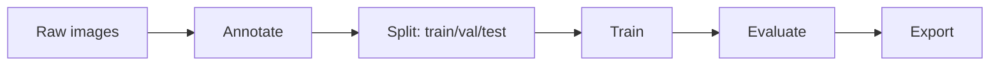
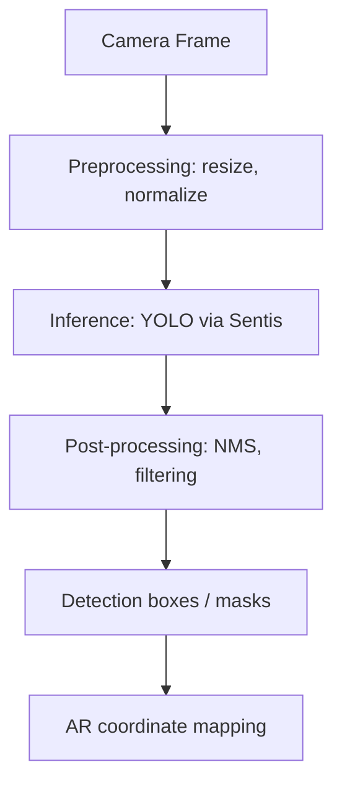
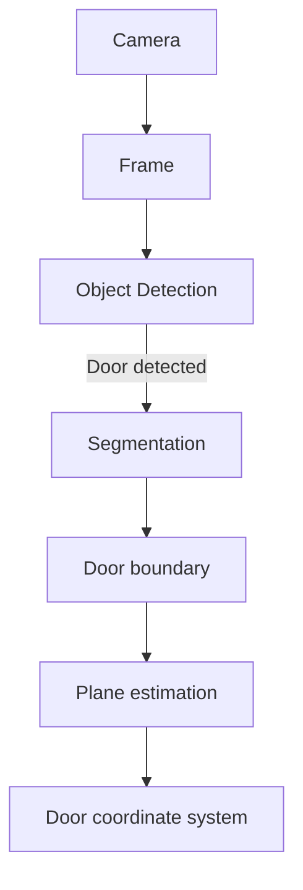

# Phase 3: Door Detection (Computer Vision)

**Duration:** 3-5 weeks (Month 3)

This phase introduces computer vision for door detection. The goal is to enable the camera to understand and identify doors within the physical environment, focusing specifically on elements essential for door hardware visualization.

## Overview

*   **Goal:** Camera understands 'That's a door'
*   **Focus:** Only detect: door, door frame, lock, handle
*   **Constraint:** Don't try to recognize every object in the scene.

---

## Step 1: Dataset Collection (Week 1)

The foundation of a robust detection model is high-quality data. We will collect and curate a dataset tailored for door detection, including specific regional variations.

### Sources
*   **Open Images Dataset:** Extract images with door annotations.
*   **Custom Photography:** Collect images focusing on Indian door styles (e.g., teak wood doors, traditional carvings, standard flush doors, jali doors).
*   **Synthetic Data Generation:** Generate varied lighting and background scenarios using 3D modeling tools (like Blender) to supplement real-world data.

### Dataset Parameters
*   **Target:** 2000+ annotated door images.
*   **Annotation Format:** COCO format.
*   **Classes:** `door`, `door_frame`, `handle`, `lock`, `hinge`.
*   **Annotation Tools:** CVAT, Label Studio, Roboflow.

### Data Augmentation Strategies
To improve model robustness, apply the following augmentations during training:
*   Horizontal flipping
*   Brightness and contrast adjustments
*   Slight rotations (±15 degrees)
*   Motion blur and Gaussian noise (to simulate camera movement)
*   Random cropping and scaling

---

## Step 2: Object Detection Model (Week 2-3)

We will use YOLO (You Only Look Once) architecture for real-time, accurate object detection on mobile devices.

### Model Selection
*   **Model:** YOLOv8 or YOLOv11 (Ultralytics).
*   **Why YOLO:** It offers the best trade-off between speed (real-time performance) and accuracy, making it ideal for mobile AR applications.

### Training Pipeline



### Training Configuration (`door_data.yaml`)

```yaml
path: ../datasets/door_dataset # dataset root dir
train: images/train # train images (relative to 'path')
val: images/val # val images (relative to 'path')
test: images/test # test images (optional)

# Classes
names:
  0: door
  1: door_frame
  2: handle
  3: lock
  4: hinge
```

### Hyperparameter Recommendations
*   `epochs`: 100 - 300
*   `batch`: 16 or 32 (depending on GPU memory)
*   `imgsz`: 640 (standard for YOLO)
*   `optimizer`: 'AdamW'
*   `lr0`: 0.01

### Evaluation Metrics
*   **mAP@0.5:** Mean Average Precision at IoU threshold 0.5.
*   **mAP@0.5:0.95:** Mean Average Precision averaged over multiple IoU thresholds.
*   **Target:** mAP > 0.85 for the `door` class.

### Python Training Script

```python
from ultralytics import YOLO

def train_model():
    # Load a model
    model = YOLO("yolov8n.pt")  # load a pretrained model (recommended for training)

    # Train the model
    results = model.train(
        data="door_data.yaml", 
        epochs=100, 
        imgsz=640,
        batch=16,
        name="door_detection_v1",
        device=0 # use GPU 0
    )
    
    # Evaluate model performance on the validation set
    metrics = model.val()
    print(f"mAP50-95: {metrics.box.map}") # map50-95
    print(f"mAP50: {metrics.box.map50}")  # map50

if __name__ == "__main__":
    train_model()
```

### Python Inference Script

```python
from ultralytics import YOLO
import cv2

def run_inference(image_path):
    # Load the trained model
    model = YOLO("runs/detect/door_detection_v1/weights/best.pt")

    # Run inference on an image
    results = model(image_path)  # results list

    # View results
    for r in results:
        im_array = r.plot()  # plot a BGR numpy array of predictions
        cv2.imshow("Detection Results", im_array)
        cv2.waitKey(0)
        cv2.destroyAllWindows()

if __name__ == "__main__":
    run_inference("test_images/sample_door.jpg")
```

---

## Step 3: Segmentation Model (Week 3-4)

To precisely align 3D models with physical doors, bounding boxes are insufficient. We need pixel-accurate boundaries.

*   **Model:** YOLOv8-seg or a lightweight alternative (e.g., MobileNetV3-based segmenter).
*   **Task:** Instance segmentation for the door boundary.
*   **Output:** Pixel-accurate door mask.
*   **Training:** Requires the dataset to have polygonal annotations (segmentation masks) for the `door` class.
*   **Post-processing:** Extracting contours from the mask and refining the boundary to form a clean quadrilateral.

### Segmentation Pipeline Code Snippet

```python
from ultralytics import YOLO
import cv2
import numpy as np

def run_segmentation(image_path):
    # Load segmentation model
    model = YOLO("yolov8n-seg.pt") # Use custom trained weights here

    results = model(image_path)
    
    for r in results:
        # Get masks and boxes
        masks = r.masks
        if masks is not None:
            # Extract first mask
            mask_array = masks.data[0].cpu().numpy()
            
            # Post-processing: extract contour
            contours, _ = cv2.findContours(
                mask_array.astype(np.uint8), 
                cv2.RETR_EXTERNAL, 
                cv2.CHAIN_APPROX_SIMPLE
            )
            
            # Approximate contour to polygon
            epsilon = 0.02 * cv2.arcLength(contours[0], True)
            approx = cv2.approxPolyDP(contours[0], epsilon, True)
            
            # Visualization
            img = cv2.imread(image_path)
            cv2.drawContours(img, [approx], -1, (0, 255, 0), 2)
            cv2.imshow("Segmented Door", img)
            cv2.waitKey(0)

if __name__ == "__main__":
    run_segmentation("test_images/sample_door.jpg")
```

---

## Step 4: Model Optimization for Mobile (Week 4)

Standard PyTorch models are too large and slow for mobile devices. We must optimize them.

### Export Pipeline
*   **iOS:** PyTorch → ONNX → Core ML
*   **Android:** PyTorch → ONNX → TensorFlow Lite
*   **Unity (Cross-platform):** PyTorch → ONNX → Unity Sentis

### Optimization Techniques
*   **Quantization:** Convert 32-bit floats (FP32) to 16-bit floats (FP16) or 8-bit integers (INT8) to reduce size and speed up inference.

### Targets
*   **Model Size:** < 20MB
*   **Latency:** < 50ms per frame on iPhone 12+ (or equivalent Android).

### Export Script

```python
from ultralytics import YOLO

def export_models():
    # Load the custom trained model
    model = YOLO("runs/detect/door_detection_v1/weights/best.pt")

    # Export to ONNX (for Unity Sentis)
    model.export(format="onnx", imgsz=640, half=True) # FP16 quantization

    # Export to CoreML (for native iOS)
    model.export(format="coreml", imgsz=640, int8=True) # INT8 quantization

    # Export to TFLite (for native Android)
    model.export(format="tflite", imgsz=640, int8=True)

if __name__ == "__main__":
    export_models()
```

---

## Step 5: Integration with AR Session (Week 4-5)

Integrate the optimized models into the Unity AR application using Unity Sentis for cross-platform inference.

### Pipeline in Unity



### Performance Considerations
*   **Frame rate management:** Do not run detection every frame. Run every N frames (e.g., every 5-10 frames) or only when the device is relatively stable.
*   **Threading:** Run inference and post-processing on a background thread or asynchronously to avoid blocking the main rendering thread.

### Unity C# Integration Code Outline

```csharp
using UnityEngine;
using Unity.Sentis;

public class DoorDetector : MonoBehaviour
{
    public ModelAsset yoloModelAsset;
    private Worker m_Worker;
    private TensorFloat m_InputTensor;

    void Start()
    {
        // Load the model
        Model model = ModelLoader.Load(yoloModelAsset);
        // Create a worker for inference on GPU
        m_Worker = WorkerFactory.CreateWorker(BackendType.GPUCompute, model);
    }

    public void DetectDoor(Texture2D cameraFrame)
    {
        // 1. Preprocess: Convert Texture2D to Tensor
        m_InputTensor = TextureConverter.ToTensor(cameraFrame, width: 640, height: 640, channels: 3);

        // 2. Execute inference
        m_Worker.Execute(m_InputTensor);

        // 3. Get output
        TensorFloat outputTensor = m_Worker.PeekOutput() as TensorFloat;

        // 4. Post-process (NMS, convert back to screen coordinates)
        ProcessYOLOOutput(outputTensor);
        
        m_InputTensor.Dispose();
    }

    private void ProcessYOLOOutput(TensorFloat output)
    {
        // Parse bounding boxes, confidence scores, and classes
        // Apply Non-Maximum Suppression (NMS)
        // Raise event with detected door coordinates
    }

    void OnDestroy()
    {
        m_Worker?.Dispose();
    }
}
```

---

## Step 6: Door Boundary Extraction

Once the door is detected or segmented, extract its geometric properties to place virtual hardware accurately.

### Algorithm Steps
1.  **From Mask to Polygon:** Use contour extraction (as shown in Step 3) to get the perimeter of the door mask.
2.  **Corner Detection:** Apply corner detection (e.g., Harris corners) or use contour approximation (`cv2.approxPolyDP`) to find the 4 corners of the door.
3.  **Edge Line Fitting:** Fit lines to the edges between corners to establish a clean, mathematical representation of the door frame.
4.  **Door Rectangle Estimation:** Calculate the width, height, and orientation (normal vector) of the door plane.
5.  **Relative Positioning:** Estimate the typical positions for locks and handles relative to the door boundaries (e.g., lock is typically ~1m from the floor on the opening edge).

### Pseudocode

```text
function ExtractDoorGeometry(segmentation_mask, detected_boxes):
    contour = FindLargestContour(segmentation_mask)
    polygon = ApproximatePolygon(contour)
    
    if NumberOfVertices(polygon) == 4:
        corners = SortCornersTopLeftToBottomRight(polygon)
        
        # Calculate dimensions
        width = Distance(corners.TopLeft, corners.TopRight)
        height = Distance(corners.TopLeft, corners.BottomLeft)
        
        # Estimate handle position (heuristic)
        is_left_handled = DetermineHandleSide(detected_boxes)
        handle_x = (is_left_handled) ? width * 0.1 : width * 0.9
        handle_y = height * 0.5 # Roughly midway up
        
        return {
            corners: corners,
            dimensions: (width, height),
            estimated_handle_pos: (handle_x, handle_y)
        }
    else:
        return null # Irregular shape, retry
```

---

## Detection Pipeline Architecture



---

## Deliverables

- [ ] Annotated dataset (2000+ images)
- [ ] Trained YOLOv8 detection model
- [ ] Trained segmentation model
- [ ] Mobile-optimized models (CoreML, TFLite, Sentis)
- [ ] Unity integration working
- [ ] Door boundary extraction algorithm
- [ ] 90%+ detection accuracy on test set
- [ ] < 50ms inference on modern phones
- [ ] Demo video of door detection

---

## Risks

| Risk | Impact | Mitigation Strategy |
| :--- | :--- | :--- |
| **Diverse Indian door styles** | High (false negatives) | Ensure high variance in custom dataset (jali, carvings, glass inserts). |
| **Lighting conditions** | Medium (poor detection in low light) | Robust data augmentation; use flash if ambient light is too low. |
| **Partial occlusion** | Medium | Train model with partially obscured doors; rely on ARKit/ARCore for tracking once detected. |
| **Glass doors** | High (transparency issues) | Include glass doors with frames in training; focus on detecting frames/handles. |
| **Model size constraints** | High (app bloat, memory limits) | Use INT8 quantization and smallest viable YOLO variant (Nano). |
