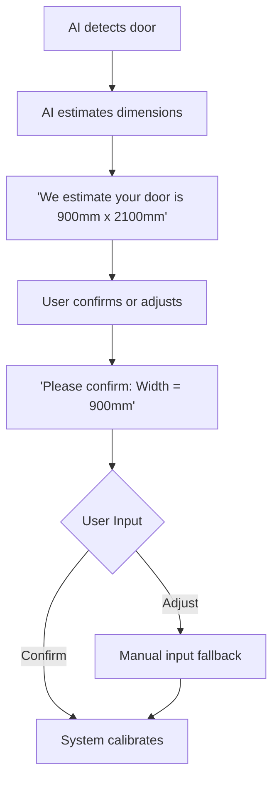
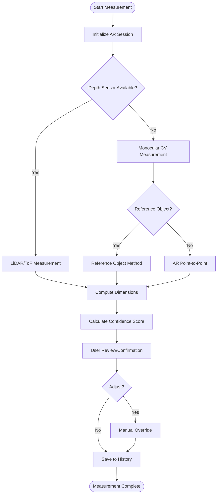

# Phase 5: Automatic Measurement

## Overview
- **Duration:** 4-6 weeks (Month 4)
- **Goal:** App estimates door dimensions and characteristics
- **Key Insight:** Use AI + user confirmation (hybrid approach)
- **Philosophy:** Don't try to solve every measurement automatically

## What to Measure
**Primary:**
- Door width
- Door height

**Secondary:**
- Door thickness (where possible)
- Handle position
- Lock position
- Hinge position

**Tertiary:**
- Door frame width

## Step 1: Depth-Based Measurement (Week 1-2)
- Utilizing ARKit/ARCore depth data.
- **LiDAR:** Primary method for iPhone 12 Pro+ and iPad Pro.
- **ToF sensor:** Primary method for Android depth-capable devices.
- **Process:** Point cloud extraction around the door, plane fitting for the door surface, and edge detection in 3D.

### Code Snippet: Basic Depth Extraction (Swift/ARKit)
```swift
import ARKit

func getDepthMeasurement(at point: CGPoint, in sceneView: ARSCNView) -> Float? {
    guard let currentFrame = sceneView.session.currentFrame,
          let depthData = currentFrame.sceneDepth ?? currentFrame.smoothedSceneDepth else {
        return nil
    }
    
    let depthMap = depthData.depthMap
    let width = CVPixelBufferGetWidth(depthMap)
    let height = CVPixelBufferGetHeight(depthMap)
    
    let col = Int(point.x * CGFloat(width) / sceneView.bounds.width)
    let row = Int(point.y * CGFloat(height) / sceneView.bounds.height)
    
    CVPixelBufferLockBaseAddress(depthMap, .readOnly)
    defer { CVPixelBufferUnlockBaseAddress(depthMap, .readOnly) }
    
    let baseAddress = CVPixelBufferGetBaseAddress(depthMap)
    let bytesPerRow = CVPixelBufferGetBytesPerRow(depthMap)
    let buffer = baseAddress?.assumingMemoryBound(to: Float32.self)
    
    let index = row * (bytesPerRow / MemoryLayout<Float32>.size) + col
    let depthInMeters = buffer?[index]
    
    return depthInMeters
}
```

## Step 2: CV-Based Measurement (Week 2-3)
Fallback measurement from a monocular camera when no depth sensor is available.

### Reference Object Method
- Use known-size objects (credit card, A4 paper).
- Calculate scale factor.

### Vanishing Point Method
- Detect door edges.
- Estimate perspective.
- Calculate real-world dimensions.

### AR-Based Measurement
- Use AR plane detection geometry.
- Measure between detected points.

### Code Snippet: Reference Object Method (Python/OpenCV)
```python
import cv2
import numpy as np

def measure_with_reference(image, ref_width_cm):
    # Detect edges (simplified)
    gray = cv2.cvtColor(image, cv2.COLOR_BGR2GRAY)
    edges = cv2.Canny(gray, 50, 150)
    contours, _ = cv2.findContours(edges, cv2.RETR_EXTERNAL, cv2.CHAIN_APPROX_SIMPLE)
    
    # Sort contours by area
    contours = sorted(contours, key=cv2.contourArea, reverse=True)
    
    # Assume contour[0] is door, contour[1] is reference object
    door_rect = cv2.minAreaRect(contours[0])
    ref_rect = cv2.minAreaRect(contours[1])
    
    # Calculate pixels per metric
    ref_pixels = min(ref_rect[1])
    pixels_per_cm = ref_pixels / ref_width_cm
    
    # Calculate door dimensions
    door_width_cm = door_rect[1][0] / pixels_per_cm
    door_height_cm = door_rect[1][1] / pixels_per_cm
    
    return door_width_cm, door_height_cm
```

## Step 3: User-Assisted Measurement (Week 3)
This is the MVP approach: AI estimates + user confirms.

### Workflow

- Includes UI design for measurement confirmation.
- Manual measurement input fallback.
- Door thickness input (manual for MVP).

## Step 4: Measurement from AR Points (Week 3-4)
- User taps two points on the door edge.
- System calculates the real-world distance using AR hit-testing and depth.
- Visual feedback is provided (measurement line with dimension).

### Code Snippet: Point-to-Point Measurement (C#/Unity AR Foundation)
```csharp
using UnityEngine;
using UnityEngine.XR.ARFoundation;
using System.Collections.Generic;

public class MeasurementManager : MonoBehaviour
{
    public ARRaycastManager raycastManager;
    private Vector3? startPoint = null;

    void Update()
    {
        if (Input.touchCount > 0 && Input.GetTouch(0).phase == TouchPhase.Began)
        {
            var touchPosition = Input.GetTouch(0).position;
            List<ARRaycastHit> hits = new List<ARRaycastHit>();
            
            if (raycastManager.Raycast(touchPosition, hits, UnityEngine.XR.ARSubsystems.TrackableType.Planes))
            {
                if (startPoint == null)
                {
                    startPoint = hits[0].pose.position;
                    // Visualize start point
                }
                else
                {
                    Vector3 endPoint = hits[0].pose.position;
                    float distance = Vector3.Distance(startPoint.Value, endPoint);
                    Debug.Log($"Measurement: {distance * 1000} mm");
                    // Visualize line and reset
                    startPoint = null;
                }
            }
        }
    }
}
```

## Step 5: Door Thickness Estimation (Week 4)
Important for compatibility checking. Show confidence level for these methods:
1. Side-angle view + depth.
2. User opens the door slightly + edge measurement.
3. User manual input with guidance.
4. Standard thickness assumption (e.g., 35mm, 40mm) with an override option.

## Step 6: Measurement Confidence & Accuracy (Week 5)
### Confidence Scoring (0-100%)
- **LiDAR measurement:** 90-95%
- **AR depth measurement:** 75-85%
- **CV monocular measurement:** 60-75%
- **User-assisted:** 85-95%
- **Manual input:** 95-100%

### Display to User
- Show confidence level clearly.

### Accuracy Targets
- **Width/Height:** ±10mm
- **Thickness:** ±5mm (with user assistance)

## Step 7: Measurement Storage & History (Week 5-6)
- Save measurements per door/room/project.
- Associate measurements with product recommendations.
- Export measurement data.
- Backend synchronization.

## Step 8: Calibration System
- Auto-calibration using known objects.
- User-triggered calibration.
- Per-device calibration profile.
- Drift detection and re-calibration prompt.

## Measurement Pipeline


## Deliverables
- [ ] Depth-based measurement working
- [ ] CV-based measurement (fallback)
- [ ] User-assisted measurement flow
- [ ] Door thickness estimation
- [ ] Confidence scoring
- [ ] Measurement UI with confirmation
- [ ] Measurement accuracy < ±10mm
- [ ] Measurement history
- [ ] Works on LiDAR and non-LiDAR devices

## Risks
- Accuracy on non-LiDAR devices
- Various lighting conditions affecting CV and depth
- User error in manual input
- Non-standard door sizes breaking assumptions
