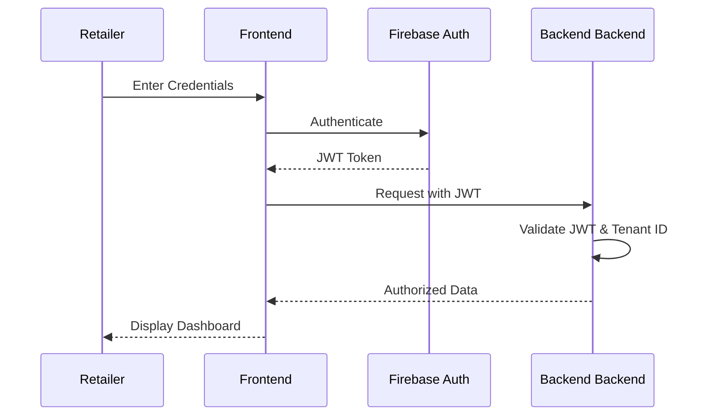

# Phase 8: Retailer Dashboard & Pilot

**Duration:** 3-5 weeks (Month 7) + Pilot (Month 8)

This phase transitions the Aayam platform into a B2B2C business by introducing a comprehensive retailer-facing dashboard. It enables retailers to manage products, track inventory, analyze customer interactions, and generate quotes, culminating in a real-world pilot deployment.

## Overview

- **Goal:** Build a retailer-facing dashboard and deploy with 3-5 pilot retailers.
- **Scope:** Dashboard for product management, inventory, leads, quotes, analytics.

## Dashboard Architecture

- **Frontend:** Next.js + React + TypeScript
- **Styling:** Tailwind CSS + UI components (e.g., shadcn/ui)
- **State Management:** React Query / Zustand
- **Auth:** Firebase Auth / Auth0
- **API:** Existing FastAPI backend
- **Hosting:** Vercel or AWS Amplify

---

## Step 1: Authentication & Authorization (Week 1)

Secure access for retailers with role-based permissions and multi-tenancy.

- **Features:** Retailer registration/login, multi-tenant architecture, JWT tokens.
- **Roles:** `admin` (store owner), `manager`, `sales_associate`.

### Auth Flow Diagram



### Next.js Middleware Example
```typescript
import { NextResponse } from 'next/server';
import type { NextRequest } from 'next/server';

export function middleware(request: NextRequest) {
  const token = request.cookies.get('auth-token')?.value;
  const isAuthPage = request.nextUrl.pathname.startsWith('/login');

  if (!token && !isAuthPage) {
    return NextResponse.redirect(new URL('/login', request.url));
  }

  if (token && isAuthPage) {
    return NextResponse.redirect(new URL('/dashboard', request.url));
  }

  return NextResponse.next();
}

export const config = {
  matcher: ['/dashboard/:path*', '/login'],
};
```

## Step 2: Product Management (Week 1-2)

- CRUD for products
- Bulk upload (CSV)
- Image and 3D model upload with WebGL preview (using Three.js/React Three Fiber)
- Specification entry form and compatibility requirements form
- Product status: `active`, `inactive`, `draft`

> [!NOTE] 
> The **Product Edit Mockup** includes a split view: left side containing form fields (Name, SKU, Price, Specs), right side displaying an interactive 3D viewer, image gallery, and a drag-and-drop zone for model updates.

## Step 3: Inventory Management (Week 2)

- Stock tracking per product
- Low stock alerts
- Price management
- Discount/promotion setup

### Schema Additions (Prisma/SQL Example)
```prisma
model Inventory {
  id          String   @id @default(uuid())
  productId   String   @unique
  product     Product  @relation(fields: [productId], references: [id])
  quantity    Int      @default(0)
  lowStock    Int      @default(5)
  price       Float
  discount    Float?
  retailerId  String
  updatedAt   DateTime @updatedAt
}
```

## Step 4: Catalogue Management (Week 2)

- Product collections/categories
- Featured products
- QR code generation per product
- QR code batch printing

### QR Generation Code Example
```tsx
import QRCode from 'qrcode.react';

const ProductQRCode = ({ productId, sku, name }) => {
  const deepLink = `aayam://product/${productId}`;
  
  return (
    <div className="flex flex-col items-center border p-4 rounded-lg">
      <h3 className="font-bold text-lg mb-2">{name}</h3>
      <p className="text-gray-500 text-sm mb-4">SKU: {sku}</p>
      <QRCode value={deepLink} size={200} level="H" includeMargin />
      <button className="mt-4 bg-blue-600 text-white px-4 py-2 rounded">
        Print Label
      </button>
    </div>
  );
};
```

## Step 5: Lead & Customer Management (Week 3)

- Customer sessions from app
- **Track:** which products scanned, viewed in AR, compared
- Customer contact capture (optional)
- **Lead status:** `new`, `contacted`, `quoted`, `purchased`
- Session timeline view

## Step 6: Quotation System (Week 3)

- Generate quotes from product selections
- Include installation charges
- PDF quote generation (e.g., using `jspdf` or `react-pdf`)
- Email/WhatsApp sharing
- Quote tracking

> [!TIP]
> **Sample Quote Format:** Header with Store Logo and details, Customer Info, tabular list of items (Image, Name, Qty, Unit Price, Total), Installation Fees subtotal, Tax, and Grand Total. Footer with validity and terms.

## Step 7: Analytics Dashboard (Week 4)

- **Key metrics:**
  - Total scans, AR visualizations, Product comparisons
  - Quotes generated, Conversions (quote → purchase)
  - Top viewed products, Compatibility hit rate, Most common door types
- Charts and graphs (using Recharts or Chart.js)
- Date range filtering and export capabilities.

> [!NOTE]
> **Dashboard Mockup:** A top row of KPI summary cards. A main line chart showing daily scans and AR views over the last 30 days. A side pie chart showing compatibility hit rates. A bottom table ranking the top 5 viewed products.

## Step 8: Retailer Onboarding (Week 4-5)

- Onboarding wizard (Multi-step form)
- Store profile setup
- Initial product upload guidance
- QR code printing instructions
- Staff training materials
- **Onboarding Checklist:** 
  - [ ] Profile complete
  - [ ] Inventory synced
  - [ ] QR codes printed
  - [ ] Staff trained

## Step 9: Pilot Deployment (Month 8)

Deploy with 3-5 hardware retailers.

### Selection Criteria
- Variety of store sizes
- Willingness to provide feedback
- Moderate foot traffic
- Mix of urban/semi-urban locations

### Deployment Plan
- **Week 1:** Install, train staff, set up products.
- **Week 2-3:** Live monitoring, bug fixes.
- **Week 4:** Data collection, feedback review.

## Pilot Metrics to Track

- Scans per day per store
- AR visualizations per scan
- Products compared per session
- Quotes generated per session
- Purchases influenced by app
- Compatibility check accuracy
- Customer satisfaction (NPS)
- Retailer satisfaction
- Bug reports & Feature requests
- Revenue attribution

## Pricing Model (Initial)

| Tier | Price | Features |
|---|---|---|
| **Tier 1** | Free | Up to 20 products, basic AR features |
| **Tier 2** | ₹2,999/month | Up to 100 products, basic analytics |
| **Tier 3** | ₹7,999/month | Unlimited products, advanced analytics, API access |
| **Setup Fee** | ₹4,999 | One-time onboarding and catalogue digitization setup |

## Dashboard Pages Structure

1. **Home / Overview:** KPI metrics and recent activity.
2. **Products:** List view, Add new, Edit, 3D Preview.
3. **Catalogue:** Collections, QR code batch management.
4. **Customers / Leads:** Session timelines, contact capture.
5. **Quotations:** Generate, view, share.
6. **Analytics:** Detailed charts and exports.
7. **Settings:** Profile, team members, billing.

## Deliverables

- [ ] Next.js dashboard deployed
- [ ] Authentication & multi-tenancy
- [ ] Product CRUD with 3D preview
- [ ] Inventory management
- [ ] QR code system
- [ ] Customer session tracking
- [ ] Quotation system with PDF
- [ ] Analytics dashboard
- [ ] Retailer onboarding wizard
- [ ] 3-5 pilot retailers onboarded
- [ ] Pilot metrics dashboard
- [ ] Feedback collection system

## Risks

- **Retailer adoption resistance:** Mitigate through hands-on onboarding.
- **Staff training challenges:** Provide clear, short video tutorials.
- **Internet connectivity in stores:** Support offline-capable scanning in app where possible.
- **Product data quality:** Implement strict validation during catalogue creation.
- **Scaling issues with multiple retailers:** Ensure proper indexing on multi-tenant queries.
